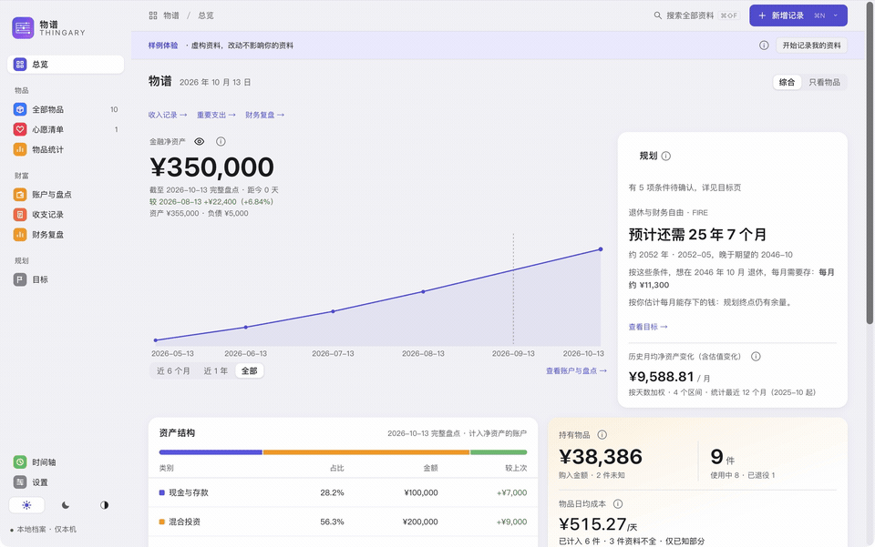

[简体中文](README.md) | [English](README.en.md)

<p align="center">
  
</p>

<h1 align="center">Thingary · 物谱</h1>

<p align="center"><strong>A ten-minute check-in each month, and a clearer answer to “how many more years of work?”</strong></p>

<p align="center"><a href="https://github.com/CoderJackZhu/Thingary/releases/tag/v0.0.8"><strong>Download 0.0.8</strong></a> · <a href="https://thingary.jackzhu.top/">Website</a> · <a href="https://thingary.jackzhu.top/quickstart/">Quick start</a> · <a href="https://gitee.com/CoderJackZhu/thingary/releases">Gitee mirror</a> · <a href="https://github.com/CoderJackZhu/Thingary/issues/new?template=usage_feedback.yml">Feedback</a></p>



▶ [53-second film](https://thingary.jackzhu.top/#film) (Chinese captions): monthly check-ins, net-worth changes, belongings, and how saving a little more moves your retirement date.

Money tends to be spread across bank accounts, brokerages, funds, a housing fund, and a mortgage. Thingary puts accounts, belongings, and plans in one place: record balances and debts once a month or quarter, see how your net worth moves, and answer three questions: **how much should I save each month, when could I stop relying on a salary, and how long could I take a break?** It runs locally, needs no account, and does not ask you to log every transaction.

The interface is available in **Simplified Chinese and English** (Settings › General; "Auto" follows the system language). Account types are designed around mainland China (housing provident fund, individual pension accounts, mortgages); the base currency is Chinese yuan (CNY), and foreign-currency accounts are supported with exchange rates you enter yourself.

## What it does

| | |
|---|---|
| **Accounts and check-ins** | Record assets, debts, and a mortgage; check balances monthly or quarterly. Complete check-ins build a net-worth trend, and a new check-in starts with unchanged balances carried over, so only accounts that moved need typing. |
| **Goals and planning** | Estimate required monthly savings and a possible financial-independence date; compare a large purchase, a break from work, or a job change. |
| **Review and plans** | Income and major expenses, period review, savings goals, recurring costs, and large planned payments. Unknown values stay unknown, never zero. |
| **Belongings (optional)** | Prices, photos, repairs, and warranties, with history kept after sale or retirement, plus daily ownership cost. |
| **Data protection** | Full and automatic backups, recently deleted records, and optional backup encryption with a recovery key you keep. |

Built for occasional check-ins. No daily transaction ledger, market-data feed, trading, or automatic payments.

## Download and install

Download only from this repository's [Releases](https://github.com/CoderJackZhu/Thingary/releases/tag/v0.0.8) or the [Gitee mirror](https://gitee.com/CoderJackZhu/thingary/releases/tag/v0.0.8). The release assets include `SHA256SUMS.txt` for checking file integrity. A checksum is not a publisher signature and does not prove where a file came from.

### macOS

Download [`Thingary-0.0.8-universal.dmg`](https://github.com/CoderJackZhu/Thingary/releases/download/v0.0.8/Thingary-0.0.8-universal.dmg) (one build for Apple Silicon and Intel; macOS 14 or later).

1. Open the DMG, drag “物谱” into Applications, then open it from Applications.
2. The app is **ad-hoc signed, without a Developer ID or Apple notarization**. If macOS blocks the first launch, right-click (or Control-click) “物谱” in Finder → **Open**, then confirm; or use **System Settings › Privacy & Security › Open Anyway**. Do this only for a file downloaded from this repository's Releases, and do not disable system security. See [Apple's instructions](https://support.apple.com/en-us/102445).
3. Check the download: in Terminal run `shasum -a 256 ~/Downloads/Thingary-0.0.8-universal.dmg` and compare the output with [`SHA256SUMS.txt`](https://github.com/CoderJackZhu/Thingary/releases/download/v0.0.8/SHA256SUMS.txt) in the release.

Tested on Apple Silicon with macOS 27. macOS 14 and Intel are covered by build and architecture checks only, not hardware testing.

### Windows

Download [`Thingary_0.0.8_x64-setup.exe`](https://github.com/CoderJackZhu/Thingary/releases/download/v0.0.8/Thingary_0.0.8_x64-setup.exe). **Windows 11 x64 is tested; Windows 10 1809+ is the target range but has not been hardware-tested.** Only an x64 installer is provided; ARM64 devices (such as Snapdragon X) run the x64 app through system emulation, which is not the same as a native ARM build.

1. Run the installer; it installs for the current user only and usually needs no administrator rights. If WebView2 is missing, the installer downloads and installs it; the first install needs internet access.
2. The installer is **unsigned**. SmartScreen may say “Windows protected your PC”: choose **More info** → **Run anyway**. If Windows 11 Smart App Control blocks it without an override, see the [Windows install guide (Chinese)](https://thingary.jackzhu.top/guide/#windows-install). Do not disable system-wide protection for this.
3. Check the download: in PowerShell run `Get-FileHash .\Thingary_0.0.8_x64-setup.exe -Algorithm SHA256` and compare it with [`SHA256SUMS.txt`](https://github.com/CoderJackZhu/Thingary/releases/download/v0.0.8/SHA256SUMS.txt) in the release.
4. If installation or launch fails, see the [Windows install guide (Chinese)](https://thingary.jackzhu.top/guide/#windows-install) and keep the app version, Windows version, WebView2 version and exact error text.

### Windows code signing

The Windows installer is currently **unsigned**. We are preparing an application to SignPath Foundation for free code signing: the project has emailed SignPath, but no formal application has been submitted yet. While unsigned, SmartScreen may say “Windows protected your PC”: choose **More info** → **Run anyway**. If Windows 11 Smart App Control blocks it without an override, see the [Windows install guide (Chinese)](https://thingary.jackzhu.top/guide/#windows-install). Do not disable system-wide protection for this.

If signing is approved and enabled, the release notes for that version are the source of truth; this page will not call an installer signed before it is. See the [Windows code signing policy (Chinese)](docs/CODE_SIGNING.md) for scope, approval, privacy, and application status.

### Android (preview, no installer yet)

The Android version is in preview; there is no APK in Releases yet, so do not install copies from third-party mirrors. Once published, the release will include `Thingary-<version>-android.apk`, with its checksum in the release's `SHA256SUMS.txt`:

1. Download the APK only from this repository's Releases.
2. Allow your browser or file manager to “install unknown apps” when prompted; you can revoke that permission afterwards.
3. Compare `sha256sum Thingary-<version>-android.apk` (or the hash shown by your file manager) with `SHA256SUMS.txt` before installing.

### iOS (build it yourself; no public installer)

The iPhone version is not currently on the App Store and has no public installer. Developers with Xcode can build and install it on their own iPhone; requirements and steps are in the [development guide's iOS section](docs/DEVELOPMENT.md#ios-开发).

Signing with a free Apple ID expires after **7 days**; rebuild and reinstall to keep using it. Reinstalling over the app keeps your data; deleting the app deletes it. The phone and the computer keep separate libraries, moved only through full backup files.

## Three steps to start

1. The first launch opens a **fictional sample**; look around, then choose “Start recording my own data” for an empty personal library.
2. In **Accounts & check-ins**, enter each platform's balance and debts once. Belongings-only users can start from **All belongings** instead. Leave unknown amounts empty; enter 0 only when it is truly zero.
3. In **Goals**, enter a target date and monthly savings to see the conclusion; the “how long could I take a break” result is on the **Trial** tab. Come back monthly or quarterly.

After your first entries, make a full backup under **Settings › Data management** and keep a copy off the machine. See [backup and restore (Chinese)](https://thingary.jackzhu.top/guide/#backup).

## Known limitations

- **No market data or trading.** There are no live prices, return tracking, automatic payments, or AI; investment returns and exchange rates are entered by hand. There is no daily transaction ledger.
- **Source includes optional WebDAV snapshot sync (experimental).** It is off by default and connects to your own server (for example Jianguoyun or Nextcloud). Snapshots are encrypted with a passphrase you choose; manifest metadata, including device names, is plaintext. Once enabled it checks the cloud when the app opens or changes between foreground and background and uploads plain fast-forwards, but it never replaces your local data on its own. There is no Thingary account system or collaboration. Tested against local WebDAV servers and an Android emulator only; real cloud providers and phones are still unverified. See the [sync guide (Chinese)](docs/USER_GUIDE.md#sync); released packages follow their release notes.
- **Builds are unsigned and not notarized.** The Mac build is ad-hoc signed without a Developer ID or Apple notarization; the free Windows code-signing application is still in progress, so current Windows installers are unsigned. Releases include checksums. See the [development guide](docs/DEVELOPMENT.md) to build your own.
- **Interface in Simplified Chinese and English.** Support: macOS 14+ (Apple Silicon tested; Intel build-checked only), Windows 11 x64 tested (Windows 10 1809+ is the target range but not hardware-tested; x64 installer only, ARM64 runs through emulation; unsigned); Android in preview, iOS requires a local Xcode build; no Linux client. See [known limitations](https://thingary.jackzhu.top/quickstart/#limits).

## Privacy

Records stay local by default, with no Thingary account or login required. Optional WebDAV sync sends encrypted snapshots to your configured server; once enabled, it connects when you click Sync now, Check only or Test connection, and when the app opens or moves between foreground and background (you can turn that off in the sync settings); opening settings and saving configuration do not use the network by themselves. Desktop update checks read the public release lists on Gitee and GitHub only when you click **Check for updates**, or after you enable startup checks; it sends no records, device, or usage information (like any website visit, the request carries standard network information and an app-version User-Agent). The iOS version does not check for updates.

The main database and photos are **not encrypted**. Backup encryption is optional, and the recovery key is yours to keep; losing it means the backup cannot be restored. Automatic backups share the same disk as the main data, so keep a separate off-device copy. Read [privacy and data safety (Chinese)](https://thingary.jackzhu.top/guide/#privacy).

## Feedback

- [Bug report](https://github.com/CoderJackZhu/Thingary/issues/new?template=bug_report.yml): what happened, how to reproduce it, version and system.
- [Windows install issue](https://github.com/CoderJackZhu/Thingary/issues/new?template=windows_install.yml): install, SmartScreen, WebView2, launch or uninstall failures (form in Chinese).
- [Feature request](https://github.com/CoderJackZhu/Thingary/issues/new?template=feature_request.yml): describe the problem first, then the idea.
- [Usage feedback](https://github.com/CoderJackZhu/Thingary/issues/new?template=usage_feedback.yml): three questions — what did you use before, did you come back for a second check-in (and if not, why), and what would make you recommend it?

Please reproduce with fictional data only, hide real amounts and account numbers, and never upload a database or backup file. Report security issues privately as described in the [security policy](SECURITY.md).

## Docs and building

[Quick start](https://thingary.jackzhu.top/quickstart/) · [User guide](https://thingary.jackzhu.top/guide/) · [Product rules (Chinese)](docs/PRODUCT_RULES.md) · [Changelog (Chinese)](CHANGELOG.md) · [Documentation index (Chinese)](docs/INDEX.md).

Contributing: [CONTRIBUTING (Chinese)](CONTRIBUTING.md) · [development and testing (Chinese)](docs/DEVELOPMENT.md) · [release process (Chinese)](docs/RELEASING.md). To build on a Mac (Node.js 22.18+, Rust, and Xcode command-line tools required):

```sh
rustup target add x86_64-apple-darwin wasm32-unknown-unknown
npm ci
npm run release
sh scripts/make-dmg.sh
```

On Windows with the MSVC toolchain, run `npm run release:win`. Both produce unsigned test builds; published installers come only from Releases.

## License

Code is licensed under [AGPL-3.0-or-later](LICENSE). Releases 0.0.4 and earlier were labeled GPL-3.0-or-later. See [third-party licenses](THIRD_PARTY_LICENSES.md).

Planning calculations use an independent Rust core; see [source notices (Chinese)](SOURCE_NOTICES.md) and the [core documentation (Chinese)](crates/planning-engine/README.md).

The names “物谱” and “Thingary” and the app icon are outside the AGPL license. Use your own name and icon when redistributing a modified app; see [brand usage (Chinese)](docs/brand/README.md).
