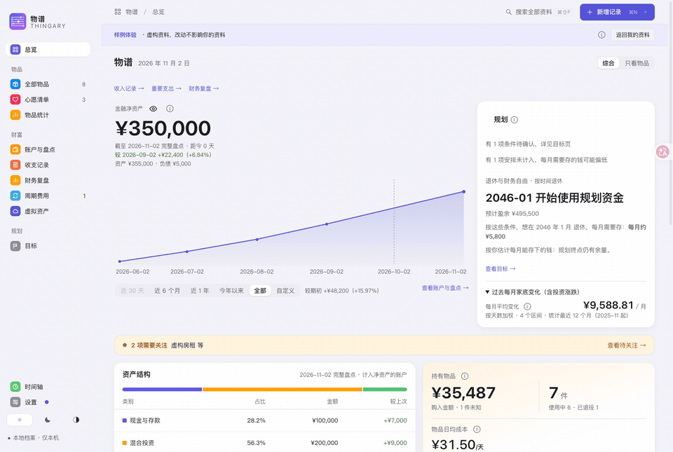
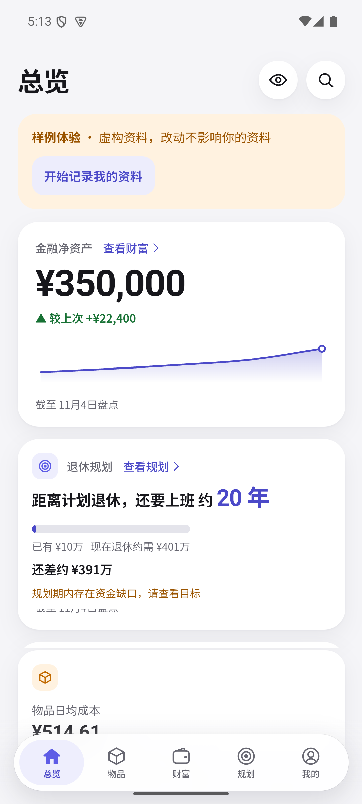
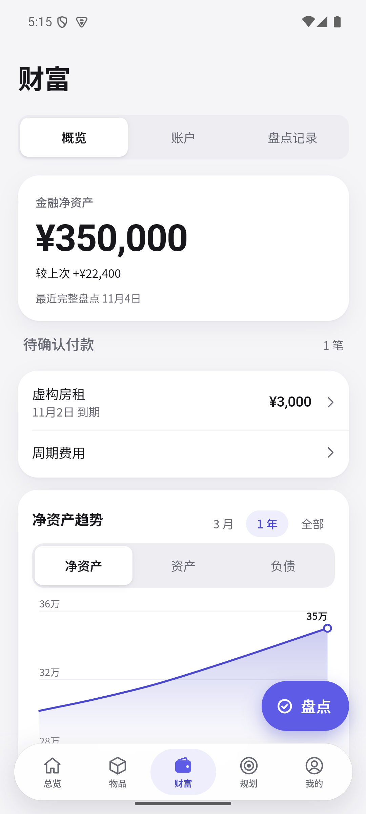
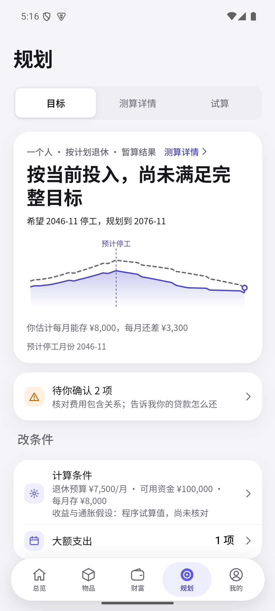

[简体中文](README.md) | [English](README.en.md)

  

<h1 align="center">Thingary · 物谱</h1>

<strong>A ten-minute check-in each month, and a clearer answer to “how many more years of work?”</strong>

<a href="https://github.com/CoderJackZhu/Thingary/releases/tag/v0.1.0"><strong>Download 0.1.0</strong></a> · <a href="https://thingary.jackzhu.top/">Website</a> · <a href="https://thingary.jackzhu.top/quickstart/">Quick start</a> · <a href="https://gitee.com/CoderJackZhu/thingary/releases">Gitee mirror</a> · <a href="https://github.com/CoderJackZhu/Thingary/issues/new?template=usage_feedback.yml">Feedback</a>

Chinese desktop interface with fictional sample data, in a 21-second browser-preview slideshow. Click the animation for a lossless screenshot.

▶ [53-second film](https://thingary.jackzhu.top/#film) (Chinese captions): monthly check-ins, net-worth changes, belongings, and how saving a little more moves your retirement date.

Money tends to be spread across bank accounts, brokerages, funds, a housing fund, and a mortgage. Thingary puts accounts, belongings, and plans in one place: record balances and debts once a month or quarter, see how your net worth moves, and answer three questions: **how much should I save each month, when could I stop relying on a salary, and how long could I take a break?** It runs locally, needs no account, and does not ask you to log every transaction.

## What it does

| Feature | Use it to |
|---|---|
| **Accounts and check-ins** | Record assets, debts, and a mortgage; check balances monthly or quarterly. Complete check-ins build a net-worth trend. Unchanged balances are carried forward for you to confirm. |
| **Goals and planning** | Estimate required monthly savings and a possible financial-independence date; compare a large purchase, a break from work, or a job change. |
| **Review and plans** | Record income and major expenses, review a period, track savings goals, and plan recurring costs and large payments. Unknown values stay unknown. |
| **Belongings (optional)** | Keep prices, photos, repairs, warranties, and daily ownership costs, with history retained after sale or retirement. |
| **Data protection** | Make full and automatic backups, restore recently deleted records, and optionally encrypt backups with a recovery key you keep. |

Built for occasional check-ins. No daily transaction ledger, market-data feed, trading, or automatic payments.

## Android interface

Overview, account check-ins, and retirement planning on the phone. These Chinese screenshots come from an Android 15 emulator with fictional sample data. Click an image for the full resolution.

| Overview | Accounts & check-ins | Goals & projections |
|:---:|:---:|:---:|
|  |  |  |

## Download and install

**0.1.0 is a public beta**, with Mac, Windows, and Android installers. A [Gitee mirror](https://gitee.com/CoderJackZhu/thingary/releases/tag/v0.1.0) is available for downloads in mainland China.

| Platform | Download | Installation |
|---|---|---|
| macOS 14+ · Apple Silicon / Intel | [Universal Mac DMG](https://github.com/CoderJackZhu/Thingary/releases/download/v0.1.0/Thingary-0.1.0-universal.dmg) | Drag into Applications. The app is ad-hoc signed without Apple notarization; the first launch may need approval in Privacy & Security |
| Windows 10 1809+ / 11 · x64 | [Windows installer](https://github.com/CoderJackZhu/Thingary/releases/download/v0.1.0/Thingary_0.1.0_x64-setup.exe) | Run the EXE; internet is needed if WebView2 is missing. The unsigned installer may trigger SmartScreen |
| Android 10+ · 64-bit ARM | [Android preview APK](https://github.com/CoderJackZhu/Thingary/releases/download/v0.1.0/Thingary-0.1.0-android.apk) | Allow your browser or file manager to install unknown apps when prompted; you can revoke permission afterwards |
| iPhone | No public installer or App Store listing yet | Developers can [build it themselves](docs/DEVELOPMENT.md#ios-开发) |

Tested on Apple Silicon Mac and Windows 11 x64. Intel, macOS 14, Windows 10, and real Android phones remain unverified. Windows ARM devices require x64 emulation.

See the [installation guide (Chinese)](https://thingary.jackzhu.top/guide/#download) for system security prompts. Download from this project's Releases or mirror; `SHA256SUMS.txt` in the release assets lets you check file integrity. **Make a full backup before upgrading**: older versions may not read upgraded data or backups.

## Three steps to start

1. Explore the **fictional sample**, then choose “Start recording my own data” for an empty personal library.
2. In **Accounts & check-ins**, enter balances and debts from each platform. Belongings-only users can start from **All belongings**. Leave unknown amounts empty; enter 0 only for an actual zero.
3. In **Goals**, enter a target date and monthly savings to see the conclusion; the **Trial** tab estimates how long you could take a break. Come back monthly or quarterly.

After your first entries, make a full backup under **Settings › Data management** and keep a copy off the device. See [backup and restore (Chinese)](https://thingary.jackzhu.top/guide/#backup).

## Data and privacy

Records stay on your device by default and work offline, without a Thingary account. The interface supports Simplified Chinese and English. Account types are designed for mainland China; the base currency is CNY, with exchange rates entered by hand. Planning results are estimates based on your inputs, not promised returns.

- **Backups:** optional recovery-key encryption. Keep the key yourself; a lost key cannot be recovered. The main database and photos are not encrypted. Keep a full backup off the device.
- **Multiple devices:** optional [WebDAV sync (Chinese)](https://thingary.jackzhu.top/guide/#sync) is experimental and off by default. It transfers encrypted full-library snapshots to your own server, without automatic merging or replacing local data.
- **Network access:** desktop update checks read public release lists when requested or when you enable startup checks. Enabled sync connects to your configured server. Read [privacy and data safety (Chinese)](https://thingary.jackzhu.top/guide/#privacy).

## Help and feedback

Start with the [quick start](https://thingary.jackzhu.top/quickstart/), look up operations in the [user guide](https://thingary.jackzhu.top/guide/), or check the [FAQ](https://thingary.jackzhu.top/guide/#faq) (all in Chinese). Changes are listed in the [changelog (Chinese)](CHANGELOG.md).

- [Report a bug](https://github.com/CoderJackZhu/Thingary/issues/new?template=bug_report.yml) with the version, system, steps, and error message. There is a separate [Windows installation form](https://github.com/CoderJackZhu/Thingary/issues/new?template=windows_install.yml).
- [Suggest a feature](https://github.com/CoderJackZhu/Thingary/issues/new?template=feature_request.yml) or [share your experience](https://github.com/CoderJackZhu/Thingary/issues/new?template=usage_feedback.yml).

Hide real amounts and account numbers before sharing screenshots; never upload a database or backup. Report security issues privately through the [security policy](SECURITY.md).

## Open source and contributing

To contribute or build the app, see [contributing](CONTRIBUTING.md), [development and testing](docs/DEVELOPMENT.md), and the [documentation index](docs/INDEX.md) (Chinese). Code is licensed under [AGPL-3.0-or-later](LICENSE); see [source notices](SOURCE_NOTICES.md) and [third-party licenses](THIRD_PARTY_LICENSES.md). The names “物谱” and “Thingary” and the icon are outside the AGPL license. Use your own name and icon for modified distributions; see [brand usage](docs/brand/README.md).
