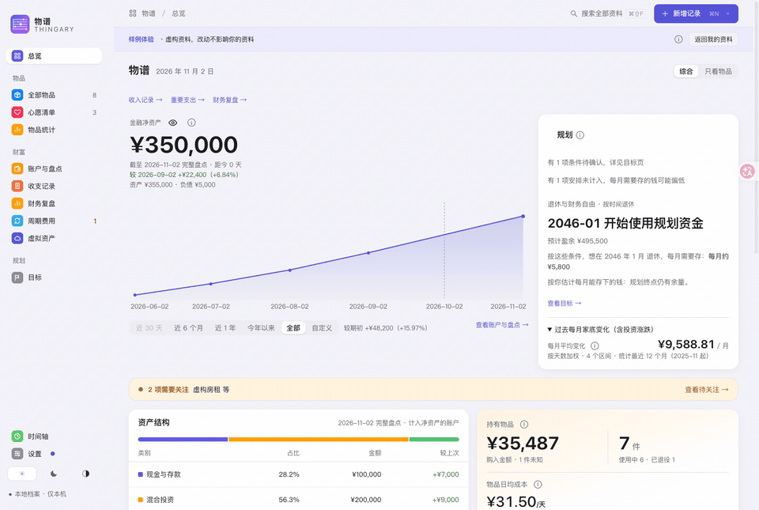
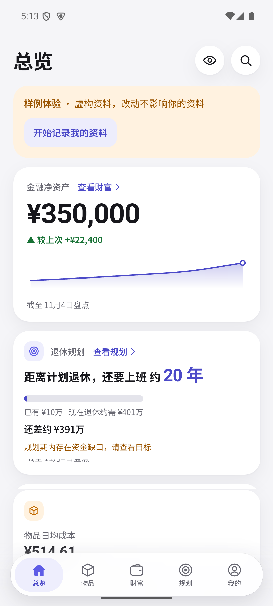
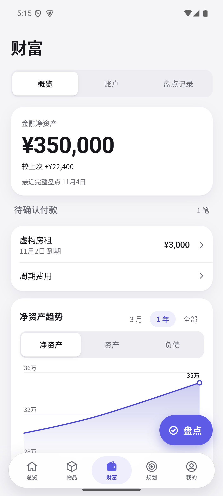
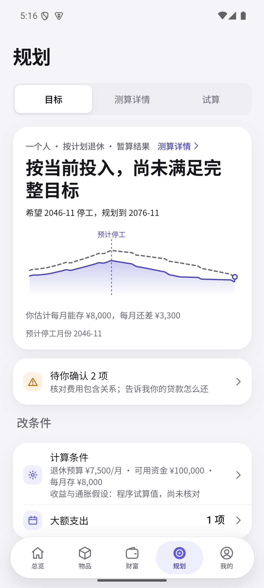

[简体中文](README.md) | [English](README.en.md)

  

<h1 align="center">物谱 · Thingary</h1>

<strong>每月 10 分钟盘一次家底，算清还要上几年班。</strong>

<a href="https://github.com/CoderJackZhu/Thingary/releases/tag/v0.1.0"><strong>下载 0.1.0</strong></a> · <a href="https://thingary.jackzhu.top/">产品主页</a> · <a href="https://thingary.jackzhu.top/quickstart/">快速上手</a> · <a href="https://gitee.com/CoderJackZhu/thingary/releases">国内镜像</a> · <a href="https://github.com/CoderJackZhu/Thingary/issues/new?template=usage_feedback.yml">使用反馈</a>

桌面端中文界面，21 秒循环，使用虚构样例（浏览器预览）。点击动图可查看无损原图。

▶ [53 秒介绍视频](https://thingary.jackzhu.top/#film)：每月盘点、净资产变化、物品档案，以及每月多存一点、退休时间怎么跟着变。

钱分散在银行卡、余额宝、券商、基金平台、公积金和房贷里，很难看清全貌。物谱把账户、物品和计划放在一处：每月或每季对照各平台录一次余额和欠款，就能看到净资产变化，并回答三个问题：**每月要存多少、什么时候能不靠工资、歇一阵能撑多久。** 本地使用，无需账号，不需要每天记账。

## 能做什么

| | |
|---|---|
| **账户与盘点** | 记录资产、负债和房贷，按月或按季核对余额；完整盘点看净资产趋势，新一次盘点会按上次金额预填，没变的不用动 |
| **目标与测算** | 反算每月要存多少、估算财务独立时间；比较买一笔大件、休息一段时间或换工作的影响 |
| **复盘与计划** | 收支记录、区间回顾、存钱目标、周期费用和大额计划；金额未知保持未知，不当作零 |
| **物品档案（可选）** | 价格、照片、维修与保障，售出或退役后仍保留历史；查看日均持有成本 |
| **资料保护** | 完整备份、自动备份、最近删除；备份可用你自己保管的恢复密钥加密 |

它适合低频记录，不提供日常流水记账、行情交易或自动付款。

## 安卓端界面

总览看家底，财富页盘账户，规划页看目标。以下为 Android 15 模拟器中的中文界面，使用虚构样例；点击图片可查看原图。

| 总览 | 账户与盘点 | 目标与测算 |
|:---:|:---:|:---:|
|  |  |  |

## 下载与安装

**0.1.0 公开测试版**，提供 Mac、Windows 和安卓安装包。GitHub 下载不便时，可用 [Gitee 国内镜像](https://gitee.com/CoderJackZhu/thingary/releases/tag/v0.1.0)。

| 平台 | 下载 | 安装提示 |
|---|---|---|
| macOS 14+ · Apple Silicon / Intel | [Mac 通用版 DMG](https://github.com/CoderJackZhu/Thingary/releases/download/v0.1.0/Thingary-0.1.0-universal.dmg) | 拖入「应用程序」。未经过 Apple 公证，首次打开可能需要在「隐私与安全性」允许打开 |
| Windows 10 1809+ / 11 · x64 | [Windows 安装程序](https://github.com/CoderJackZhu/Thingary/releases/download/v0.1.0/Thingary_0.1.0_x64-setup.exe) | 运行 EXE；缺少 WebView2 时需联网安装。安装包未签名，可能出现 SmartScreen 提示 |
| Android 10+ · 64 位 ARM | [安卓预览版 APK](https://github.com/CoderJackZhu/Thingary/releases/download/v0.1.0/Thingary-0.1.0-android.apk) | 按系统提示允许下载来源「安装未知应用」，装好后可收回权限 |
| iPhone | 暂无公开安装包，尚未上架 App Store | 开发者可[自行构建](docs/DEVELOPMENT.md#ios-开发) |

Mac 已在 Apple Silicon、Windows 已在 Windows 11 x64 使用；Intel、macOS 14、Windows 10 和安卓真机尚未验证。Windows ARM 设备需通过系统模拟运行 x64 版。

安装遇到拦截时，按[安装指南](https://thingary.jackzhu.top/guide/#download)处理。请从本项目 Release 或镜像下载，附件中的 `SHA256SUMS.txt` 可核对文件完整性。**升级前先做完整备份**，旧版本可能无法读取升级后的资料和备份。

## 三步开始

1. 先浏览**虚构样例**；准备好后点「开始记录我的资料」（手机为「开始记录」），进入自己的空白资料。
2. 到「账户与盘点」对照各平台录一次余额和欠款；只想整理物品也可以从「全部物品」开始。不知道的金额留空，明确为零才填 0。
3. 到「目标」填目标时间和每月能存的钱，看右侧结论；「歇一阵能撑多久」在「试算」页。之后每月或每季回来盘一次即可。

录完第一批资料后，到「设置 › 数据管理」做一次完整备份，另外保存一份到原机之外。详见[备份与恢复](https://thingary.jackzhu.top/guide/#backup)。

## 资料与隐私

资料默认保存在本机，无需物谱账号，可离线使用。界面支持简体中文和 English；金额以人民币为本位，外币汇率由你填写。规划是基于所填条件的估算，不是收益承诺。

- **备份**：可用恢复密钥加密，密钥由你保管，丢失无法找回。主资料库和图片未加密；请把完整备份另存一份到原设备之外。
- **多设备**：可选的 [WebDAV 同步](https://thingary.jackzhu.top/guide/#sync)仍是实验性功能，默认关闭。开启后向你自己的服务器传输加密整库快照，不自动合并或替换本机资料。
- **联网**：桌面版手动检查更新，或主动开启启动检查时，才查询公开版本列表；开启同步后会连接你配置的服务器。详见[隐私与资料安全](https://thingary.jackzhu.top/guide/#privacy)。

## 帮助与反馈

第一次使用看[快速上手](https://thingary.jackzhu.top/quickstart/)；操作细节查[完整使用指南](https://thingary.jackzhu.top/guide/)，遇到问题先看[常见问题](https://thingary.jackzhu.top/guide/#faq)。更新内容见[版本记录](CHANGELOG.md)。

- [报告问题](https://github.com/CoderJackZhu/Thingary/issues/new?template=bug_report.yml)：附版本、系统、操作步骤和错误提示；[Windows 安装问题](https://github.com/CoderJackZhu/Thingary/issues/new?template=windows_install.yml)有单独入口。
- [提出建议](https://github.com/CoderJackZhu/Thingary/issues/new?template=feature_request.yml)或[分享使用感受](https://github.com/CoderJackZhu/Thingary/issues/new?template=usage_feedback.yml)。

反馈前请遮住真实金额和账户号，不要上传数据库或备份。安全问题按[安全政策](SECURITY.md)私下报告。

## 开源与贡献

参与开发或自行构建，请看[贡献指南](CONTRIBUTING.md)、[开发与测试](docs/DEVELOPMENT.md)和[文档索引](docs/INDEX.md)。代码按 [AGPL-3.0-or-later](LICENSE) 授权；[来源告知](SOURCE_NOTICES.md)与[第三方许可](THIRD_PARTY_LICENSES.md)列出相关声明。名称「物谱」「Thingary」与图标不在 AGPL 授权范围内，修改版请使用自己的名称和图标，见[品牌使用说明](docs/brand/README.md)。
