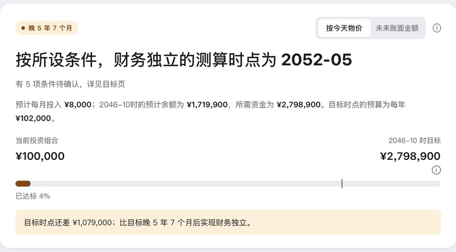

  

<h1 align="center">物谱 · Thingary</h1>

<strong>不用记流水。每月盘一次家底，看看离不上班还有多远。</strong>

钱分散在银行卡、余额宝、券商、基金平台、公积金和房贷里，很难看清全貌。物谱是一个本地使用的桌面应用：每月对照各平台录一次余额和欠款，就能看到净资产变化；目标测算随每次盘点更新，回答「每月要存多少」「什么时候能不靠工资」「歇一阵能撑多久」。公开测试版提供 macOS 安装包，Windows 候选版正在验收。无需注册账号，也无需编程或联网使用。

重要物品的档案（价格、照片、维修与保障）作为可选功能保留，可以单独使用。

**[0.0.6 公开测试版 · Mac（Apple Silicon 与 Intel）](https://github.com/CoderJackZhu/Thingary/releases/tag/v0.0.6)** · [图文使用指南](docs/USER_GUIDE.md#download) · [版本说明](https://github.com/CoderJackZhu/Thingary/releases/tag/v0.0.6) · [国内镜像（Gitee）](https://gitee.com/CoderJackZhu/thingary/releases) · [反馈问题](https://github.com/CoderJackZhu/Thingary/issues)

> 0.0.6 公开测试版提供 Apple Silicon 与 Intel 通用 DMG，下载以 Release 的公开附件为准。本版升级了资料格式，旧版不能直接打开升级后的资料，请先做完整备份，见[更新步骤](docs/USER_GUIDE.md#update)。

> Windows 0.0.7 当前为未签名候选版，目标为 Windows 10 1809+／Windows 11 x64，尚未公开发布。可在 [Windows 候选包工作流](https://github.com/CoderJackZhu/Thingary/actions/workflows/windows-package.yml)查看成功运行的安装包附件（需登录 GitHub，保留 30 天）；安装与限制见[Windows 使用说明](docs/USER_GUIDE.md#windows-install)。Mac 公开版仍是 0.0.6。

21 秒原生界面顺序预览：总览 → 账户盘点 → 目标结论 → 资金轨迹 → 市场模拟 → 物品。全部使用 0.0.6 隔离虚构样例，不是连续操作录像。

## 开始使用

1. 下载 `.dmg`，打开后将「物谱」拖入「应用程序」。
2. 从「应用程序」打开物谱，先浏览独立的虚构样例。
3. 点「开始记录我的资料」，从[先盘点账户](docs/USER_GUIDE.md#first-snapshot)开始；也可以[先整理物品](docs/USER_GUIDE.md#first-record)，另一条路径随时再开始。
4. 录入自己的资料后，[做一次完整备份并异地保存](docs/USER_GUIDE.md#backup)。

本次 **0.0.6 公开测试版** 使用本地临时签名，未经过 Developer ID 签名和 Apple 公证。首次打开可能需要在「系统设置 › 隐私与安全性」选择「仍要打开」；请按[安装与故障排查指南](docs/USER_GUIDE.md#download)操作，无需编译或使用终端。下载页中的 Source code 是源码，不是安装包。

| 支持范围 | 当前情况 |
|---|---|
| 芯片 | 通用安装包，同时支持 Apple Silicon 与 Intel；Intel Mac 尚未实机验证 |
| 系统 | 已在 macOS 27 验证；打包最低目标为 macOS 14，其他版本尚未实测 |
| 语言与更新 | 界面为中文；设置中可主动检查更新，仍需手动下载安装 |
| Windows | 0.0.7 x64 候选版，目标 Windows 10 1809+／11；原生验收未完成，尚无公开 Release |
| 其他平台 | 暂无 Linux、手机客户端或跨设备同步 |

本系列处于公开测试阶段。更新前请先完整备份，再按[更新步骤](docs/USER_GUIDE.md#update)手动替换应用；较低的公开版本号不表示资料格式可以降级。

本版内容见[0.0.6 发布说明](docs/releases/v0.0.6.md)。当前版本已将财富分为账户与盘点、收支记录和财务复盘；规划以「目标」为单入口，页内分为「目标／测算详情／试算」，退出社保、医保和养老金政策测算，未来养老金可作为手填收入条件维护。

## 资料与隐私

帮助入口与资料保护说明见[关于与帮助](docs/USER_GUIDE.md#help)和[隐私与资料安全](docs/USER_GUIDE.md#privacy)。

资料只在你的电脑上：没有账号，应用平时不联网（只有你在「设置 › 关于与帮助」点「检查更新」时，才会向 Gitee 和 GitHub 各查询一次公开的版本列表，不发送任何资料），代码公开可查。**当前候选源码支持用恢复密钥加密备份；主资料库、图片和恢复保护副本未加密**；若主动选用云盘作为额外备份位置，副本由该云盘软件同步。自动备份和主资料同盘，仍应额外保留异地完整备份。

Mac 删除应用保留资料；Windows 卸载默认保留资料，若要保留记录，不要勾选卸载器的“删除应用数据”。更新、换机、资料位置、恢复与当前限制统一见[使用指南](docs/USER_GUIDE.md#update)。反馈时请遮住真实资料，不上传数据库或备份；漏洞请按[安全政策](SECURITY.md)私下报告。

## 现在可以做什么

| 功能组 | 物谱提供的功能 |
|---|---|
| 账户盘点 | 定期核对账户资产与负债，查看金融净资产趋势与盘点变化；按需记录收入、重要支出和资金流动，核对同一投资范围的损益金额 |
| 目标与规划 | 反算每月需要存多少，估算财务独立时间；临时比较购买、休息或换工作的影响；查看投资组合轨迹、市场路径模拟、压力情景、敏感性矩阵和收益顺序检查 |
| 物品档案（可选） | 名称、购入金额与日期、照片、备注、品牌型号、维护与保障；使用中／退役／售出、日均与按次成本、心愿决定与明确购入记录 |
| 辅助模块（可选） | 周期费用及软件、域名等虚拟资产档案，可在设置中按需打开或隐藏 |

资料支持最近删除恢复、完整备份与恢复、自动备份，以及统一 Excel 导入导出与金融历史导入。先备份，再换机或更新。

物谱适合低频记录，例如每月盘点一次账户、补充近期的重要购入。它不提供日常流水记账、行情交易或自动付款。物品购入金额和金融净资产分别展示，不相加，也不重复扣减。

## 每月要存多少，什么时候能财务独立？

填入生活预算、可用资金、目标时间和未来收入，物谱先反算**为了固定目标，每月大约需要存多少钱**。再填自己预计每月能存下的金额，检查固定月份是否够用；切换为财务自由模式，则估算**按这些条件，资金何时足以支撑规划期内的生活**。目标时间和预计达成时间分别展示，未填投入时保留未知。

**投资组合轨迹**把积累、退休后的提取、目标月份、财务独立月份和所需资金放在同一张图里；可按今天购买力或未来账面金额查看，并通过逐年快照核对投入、收入、支出与余额。它推演的是计划资金，不是证券持仓的历史收益曲线。

**假设分析**继续回答“条件变了会怎样”：

- 压力测试：收益降低、通胀升高、生活费增加、提前退休或投入减少，分别会怎样影响缺口和时间。
- 市场路径模拟：查看多条随机路径的中位数和分位区间，支持 1,000、1 万和 2 万条路径。图上的覆盖占比是模型结果，不能当作现实成功概率。
- 敏感性矩阵：比较不同储蓄、收益、预算和退休月份的组合。
- 收益顺序检查：把同一次下跌分别放在退休开头和末段，查看资金缺口出现的时间为什么不同。

以上规划图使用同一组 0.0.6 财务自由虚构样例，完整保留功能卡片的说明、坐标、图例与结果。固定月份退休和财务自由使用不同的退休触发条件；模型路径占比不是现实成功概率。缺项、未知和待核对事项照实保留；操作见[规划入门](docs/USER_GUIDE.md#planning)。

查看临时试算与职业变化

「试算」集中提供心愿对目标的影响、职业变化与资金续航。心愿只比较影响，不计入目标；大额计划与心愿的含义分别说明，临时试算不改已保存的条件。

「歇一阵能撑多久」「高收入还要做多久」「换工作后每月要攒多少」复用已有计划，再改少量条件；关闭即丢弃。默认沿用保存计划的未来收入与已确认资金释放，可在本次收入与资金假设中调整；开销中的社保、医保等自付费用需要本人确认。见[职业试算说明](docs/USER_GUIDE.md#career-trial)。

职业面板图为既有虚构原生截图；当前入口位于「试算」标签。

当前源码可以设置收益假设并做压力测算，也可核对两次盘点间的外部转入／转出，计算同一投资范围的损益金额；不提供证券收益归因、实际组合收益率或自动行情。净资产涨幅包含存取、消费和估值变化，不能当成投资收益。目标页已接入“查看当前报告”：默认隐私，可切换完整数值并复制摘要，关闭不保存报告。报告只覆盖列明的资金与计算条件；逐月图表和详细购买结果在“测算详情”标签查看。PDF、冻结基准与多套命名方案仍待实施。当前候选源码另外提供[存钱目标](docs/USER_GUIDE.md#savings-goals)及[年度回顾](docs/USER_GUIDE.md#annual-review)，尚未替换公开的 0.0.6 安装包；加密备份也已接入，当前候选待 review 与最终统一验收；已有开发验证及 Windows 等未验边界见开发说明，尚未宣布界面冻结。

查看更多界面：账户、深色外观、物品与年度支出

| 账户与总览 | 物品与支出 |
|---|---|
|  |  |
|  |  |

界面图全部使用虚构资料，来源、应用基线与拍摄范围见[截图维护清单](docs/images/README.md)；截图不代表所有功能都已完成原生验收。应用提供浅色、深色、跟随系统，以及三种界面风格。

## 文档与参与贡献

- 使用软件：[使用指南](docs/USER_GUIDE.md)，包含安装、入门、模块操作、备份、更新与常见问题。
- 理解计算：[业务规则](docs/PRODUCT_RULES.md)，说明成本、净资产、支出与未知值的口径。
- 参与开发：[贡献指南](CONTRIBUTING.md)、[开发与测试](docs/DEVELOPMENT.md)、[架构说明](docs/ARCHITECTURE.md)。
- 维护项目：[文档职责与维护方式](docs/MAINTAINING.md)、[发布流程](docs/RELEASING.md)、[版本记录](CHANGELOG.md)。

完整文档入口见[文档索引](docs/INDEX.md)。从源码运行需要 Mac、Node.js、Rust 与 Xcode 命令行工具；普通用户直接下载安装包即可。

## 许可

规划计算由独立的 Rust 核心实现，来源与许可说明见[来源告知](SOURCE_NOTICES.md)，接口与构建见[核心说明](crates/planning-engine/README.md)。

代码按 [AGPL-3.0-or-later](LICENSE) 授权（0.0.4 及更早版本发布时标注为 GPL-3.0-or-later），第三方依赖许可见 [THIRD_PARTY_LICENSES](THIRD_PARTY_LICENSES.md)。名称「物谱」「Thingary」与应用图标不在 AGPL 授权范围内；修改版再发布请采用自己的名称与图标，详见[品牌使用说明](docs/brand/README.md)。
