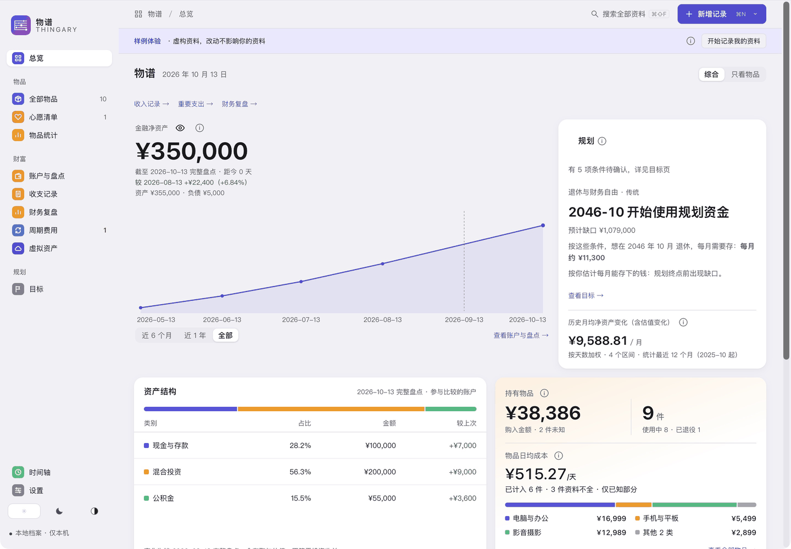
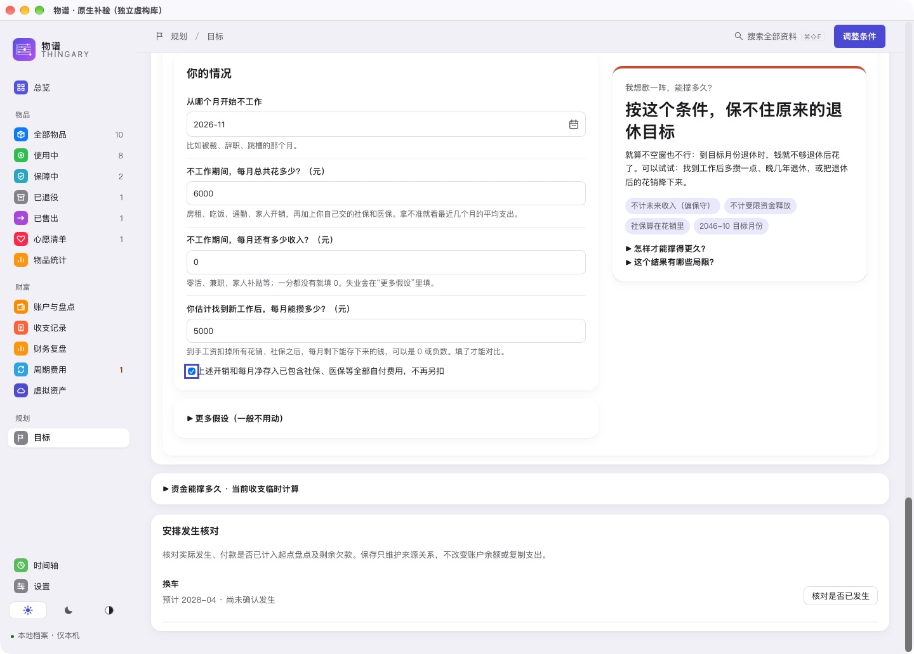
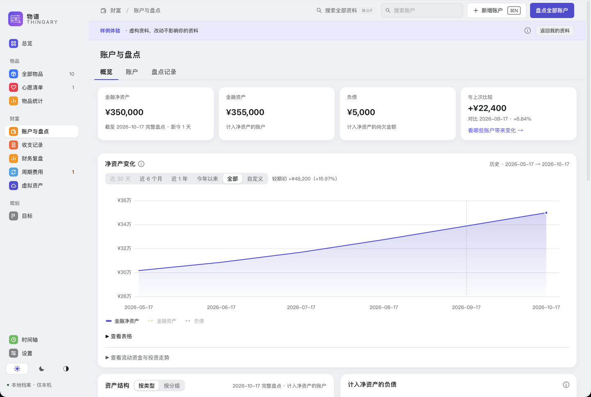
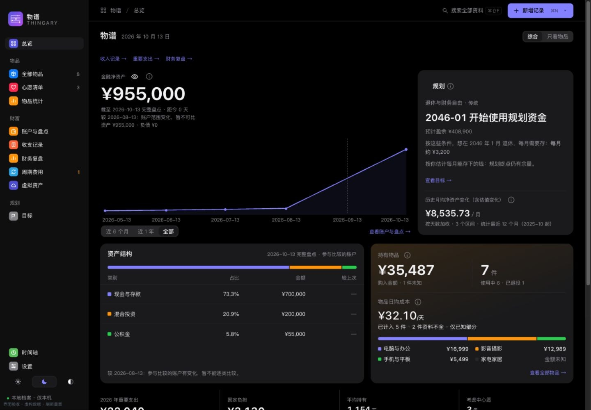

  

<h1 align="center">物谱 · Thingary</h1>

<strong>给记账坚持不下来的人：不用每天记流水。重要的东西留个档，每月盘一次钱，需要时算算未来。</strong>

物谱是一个本地使用的 macOS 应用。物品档案与账户盘点是两个并列起点，只用其中一个也完整成立：给重要物品留档，或每月核对资产与负债。规划在盘点之上回答未来问题，用已保存的目标、可核对的测算详情和临时试算分别呈现。无需注册账号，也无需编程或联网使用。

**[0.0.3 公开测试版 · Apple Silicon Mac](https://github.com/CoderJackZhu/Thingary/releases/tag/v0.0.3)** · [图文使用指南](docs/USER_GUIDE.md#download) · [版本说明](https://github.com/CoderJackZhu/Thingary/releases/tag/v0.0.3) · [反馈问题](https://github.com/CoderJackZhu/Thingary/issues)

> 0.0.3 已公开提供 Apple Silicon 测试版 DMG。下载以 Release 的公开附件为准。0.0.4 准备为草稿测试版，尚未公开；主分支的财务工作区、简化规划与报告预览不代表 0.0.3 安装包已经更新。维护者确认后再开放新版本下载。

总览把账户盘点与按条件估算的目标并排展示；截图为已设置目标的内存虚构示例。

12 秒的内存虚构演示：打开总览 → 进入账户盘点页 → 查看目标结论。

## 开始使用

1. 下载 `.dmg`，打开后将「物谱」拖入「应用程序」。
2. 从「应用程序」打开物谱，先浏览独立的虚构样例。
3. 点「开始记录我的资料」，选择[先整理物品](docs/USER_GUIDE.md#first-record)或[先盘点账户](docs/USER_GUIDE.md#first-snapshot)；另一条路径随时再开始。
4. 录入自己的资料后，[做一次完整备份并异地保存](docs/USER_GUIDE.md#backup)。

本次 **0.0.3 公开测试版** 使用本地临时签名，未经过 Developer ID 签名和 Apple 公证。首次打开可能需要在「系统设置 › 隐私与安全性」选择「仍要打开」；请按[安装与故障排查指南](docs/USER_GUIDE.md#download)操作，无需编译或使用终端。下载页中的 Source code 是源码，不是安装包。

| 支持范围 | 当前情况 |
|---|---|
| 芯片 | 提供 Apple Silicon（M 系列）安装包；暂无 Intel 包 |
| 系统 | 已在 macOS 27 验证；打包最低目标为 macOS 14，其他版本尚未实测 |
| 语言与更新 | 界面为中文；目前需手动下载安装更新 |
| 其他平台 | 暂无 Windows、Linux、手机客户端或跨设备同步 |

本系列处于公开测试阶段。更新前请先完整备份，再按[更新步骤](docs/USER_GUIDE.md#update)手动替换应用；较低的公开版本号不表示资料格式可以降级。

0.0.3 的历史包内容见[发布说明](docs/releases/v0.0.3.md)。当前源码已将财富分为账户与盘点、收支记录和财务复盘；规划以「目标」为单入口，页内分为「目标／测算详情／试算」，退出社保、医保和养老金政策测算，未来养老金可作为手填收入条件维护。

## 资料与隐私

资料只在你的电脑上：没有账号、没有网络请求、代码公开可查。**资料与备份没有应用级加密**；若主动选用云盘作为额外备份位置，副本由该云盘软件同步。自动备份和主资料同盘，仍应额外保留异地完整备份。

删除应用不会删除资料。更新、换 Mac、资料位置、恢复与当前限制统一见[使用指南](docs/USER_GUIDE.md#update)。反馈时请遮住真实资料，不上传数据库或备份；漏洞请按[安全政策](SECURITY.md)私下报告。

## 现在可以做什么

| 功能组 | 物谱提供的功能 |
|---|---|
| 物品档案 | 名称、购入金额与日期、照片、备注、品牌型号、维护与保障；使用中／退役／售出、日均与按次成本、心愿决定与明确购入记录 |
| 账户盘点 | 定期核对账户资产与负债，查看金融净资产趋势与盘点变化；按需记录收入、重要支出和资金流动，核对同一投资范围的损益金额 |
| 规划 | 「目标」保存条件、结论与大额计划；「测算详情」核对轨迹、快照和风险；「试算」比较心愿影响、职业变化与资金续航，关闭即丢弃 |
| 辅助模块 | 周期费用及软件、域名等虚拟资产档案，可在设置中按需打开或隐藏 |

资料支持最近删除恢复、完整备份与恢复、自动备份，以及统一 Excel 导入导出与金融历史导入。先备份，再换机或更新。

物谱适合低频记录，例如每月盘点一次账户、补充近期的重要购入。它不提供日常流水记账、行情交易或自动付款。物品购入金额和金融净资产分别展示，不相加，也不重复扣减。

## 目标、测算详情与试算

规划页内有三个标签。在「目标」中确认资金使用月份、每月生活费、可用资金和未来固定收入，先看“每月大约要存多少”；预计每月净投入可以稍后补。已决定、计入目标的大额计划也留在这里。实际盘点、模拟起点和未来假设分别说明，未知不会当作零。

需要深入时，切到「测算详情」核对资产轨迹、逐年快照、退休收入和预算，再看收益、通胀、支出与市场路径分析。缺资料会列出缺项，未知不会当作零。操作见[规划入门](docs/USER_GUIDE.md#planning)。

查看测算详情与临时试算

「试算」集中提供心愿对目标的影响、职业变化与资金续航。心愿只比较影响，不计入目标；大额计划与心愿的含义分别说明，临时试算不改已保存的条件。

「歇一阵能撑多久」「高收入还要做多久」「换工作后每月要攒多少」复用已有计划，再改少量条件；关闭即丢弃。默认沿用保存计划的未来收入与已确认资金释放，可在本次收入与资金假设中调整；开销中的社保、医保等自付费用需要本人确认。见[职业试算说明](docs/USER_GUIDE.md#career-trial)。

职业面板图为既有虚构原生截图；当前入口位于「试算」标签。

当前源码可以设置收益假设并做压力测算，也可核对两次盘点间的外部转入／转出，计算同一投资范围的损益金额；不提供证券收益归因、实际组合收益率或自动行情。净资产涨幅包含存取、消费和估值变化，不能当成投资收益。目标页已接入“查看当前报告”：默认隐私，可切换完整数值并复制摘要，关闭不保存报告。报告只覆盖列明的资金与计算条件；逐月图表和详细购买结果在“测算详情”标签查看。PDF、冻结基准、多套命名方案及普通金额目标仍待实施。

查看更多界面：物品、账户、年度支出与深色外观

| 物品与支出 | 账户与总览 |
|---|---|
|  |  |
|  |  |

界面图全部使用虚构资料，来源、应用基线与拍摄范围见[截图维护清单](docs/images/README.md)；截图不代表所有功能都已完成原生验收。应用提供浅色、深色、跟随系统，以及三种界面风格。

## 文档与参与贡献

- 使用软件：[使用指南](docs/USER_GUIDE.md)，包含安装、入门、模块操作、备份、更新与常见问题。
- 理解计算：[业务规则](docs/PRODUCT_RULES.md)，说明成本、净资产、支出与未知值的口径。
- 参与开发：[贡献指南](CONTRIBUTING.md)、[开发与测试](docs/DEVELOPMENT.md)、[架构说明](docs/ARCHITECTURE.md)。
- 维护项目：[文档职责与维护方式](docs/MAINTAINING.md)、[发布流程](docs/RELEASING.md)、[版本记录](CHANGELOG.md)。

完整文档入口见[文档索引](docs/INDEX.md)。从源码运行需要 Mac、Node.js、Rust 与 Xcode 命令行工具；普通用户直接下载安装包即可。

## 许可

规划模块的早期实现参考了 [Wealthfolio](https://github.com/wealthfolio/wealthfolio) 的公开实现。

代码按 [GPL-3.0-or-later](LICENSE) 授权，第三方依赖许可见 [THIRD_PARTY_LICENSES](THIRD_PARTY_LICENSES.md)。名称「物谱」「Thingary」与应用图标不在 GPL 授权范围内；修改版再发布请采用自己的名称与图标，详见[品牌使用说明](docs/brand/README.md)。
