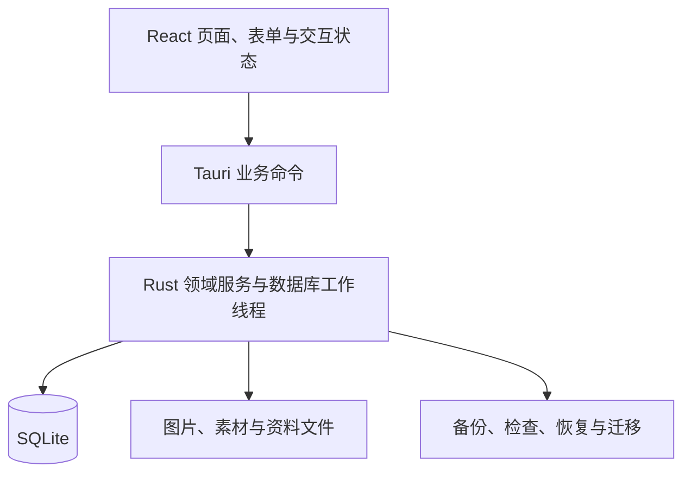

# 架构说明

物谱采用 Tauri 2、React／TypeScript、Rust 和 SQLite，运行于 macOS。前端是本地打包资源，持久化操作经 Tauri 命令进入 Rust；无服务端、Node sidecar、账号系统或网络同步。业务语义见[业务规则](PRODUCT_RULES.md)，开发入口见[开发与测试](DEVELOPMENT.md)。

下一阶段逻辑对象、方案/事实分离、事件与贷款接续、基准和导入事务的目标契约见 [统一规划设计](PLANNING_LIFECYCLE_DESIGN.md)及其专项规格，**分阶段实施中**；当前已接入的资金／事件核对和月账本见下文。当前规划报告通过只读适配器接入真实来源，不新增持久对象；命名方案、冻结基准及基准／比较报告尚未接入，其物理表、命令与迁移版本仍在实施前确定，不能从设计对象推定数据库已变更。

## 分层与入口

| 位置 | 职责 |
|---|---|
| `src/` | 页面、组件、命令类型、展示格式、样例预览；外观令牌在 `src/theme.css` |
| `src-tauri/src/` | 应用入口、业务命令、数据存储、领域计算、工作线程与恢复协议 |
| `src-tauri/tests/` | 存储／领域集成测试、事务与故障注入、迁移、备份恢复 |
| `src-tauri/examples/` | 隔离的虚构样例导入与验收夹具，不用于正式资料 |
| `src-tauri/materials/`、`src-tauri/icons/` | 随包提供的素材与正式图标 |
| `tests/` | 前端纯逻辑、布局与格式约束；不等同于原生自动化 |
| `scripts/` | 素材生成、离线指南、许可清单、打包与辅助验收 |

前端不直接访问 SQLite。阻塞的数据库与文件工作通过后端工作线程处理；写操作串行化并在事务中维护业务事实与引用。界面刷新和缓存失效必须随业务提交结果更新。

## 身份与资料隔离

正式身份为 `local.thingary.main`，开发预览为 `local.thingary.preview`。它们使用不同资料目录；验收夹具还应有独立身份。浏览器预览只用内存虚构数据，刷新即重置。

恢复和切换资料库时使用资料库身份／generation 约束；旧表单、旧异步响应和旧请求不能落到新资料库。正式目录不是测试夹具，也不能靠修改版本号自动隔离资料。

## 保存、冲突与未知结果

写操作使用请求身份／回执防止重试产生重复事实，编辑使用修订约束避免旧表单覆盖后来更正。成功、明确失败和提交结果未知需要区分：结果未知先查回执，不能直接当失败重做。

用户主动关闭普通表单时不保存草稿；明确失败时保留当前输入以便修正。错误转换为可读提示，必要时关联字段与重试入口；日志避免记录完整表单、序列号、账户资料或图片内容。

## 财务工作区的读取与能力

当前源码已接入财务工作区，已完成代码复核、自动检查、浏览器矩阵及隔离原生核心流程验收，见[开发说明](DEVELOPMENT.md#finance-workspace-validation)。`finance-contract.ts`／`finance-navigation.ts` 定义期间、能力与业务意图；`finance-service.ts` 显式适配原生 `finance_sources`，`finance-data.ts` 管理读取票据及过期响应。`finance_sources.rs` 在同一只读事务中取得期间、账户／盘点、收入、支出、投资核对及历史参考；Worker 同轮采样当前资料库与 RuntimeModules，不能把多个旧来源请求拼成一份本期结论。局部 disabled／error／empty／partial 状态保留区别，未知整数分不补零；用于选区间的全量启动读取不冒充期间事实。

RuntimeModules 增加独立 `incomes` 和 `movements`，前者不依赖目标，后者还要求 `wealth`；`planning` 只控制目标及目标来源。可信旧配置只继承一次，不能随着后续目标开关反复改变收入与流动偏好；坏配置与未知版本不默认全开，失败保全原文件。展示、候选、写入、导入预览与提交分别门控；完整导出／备份不删隐藏模块事实。模块开关不改 schema、历史请求指纹或带 plan_ 前缀的现有事实表。

手填与流动明细仍为互斥的投资核对来源。流动关闭后，手填核对只读已存事实且不查询流动，明细模式显式 unavailable，不自动改模式或通过旧读取端口绕过。目标关闭不影响收入、流动及财务聚合。结果未知的回执核对属于只读恢复，沿用原 request_id／generation；不能因模块关闭或宿主迁移而生成新请求重放。全局保存锁保留独立于模块开关和业务页面的只读回执核对入口；金融导入回执进入数据管理处理，不误用财富回执查询。核对失败保留锁和原请求，明确结果后刷新资料。新增收入使用只返回最新非投资收入缴存默认值的轻量读取，不传输全部收入历史；默认读取失败允许留空录入，generation、模块及迟到响应守卫仍生效。

## 当前规划报告

`PlanningPage` 使用同一批 `PlanningSources` 与 `buildBasicCapabilities`，经 `planning-report/current-adapter.ts` 和 `parseReportInput` 生成脱离来源引用的白名单快照。`PlanningCurrentReportDialog` 只持有内存快照；普通来源刷新不替换正文，切库、恢复、关闭规划或离开目标使其失效。报告不写账户、规划或回执，未知净投入不补零生成预测；影响计算的待核对项限制主结论。实际资金与模拟起点分别标注，账户在完整／隐私视图共用稳定局部别名。

真实入口默认隐私，只提供完整切换与摘要复制，复制失败明确提示。当前展示资金、计算条件、需求与可准确表达的结论；逐月曲线、购买结果、历史差异和原生打印／PDF未由这一步接入。显示缺项不改变领域模型的预算覆盖与终点余量判据。

## 账户、完整盘点与月度收入历史导入

`DataManagement.tsx` 在设置的数据管理统一托管物品导入、金融历史导入、Excel 导出与完整备份／恢复；`FinancialImportDialog.tsx` 提供金融历史四步界面；`financial-import.ts` 负责列头、动作、分页与请求元数据纯逻辑，金额仍为整数分字符串。`financial_import.rs` 组合纯解析器、真实账户目录与 `wealth.rs` 的 `write_account_tx` / `write_snapshot_tx`，预览只在 SQLite 内存备份的事务副本模拟，提交在个人 Store 的单一事务重新验证后写入。原命令保留 generation、UUID、原指纹、回执和故障点；导入专用历史覆盖与整批最终状态校验不改变普通保存语义。

`financial_import_preview` / `financial_import_commit` 与文件读取、模板、进度、取消、回执查询命令在 `lib.rs` 登记。`spreadsheet.rs` 使用 calamine / rust_xlsxwriter 读写 `.xlsx`。原生受控选择器仅接受 xlsx；一个工作簿提取账户／完整盘点／收入工作表（空表忽略），规范化为内部 CSV 文本再复用原校验和事务。外部不再提供 CSV 入口。ZIP 实际解压总量、XML 坐标／范围先限界，再解码单元格；拒绝公式、宏、错误值和数值型外部编号。工作簿与规范化内容分别最多 20 MiB，所选数据合计最多 50000 行，解压最多 64 MiB，每表 32 列；不接收任意前端路径。取消与进度直接读取独立任务注册表，不进入串行 Worker，目录扫描、SQLite 复制及解析检查点均可取消；提交阶段不允许半途取消。

`x10.sql` 将 schema 33 升至 34，新增 `import_external_key`（来源／映射集合／对象类型／外部键复合主键、稳定对象 ID、值指纹、修订与 active/purged 状态）及 `import_receipt`（request_id 主键、请求指纹、批次指纹唯一、成功对象 ID／修订／计数／时间）。仅成功事务持久化回执，失败后同一请求可重试；重复批次返回原回执，同时按稳定对象 ID 只读计算已删除／清除数量；该当前可用性字段不写回持久回执、不改变指纹或 schema。预览与回执区分原事务结果和当前对象可用性，并提供恢复／更换映射集合等下一步。永久清除账户或盘点时映射标墓碑，回执保留，不按同名重绑。两表纳入完整备份、规范 schema 及引用校验；旧备份升级时两表为空。升级恢复日志仅在 `recover_root` 的恢复数据集验证处允许已知旧 schema，通用 `validate_dataset` 仍保持严格。迁移提交前失败回滚版本与两表，原资料、稳定引用和未知值保留。

普通预览关闭不存草稿。未知提交只保留 request_id / generation；恢复清理普通本地工作时保留该元数据。跨 generation 不重提旧输入，可只读检查当前库是否恢复了同一回执；当前库查无回执不能判断原库未提交。导入成功统一失效财富／规划读取，告知起点盘点是否改变，不修改未来投入、假设或冻结基准。

## 图片与文件一致性

用户选中的图片经受控读取、暂存、校验和托管后与记录关联；失败不能静默跳过图片，也不能清理其他记录引用的文件。内置素材使用受控 ID 与随包资源，不接收任意前端资源路径作为可信来源。

删除资料先维护最近删除及其引用。恢复保留对象身份和关联；不能把照片当普通缓存随意清空。未引用原图与恢复保护副本目前不会自动清理，保持这一限制的说明。

## 备份、恢复与迁移

完整备份记录 SQLite 数据及托管文件，并校验格式、版本和内容。恢复先检查、再明确确认，准备新资料集、保护原资料并切换；恢复是整体替换。中断后的恢复不能仅凭 UI 状态推断成功，更不能自动创建空库掩盖损坏。

订阅简化使用 schema 21 的增量迁移：计划增加可空服务起点与覆盖锚点，付款增加可空覆盖区间，并保存之后的价格变化。旧字段不改值，空的新字段继续采用旧排期语义。权益与关联计划在同一事务、同一请求回执中保存，双方修订冲突使整个事务失败。付款确认时固定覆盖期，改计划不重写付款事实。范围补记也使用事务、计划修订和回执防重。

虚拟资产标签与计费使用 schema 22→23→24 的增量迁移（设计见 [VIRTUAL_ASSET_BILLING_DESIGN](VIRTUAL_ASSET_BILLING_DESIGN.md)，已实现并经过独立复审修复，纳入 2026-10-05 重建的 0.0.1 Beta，原生完整交互验收尚未闭环）：schema 22 新增 `label_scopes`、`plan_period_ends`、`virtual_topups`、`virtual_balances` 表，`virtual_assets` 重建以扩展类型 CHECK 并加入计费方式、标签、支付方式与永久有效列，`reminders` 重建以加入 `renewal` 类别，计划增加固定天数与试用列；schema 23 增加 `plan_rules` 生效规则分段表并在事务外暂停外键、事务内重建 `recurring_plans`（放宽结束日期下界到服务开始日，让试用内结束可保存），提交前执行 `foreign_key_check`，失败回滚并恢复连接原外键设置；schema 24 补齐规则的付款锚点、服务开始日和试用历史，持久化独立的自动续费状态。付款候选、范围补记、覆盖期与累计估算共同沿生效规则分段行走：每段有自己的锚点与周期长度，历史期用所属时段规则与价格，调周期、锚点或试用不回写历史事实，特殊到期在链上顺延；待付款金额与预测按服务期开始日的生效价格，预付日期不提前触发下一价格段。迁移只补默认值：旧行按“有计划→订阅、无计划→单次投入”填充计费方式，旧标签补“实物”范围，ID、金额、日期、价格历史、付款与图片保持原义。权益、计划、首次充值与标签引用在一次保存事务和同一请求回执中维护；充值与余额是独立稳定事实，删除恢复遵守父子关系；新表纳入规范 schema 定义校验、领域校验、备份 inspect 摘要与恢复检查。续期提醒沿用既有提醒计划推导：派生计划在每个写入后重算，停止、删除或模块关闭的资产不再出现在待通知计划中，从而撤销未发送通知。

schema 25 为维护记录增加配件类型：事务内重建 CHECK 约束，保留维护 ID、费用、时间、删除标记、审计与图片引用，恢复日期守卫及索引；提交前验证外键，失败回滚并恢复连接原外键设置。旧维护记录保持原义。

schema 26（已随 0.0.2 发布）为提醒增加 `repeat_every_period` 和 `lead_days`，旧行补为单次、提前 3 天，保障与心愿仍只支持单次。虚拟订阅付款入口和每期通知共用当前／未来未记录期推导，沿 `plan_rules`、特殊到期和分段价格读取，不回填历史漏记。paid／skipped 排除对应期；每期通知 ID 由提醒源 ID 与付款日组合，未来 12 个月内的付款期预先安排，写入／启动时沿原生调度补充并撤销不再有效的通知。备份规范 schema 随迁移更新，新版备份不可交给 schema 25 应用恢复。

全局搜索（B 阶段）是 `search.rs` 的只读投影查询：一次查询在同一个读事务内完成九类候选的匹配、固定排序、完整计数与分页，无写入、无独立磁盘索引与新全文检索依赖；模块开关在查询内门控类型与计数，响应回显关键词、类型、偏移与资料库 generation，过期 generation 直接拒绝。账户加入来源类型并按稳定 ID 打开资料表单，盘点结果进入 A 阶段的只读详情。

原生 `search_all` 命令经 Worker 调用；四类固定类别名称参与 SQL 候选匹配，与结果摘要使用同一显示映射，ASCII 大小写折叠保持 UTF-8 字节边界。读取版本采用当前连接的写入计数，仅用于本轮会话检测变化（包括失败写入后的保守失效），不落盘也不充当写入修订；后续分页或重开查询发现版本变化时返回第一页，响应页码与前端同步。前端面板的会话状态（关键词、类型、分页、滚动和读取版本）仅存内存，资料库切换或模块开关即清空并废弃在途响应。查询与来源打开分别使用票据及存活／上下文守卫；关闭、卸载或变更查询后不处理迟到结果；来源打开带并发锁，重试有独立轮次，组合输入结束可靠触发查询。已付与已跳过付款都按原记录及所属计划 ID 校验并打开精确期次。

C 阶段包含待替换物品关系与盘点表单简化（已包含在 0.0.2 Beta 下载包）：schema 28 为 `wishlist_items` 增加可空 `replacement_asset_id`（独立于购入关联的外键）与 `replacement_asset_name` 展示历史；写路径复用 `save_wish_plan` 的事务与回执，新增关系校验目标为在册未删除物品，保留已有软删关系允许编辑其他字段，物品本身不被修改；永久删除物品时先清外键、写入该物品名称作为失效关系展示资料，旧物生命周期不由该关系驱动。空 ID 清除有效关系但保留失效名称，`clear_replacement=true` 才明确清除历史；该可选标记为 false 时不参与序列化，保留已生成 schema 28 回执指纹。无替换操作的旧请求另按 schema 27 的原始字段顺序核对指纹，内容改变仍拒绝复用回执。盘点表单只提供金额输入，填齐所有应盘点账户后保存，用户输入一律提交 `entered`，即使数值等于前值。旧 `missing`／`unchanged` 状态及回执继续兼容读取与恢复；更正时未编辑的旧 `unchanged` 行提交空 amount，后端沿用原记录金额，避免只改备注重写历史余额。旧缺失条目进入更正后需补齐金额。前端不再提供状态按钮或批量确认，无额外 schema 变更。

schema 27（低频整理与心愿决策 A 阶段，已随 0.0.2 发布）为 `wishlist_items` 增加唯一权威的 `decision_state`（考虑中／已购入／不再考虑／历史待核实）、决定备注、购入来源与只读的历史生成关系 `legacy_generated_asset_id`／`legacy_generated_at`，并按旧 `achievement_source` 分类旧行：manual／conversion 且有原关联物品时保持已购入，无关联的合法旧实现转为历史待核实并保留旧日期，savings 与来源不足转为历史待核实并把自动生成物品移入历史关系，物品、金额、照片与审计不删不改；心愿提醒仅考虑中保留，审计表重建以放宽 action CHECK。旧 `status` 列留作兼容投影，v12／v14 成就触发器在新投影下继续成立。攒钱写命令停用（旧回执仍可核对），读取时自动补生成物品的路径退出；显式购入确认、关联已有物品与历史核实走独立原子命令（`convert_wishlist`／`link_wish_asset`／`verify_legacy_wish`），各自携带请求回执与修订校验，历史生成关系与有效购入关联同样阻止永久删除物品。盘点更正中，未编辑的 `unchanged` 条目以空金额保留原值，用户本次重新确认时提交显示金额并校验前次观测；不新增存储字段。核实表单以预填版本为修改基线，只提交有变化的字段，不用提交前重新读取的修订替代基线；关联选择器按搜索条件在后端分页查询，异步响应受当前搜索轮次约束，不截断候选全集。只读盘点详情按稳定 snapshot ID 读取，趋势／比较端点与财富 CSV 附带备注。

schema 33（0.0.2，重要支出年度总览与关联订阅）为整组删除新增 `link_trash_groups`／`link_trash_members`：组状态（deleted／restored／purged）、来源请求 ID 与成员删除前后修订；成员限定虚拟档案与周期计划且不设外键（永久清除后组仅留归属记录），迁移只建结构、不修复任何历史关系。`link.rs` 提供关联读取与操作命令：`link_view` 一次只读快照返回双方、关系状态（linked／asset_trashed／plan_trashed／both_trashed／group_deleted／plan_occupied）、付款摘要与候选；删除／恢复走 `link_delete_preview`→`link_trash` 与 `link_restore_preview`→`link_restore`，预览返回确定性影响摘要（覆盖 generation、动作、双方修订与删除状态、计划下全部付款的 ID／修订／状态、规划引用负载），提交在写事务按同一规则重算并比较——新增付款或更正都会使旧确认失效。共享计费保存 `link_save` 在一个事务携带双方 expected_revision（任一页旧表单冲突）、保持计划分类并按「统一名称」语义同步显示名；`link_create` 给既有计划新增档案不补付款；`link_reconcile` 处理旧停用两种动作与历史归组。旧入口保护：`recurring_plan_save` 拒绝已关联计划的单边写入，`wealth_trash` 对已关联双方要求整组、对组成员要求整组恢复、对双方分别历史删除要求先核对归组，`virtual_save` 拒绝对已关联档案新写旧停用路径；永久删除与清空按组整体处理，计划仍被有效档案使用或组外档案按 ID 引用时保留并说明。新表与命令纳入备份 schema 校验、领域校验、inspect 摘要（link_groups 计数）与恢复检查。`expense_view` 的年度桶与全部摘要、明细在同一只读快照完成，月桶补齐已知／未知计数。

该阶段合并版本为 schema 33：保留主分支 schema 32 的规划载荷契约，再新增关联删除组。未发布订阅分支也曾使用 schema 32 并包含组表，迁移与旧备份检查按完整规范结构识别两种 32；只接受确切组表和索引定义，不接受半组结构或随意新增字段。升级保留组状态、稳定 ID、规划载荷和付款事实；schema 32→33 提交前故障回滚。

数据库 schema 版本、备份格式和应用发布版本承担不同职责。迁移保持历史事实；应用版本号调整不代表可以重置 schema、资料目录或稳定 ID。不要承诺高版本备份可被低版本恢复。

## 界面与可访问性约束

复用已有 SVG、组件与 `src/theme.css` 令牌，覆盖三种界面风格的浅／深组合。颜色表达不能替代文本，金额与日期格式统一，未知值不画成零。周期付款与复盘来源按 50 条分页渲染，完整合计与排序仍基于全量来源；分页不替代后端完整校验。布局应覆盖正常、未知、空白、读取失败和保存失败；焦点、Tab 顺序、方向键、Esc 返回和中文输入组合需与操作语义一致。

`wealth-display.ts` 管理账户显示范围，与汇总计算分离；变化列表保留有历史影响或未知的停用账户。`chart-labels.ts` 按实际位置与文字宽度筛选横轴标签，`chart-width.ts` 观察 SVG 显示比例，数据与详情不抽样。总览金融金额显隐仅保存本机显示偏好，隐藏时不渲染金融图形和相关金额内容。`PlanningCosts` 共用费用编辑器，独立保存只替换 basic 中两组费用关系；完整设置仍按原事务统一保存。停用计划的来源 ID 保留，当前作用域只计算生效来源，重新开启无需抹去后重建费用关系。

共用操作外观由 `controls.css` 统一负责；页面布局继续留在各页面样式。`FormControls` 的字段标签与提示通过上下文供复合控件使用，直接原生控件合并原有说明 ID。`DateInput`／`MonthInput` 共用本地日历计算与定位模块 `date-picker.ts`：仍传 YYYY-MM-DD／YYYY-MM 字符串，日历门户留在所属原生 dialog 的顶层容器内，独立管理焦点与边界。`YearSelect` 按记录、近期或长期用途组织常用年份和分页网格，展示范围与业务 min／max 分离；嵌套年份门户留在所属日历内。`finance_sources.record_years` 在同一读取快照汇总启用来源的完整记录年份，独立于所选期间，错误与空集合分开。选择器不能提交表单或改变回执保存规则。规格见 [共用界面设计](VISUAL_SYSTEM_DESIGN.md)。

大额计划的横向滚动限制在表格区域，目标卡片使用可收缩的单列网格。长表单复用固定头部与内部滚动的编辑器布局。编辑弹窗、菜单与日期选择弹层不使用透明度入场动画，避免原生 WebKit 将已打开的操作界面留在透明状态；弹窗内的日历仍留在所属 dialog。

新增界面提供同尺寸前后截图，并明确浏览器与原生证据的边界。界面规范以当前组件和令牌实现为基准，不复制历史原型中的固定尺寸或过时品牌元素。VoiceOver 等尚未验证范围见[使用指南](USER_GUIDE.md#limits)。

## 验证边界

Rust 故障注入验证事务、回执与恢复协议；前端逻辑检查验证格式、筛选和布局约束；原生验收验证 WebView、系统文件对话框与持久化。浏览器截图不能证明 macOS 原生功能已经通过。

目前只在 Apple Silicon、macOS 27 实测；打包最低目标 macOS 14 不等于已完成该版本兼容性验证。具体发布核验见[发布流程](RELEASING.md)。

## 已批准、分阶段实施的设计

[低频整理、盘点与心愿决策设计](LOW_FREQUENCY_REVIEW_DESIGN.md)维护目标行为与技术约束。A 阶段（心愿决策与盘点表达）、B 阶段（全局搜索）与 C 阶段（考虑替换的物品、逐账户金额盘点）已纳入 schema 27／28、搜索投影与各模块说明，完成 Review 修复、自动检查与隔离核心原生验收。原 C2 批量确认已按用户决定撤销；系统输入法组合、VoiceOver 与通知送达仍未原生验证。实施前核对最新 schema 与实际代码，不预占数据库或应用版本号。

### 简化规划与一次性迁移

schema36 迁移沿用 plan_profile JSON 和 plan_income 事实表。plan_migration 在现有 schema 事务内转换旧资料，通用事实与引用严格校验，政策字段不进入当前 DTO；有语义变化才增加修订，保留原更新时间。旧备份只读检查与恢复复用该转换。全部历史回执保留；旧规划请求只能按原 ID 核对，不重放旧载荷。

plan-simplified-contract.ts 是时间与未来收入的唯一类型入口，Rust plan_simplified 严格拒绝旧字段。时间保存明确月份；UI 默认使用出生年月和退休／终点年龄换算，新确认的出生年月用现有 reference（月、age_months=0）表达。没有新 DTO 字段或迁移，不继承旧政策生日，原非零参考保留；更正参考不自动改已保存月份。plan-basic 编译未来收入与受限资金释放后，所有消费者共用 plan-ledger，不复制政策引擎。Core 仍维护用途、付款、余债与稳定来源引用，releases 仅是未来计划。

### 规划首次设置

PlanningSetup 的四问复用 TimeFields 与 FutureIncomeSection，最终一次 setup 保存 basic、budget、funds 与 simplified。目标逐项编辑只更新对应分区。保存继续使用 generation、expected_revision、request_id、事务与回执；普通草稿关闭丢弃，未知结果冻结并保留原请求。planning-simplified-port 提供真实源读取、保存及旧回执只读核对。

### 结果与分析消费者

首页、目标、心愿复用同批已保存来源和 buildBasicCapabilities；临时投入不影响其他入口。图表、市场模拟、敏感性与逐年快照使用月份，年龄可空。资金续航和职业试算是临时输入，不保存职业阶段。planning-consumers 维护显示缺漏说明的消费者清单。

已有贷款仍使用 Core.debt_repayments，按负债账户 ID、盘点余额及截至日期核对，复用修订与备份引用校验，不新建表。金融导入保留 schema35 已有的真实收入／缴存／账户／盘点与回执，schema36 只转换规划 payload。

schema37 在单次迁移中扩展 plan_income 分类／账户引用／去向及分类更正标记，新增 investment_flows 区间核对。旧缺省字段省略序列化，保护旧收入请求指纹。旧文件缺少分类列时更正不清除已有分类；分类更正保护标记只可置位，避免 Excel 往返恢复不安全的旧估计。

investment_review Store 从真实完整盘点构造 counted 投资范围，复用独立纯计算核心；read/list/save/trash IPC 经过串行 Worker。保存重读端点内容键，校验 generation、revision、重叠并在同一事务保存输入与回执，结果不持久化。原端点键留作核对依据，盘点更正时动态标为失效；原核对删除后仍支持恢复及冲突检查。InvestmentReviewHost 负责原请求保留、冻结和重新读取，界面不另算损益。账户关闭不开放新业务读写；流动关闭按手填／明细模式门控，原请求只读回执核对仍可达。

收入来源通过稳定账户 ID 关联；软删除后保留原事实，仍被收入引用的账户拒绝永久清除。投资核对的历史端点在删除后保留原始快照依据；不以当前引用失效抹掉已记录的资金流动。

## Excel 工作簿

资料管理的导出保存一个工作簿：说明、物品、账户、完整盘点、月度收入及分析表（盘点记录、重要支出、周期费用、投资区间核对、资金流动、规划假设、规划核对审计）。明确字符串单元格防止公式执行、编号和日期自动转换及金额精度丢失；空单元格保留未知。先在内存完成再原子写入，文件替换由系统保存面板确认。物品导入只读取物品表，仍为新增事务及疑似重复预览；金融工作表仍按既有整批事务与回执提交。规范化文本的物理行到 Excel 行映射只用于界面定位，不改变已存回执、摘要或数据库 schema。完整恢复与换机继续使用 `.thingary`；Excel 不包含图片及全部配置与关系。

### 窗口尺寸与持续维护视图

`window_size` 按应用身份在 app_config_dir 保存普通窗口逻辑尺寸，启动按显示器可用区域限界并居中；保存失败只影响偏好，不触及资料库。关闭及退出保存，全屏／最大化／最小化时跳过。本机偏好不参与备份恢复。

PlanningPage 仅托管目标及其发生确认／撤回，保留四问与逐年快照；快照复用 snapshotRows，在详情双栏外渲染，不另算预测。财富下 FinanceRecordsPage 承载收入／重要支出／资金流动，FinanceReviewPage 承载本期复盘／盘点比较。期间、搜索、排序、展开项与滚动仅是会话内存状态，不进入资料库或备份。IncomeRecords 的列表与汇总共用期间集合，搜索只过滤明细；从复盘带入闭开区间时仍排除起点。来源跳转由稳定 ID 及 generation 验证，返回上下文只有一层，最近跳转覆盖更早上下文；切库、恢复和能力失效清理上下文，迟到响应不能重新定位。

## 假设核对分区

schema 38 在 `plan_assumption_checks` 单独保存后端拥有的已核对四项数值及待核对标记，原 profile DTO 与旧 basic/setup 请求序列化保持不变。`plan_assumptions_read/save` 经 Worker 沿用 profile 修订、generation、同一 `feature_requests` 和提交故障点；只有明确确认才写确认值。各 profile 保存路径比较实际收益、通胀及波动的变化并撤销有效确认，预算、费用、投入等无关保存保持状态。没有已保存 basic 的独立假设写入被拒绝，不建立空计划。旧资料迁移不改原值，新增核对表为空；规范 schema 与领域校验随完整备份恢复。

`src/planning-followup-port.ts` 以现有 `wealth.submit` 和 pending 入口适配原生方法。C1 提供假设读取、保存与回执核对，C2 补齐资金流动和来源核对全部方法，UI 在目标、收支记录和财务复盘页面接入同一适配器。独立四字段编辑器统一假设入口；失效区间重新打开时不沿用原完整性确认。

## 可选资金流动与区间来源

schema 39 新增 `cash_movements`、`investment_flow_sources` 与 `planning_flow_audit`；旧 `investment_flows` 和历史请求保持原值与原指纹。迁移新结构为空，缺少来源元数据的旧核对按手填处理，不生成流动。流动以稳定 ID 原子保存两端，`fact_revision` 只随影响计算的更正、删除恢复与关联来源变化增加，备注修订不影响内容键。账户引用包含软删流动，永久清除前由领域显式保护；来源清除需先解除关联，并保留流动审计。

`cash_movement.rs` 验证已结算正额、日期、端点和用途，账户余额始终取完整盘点。新端点限现金／投资／混合投资／基金／债券资产账户，负债、公积金、其他资产不自动归为可解释的转账范围；历史失效账户仍可显示。来源候选首版适配月度收入与未关联物品的独立重要支出，来源键由后端提供。派生购买、维护、付款、充值等支出不提供关联候选，不按金额或名称猜测身份。来源须同日同额且方向一致；有效关联唯一，来源更正、软删与恢复保留流动并撤销区间确认。读列表使用同一事务，游标绑定 generation、查询及完整列表内容，过期时报错，不截断计算全集。

`planning_flow_review.rs` 在现有 `investment_review_component` 外层管理手填／明细两种互斥来源。内容键覆盖端点、范围、草稿、全部相关明细及来源状态；保存事务内重算键，旧预览拒绝为 `STALE_BASIS`。明细范围内互转抵消，投资费用不作为取回加回，范围外另付成本通过原因披露。无明细可预览 0／0，但必须明确完整确认才有就绪损益。原合计、来源切换和删除恢复保留审计；同范围重叠仍拒绝。旧读入口同步撤销失效的就绪结果；有明细时旧保存不能绕过内容键确认。

新方法经 `planning_followup_commands.rs` 登记，由原 Worker 串行执行；写入使用同一 `feature_requests` 和 `wealth.submit` pending 机制。回执核对只读原 request_id 和 generation，不重放输入；跨库查不到回执也不声称原库未提交。完整备份含新表并校验索引、引用与载荷；Excel 增加资金流动、规划假设、核对审计和区间来源／当前状态列，保留已删除历史，不承诺新明细表回导。C1/C2/C3 已整合并通过自动检查；隔离原生已验证保存、重启、备份恢复与 Excel 系统面板及内容，完整键盘、输入法与 VoiceOver 边界见开发说明。
