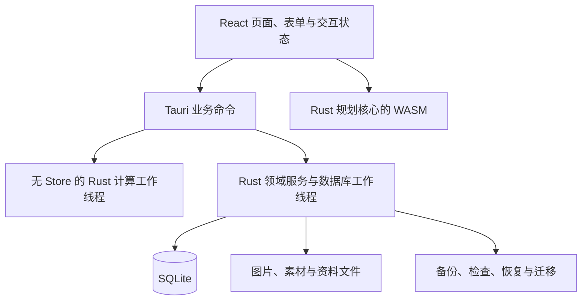

# 架构说明

物谱采用 Tauri 2、React／TypeScript、Rust 和 SQLite，公开版运行于 macOS，Windows x64 实现处于候选验收。前端是本地打包资源，持久化操作经 Tauri 命令进入 Rust；无服务端、Node sidecar、账号系统或网络同步。业务语义见[业务规则](PRODUCT_RULES.md)，开发入口见[开发与测试](DEVELOPMENT.md)。

当前已接入的资金／事件核对和月账本见下文。当前规划报告通过只读适配器接入真实来源，不新增持久对象；命名方案、冻结基准及基准／比较报告尚未接入，其物理表、命令与迁移版本在实施前确定，不能从规划推定数据库已变更。

## 关于与帮助入口

`SupportPanel` 在设置「关于与帮助」直接展示版本、检查更新、「启动时检查更新」开关、帮助与许可，复用现有组件和外观令牌；许可全文与第三方依赖清单来自仓库当前文件并随前端打包。版本从 Cargo 的 `app_version` 读取。`UpdateCheck`（`src/UpdateDiscovery.tsx`）紧接版本与简介显示，读写由 `UpdateDiscoveryProvider` 提供的应用级共享状态：打开页面只读本机更新状态，联网只由检查按钮或已开启的启动检查经后端发起，结果在原处展示。没有单独的关于弹窗或第二层关于按钮。更新组件在此使用紧凑版本行，没有内嵌卡片或重复标题；完整联网说明位于隐私折叠项。维护者主页沿用固定目标白名单，Star 提示复用项目链接，不调用 GitHub 点赞接口。

原生「关于物谱」「检查更新…」「物谱帮助」通过 `asset-action` 进入同一设置页面；更新菜单额外滚动并聚焦版本行，不自动联网。备份入口切换到数据管理并聚焦标题，仍受编辑和回执保护；更新不进入数据管理。已有编辑弹窗不会被菜单替换。`SupportLink` 只传固定目标 ID 给 `support_open`；Rust 白名单映射公开 HTTPS 地址并调用系统浏览器，不读取资料库，不接受任意 URL、路径或参数。

## 屏幕隐私与原生身份验证

`src/privacy-lock.ts` 提供偏好解析和纯状态机；`PrivacyBoundary` 在 `main.tsx` 最外层控制 `Bootstrap` 挂载。启动锁定时只调用 `privacy_auth_available`／`privacy_authenticate`，能力检查或验证失败不会进入资料读取入口；能力不可用时按关闭处理。主应用挂载后的重新锁定保持同一 React 树，通过不透明全屏顶层 `dialog` 遮盖页面、设置背景 inert，避免已有表单对话框越过遮罩。编辑状态、资料操作、打开的对话框及待核对回执延后重锁；原生菜单与键盘快捷键使用同步锁定标记丢弃操作，不留队列。

设置分类「屏幕隐私」直接提供开关与闲置验证说明，不再放在帮助折叠中。两个本机偏好键为 `thingary.privacy-cover.v1`（布尔值）和 `thingary.privacy-lock.v1`（JSON：`enabled`、`idleMinutes`，仅 0／5／15／60），读写失败不抛出到应用，损坏偏好按关闭处理。`wealth-preview.ts` 只模拟虚构认证能力和取消／成功，不调用设备身份验证。

`src-tauri/native/auth.m` 链接系统 `LocalAuthentication`，采用 `LAPolicyDeviceOwnerAuthentication` 支持系统密码兜底；信号量最多等待 120 秒，超时使认证上下文失效。返回字符串由 `thingary_free` 释放。Rust `privacy_lock.rs` 的两个异步命令通过 `spawn_blocking` 调用原生同步函数，不借用 Store；非 macOS 能力返回 false，认证返回 `UNSUPPORTED`。锁屏只防旁观，不加密或阻止文件访问，原生 Worker 的既有启动初始化、提醒及备份生命周期保持不变。自动测试不触发生物识别，真实认证与窗口焦点行为需要隔离身份实机验收。

## 分层与入口

| 位置 | 职责 |
|---|---|
| `src/` | 页面、组件、命令类型、展示格式、样例预览；外观令牌在 `src/theme.css` |
| `crates/planning-engine/` | 共用的规划纯计算、校验与独立数学用例 |
| `src-tauri/src/` | 应用入口、业务命令、数据存储、领域计算、工作线程与恢复协议 |
| `src-tauri/tests/` | 存储／领域集成测试、事务与故障注入、迁移、备份恢复 |
| `src-tauri/examples/` | 隔离的虚构样例导入与验收夹具，不用于正式资料 |
| `src-tauri/materials/`、`src-tauri/icons/` | 随包提供的素材与正式图标 |
| `tests/` | 前端纯逻辑、布局与格式约束；不等同于原生自动化 |
| `scripts/` | 素材生成、离线指南、许可清单、打包与辅助验收 |

前端不直接访问 SQLite。阻塞的数据库与文件工作通过后端工作线程处理；写操作串行化并在事务中维护业务事实与引用。界面刷新和缓存失效必须随业务提交结果更新。

### 手机界面

`mobile.html` → `src/mobile/main.tsx` 是独立的手机前端入口，和 `index.html` 一起由 Vite 多页面构建；iOS 宿主约定打开 `mobile.html`。手机布局只加载 `theme.css`、`mobile.css` 与 `ui/ui.css`，使用安全区和至少 44px 的触控区域，外观跟随系统明暗。业务逻辑、IPC 命令与 `src/*.ts` 数据层与桌面共用，只有界面另写；桌面入口、样式与后端保持原有行为。设计稿在 [docs/design/mobile](design/mobile/README.md)，开发约定（目录归属、路由注册、页面栈、组件、预览与截图）见 [src/mobile/README.md](../src/mobile/README.md)。

底部五个标签：总览、物品、财富、规划、我的。物品、总览、我的始终显示；财富在财富、支出、周期费用、虚拟资产、收入模块全关时隐藏，规划在规划模块关闭时隐藏，关闭的模块同样隐藏其分段和入口，数据不受影响。

- 总览：物品日均成本、金融净资产、「还要上几年班」、待处理事项与近期记录。
- 物品：顶部分段「物品 / 心愿 / 统计」。列表含状态分段、分类标签、筛选与排序、列表／网格、置顶、搜索、批量选择；详情、新增与编辑（拍照建档）、图标与素材、心愿及其详情、统计。
- 财富：顶部分段「概览 / 账户 / 盘点记录」；账户详情、完整盘点、盘点比较，以及支出、周期费用、虚拟资产、财务复盘入口。
- 规划：顶部分段「目标 / 测算详情 / 试算」；设置条件（一屏一步）、假设分析、职业变化表单版、心愿影响。
- 我的：时间轴、搜索全部资料、设置分组（功能模块、外观、选项管理、素材库、盘点提醒、隐私）、数据管理（备份与恢复、加密、最近删除、导出表格）、关于；首次打开提供样例、开始记录或从备份导入。

第一版不做：金融表格导入向导、投资流水核对（投资收益只读展示）、职业变化地图版、桌面快捷键与应用内检查更新、自动备份的额外位置（只保留本机最近备份并通过系统分享面板手动导出）、旧版攒钱记录核实流程（只读显示）。

页面由 `src/mobile/routes.ts` 注册表登记（路由名、标题、page／modal／sheet、所属标签），每个标签有独立页面栈，推入页面同步浏览器历史以支持返回手势，刷新回到标签根页。保存结果未确定时暂停切页与后退。

当前已实现的财富页来自早期手机基础：家底通过 `wealth_summary` 直接使用桌面完整盘点的资产、负债、净资产及比较结果；「总资产」限定为计入金融净资产的资产账户，房产等不计入账户不混入总额。最近不完整时披露缺项并沿用最近完整盘点，没有完整盘点时只显示已知资产／负债，净资产保持未知。盘点通过 `wealth_accounts`、`wealth_snapshot_draft` 与 `wealth.ts` 的可用范围及金额／外币／持仓事实构建器录入，一个「保存本次盘点」按钮按账户串行调用 `wealth_quick_update`：现有命令只支持单账户更新或双账户转账，因此多账户保存不是原子事务；整批先校验，每笔独立 `request_id`、同一 `generation`，失败或结果未知即停止，已成功部分保留。未输入账户遵循后端原有沿用／未知规则。首次建账户复用 `wealth_account_save`，手机简表创建人民币账户。

保存共用 `submit`、`storedPending` 与 `resolvePending`。未知回执保留原请求并暂停编辑和切页，以原请求身份只读核对，不自动继续剩余账户；确认成功后清除对应行输入并刷新来源，未保存时保留当前输入。普通输入只在当前页面内存保留，离页不存草稿。读取拒绝 generation／日期不匹配和已失效响应。

`mobile-preview.html` → `src/mobile/preview.ts` 仅用于开发，经 `mockIPC` 使用与桌面预览共用的 `src/preview-ipc.ts` 虚构数据，不进入生产构建。`?theme=light|dark` 固定外观，`wealth=empty|missing|error` 覆盖空白／缺项／读取错误，`mobile-state=unknown|save-error` 模拟保存响应丢失和保存错误，`?tab=` 与 `?route=` 直接打开某个标签或页面，`route=dev.gallery` 展示组件库。浏览器预览刷新会重建虚构数据；它不证明原生持久性。手机逻辑测试位于 `tests/mobile-*.test.mjs`；浏览器尺寸与状态截图不替代 iOS 工程、WKWebView、安全区、软键盘或 VoiceOver 实机验收。

## 规划计算核心

`crates/planning-engine` 是无存储、文件和网络访问的 Rust 计算库。`plan-ledger.ts` 与 `plan-risk.ts` 保留数据接口、展示适配和取消控制；逐月账本、资金需求、投入额反求、覆盖、市场模拟、敏感性与收益顺序由同一 Rust 实现承担。`plan-basic` 仍负责资料读取、来源核对、未知值门控与输入编译；年龄参考只影响基本模式的展示，不移动日历现金流。

原生批量模拟通过 `planning_engine_evaluate` 在阻塞工作线程上执行，命令不持有 Store；同步计算及浏览器虚构预览使用同一 crate 的 WASM 构建。不存在另一套 TypeScript 账本回退。前端每批 40 条路径，取消后停止后续批次并丢弃迟到结果；已开始的一批不承诺强制中断。每次最多 20000 条路径，计划最多 1440 个逐月区间，传输上限 64 MiB。

`build-planning-engine.mjs` 生成随源码保存的 WASM 模块及源码／二进制散列；源码散列统一使用 `/` 分隔的仓库相对路径排序，避免相同源码因 Windows 路径分隔符不同而误判过期；基本规划能力的 context 与新生成的当前报告包含源码散列前缀；职业试算保留其产品协议版本，核心散列在 context 中。既有目标进度点未记录核心版本，历史点按原值保留，不能把全部历史结果称作已有模型版本。开发启动前自动构建核心；CI 在重建前用 `check:engine-source` 核对提交产物的源码与二进制散列，避免构建覆盖掩盖过期产物。`check:engine` 另在相同工具链下核对重建字节；原生／WASM 对照使用 `dispatch_stdio` 和虚构输入。CSP 仅增加 WASM 编译所需的 `wasm-unsafe-eval`。规格和来源范围见[核心说明](../crates/planning-engine/README.md)与[来源告知](../SOURCE_NOTICES.md)；独立重建的范围是计算库，不扩展为全部 UI 或历史版本。

## 网络

webview 的 CSP 只允许 IPC（`connect-src ipc: http://ipc.localhost`），界面不能直接联网。应用唯一的联网路径是后端的更新查询（手动按钮或已授权的启动检查，见下节「更新发现状态」）：依次通过系统 `curl`（macOS 为 `/usr/bin/curl`、Windows 为 `curl.exe`，限定 `--proto =https`，Gitee 8 秒、GitHub 6 秒超时，响应上限 2 MB）读取 Gitee（`gitee.com/api/v5/repos/CoderJackZhu/thingary/releases`，国内通常可达）与 GitHub（`api.github.com/repos/CoderJackZhu/Thingary/releases`）的发布列表，不引入 HTTP 客户端依赖。两处结果按版本合并，取含当前应用平台兼容附件的最高版本；发布列表每源最多读取最近 30 条，不把未找到兼容包说成全部历史不存在，只有一处可达时返回其结果并标出不可达来源，两处都失败才报错。响应只用于版本、安装附件匹配与纯文本展示：仅接受未标为草稿、标签为严格 `vX.Y.Z` 的条目（GitHub 的 `published_at` 与 Gitee 的 `created_at` 都只作展示），按数值比较版本，发布说明截断为纯文本；`update_open_release` 只接受严格版本号与已知来源名，自行拼出固定前缀的 Releases 页面再用平台打开方式（macOS `open`／Windows `explorer.exe`）打开，不采用响应里的任意链接。`update_open_download` 接受严格版本、已知来源与约定安装文件名，重新验证当前平台并从固定仓库前缀重建下载地址；附件解析要求响应地址与该地址完全一致，拒绝空文件、未完成附件、其他架构及不同版本。Gitee 附件数组和 links 结构均适配；同版本下载源只包含拥有兼容附件的来源，Mac 通用包优先，Windows NSIS 优先于 MSI。下载由浏览器执行，应用不保存文件、不启动安装、不写任何本机设置。更高版本没有兼容附件时独立返回 newer_unavailable，不冒充可用更新。

帮助链接的 `support_open` 只接受固定目的地 ID，macOS 用 `/usr/bin/open`、Windows 用 `explorer.exe` 打开系统默认浏览器；维护者、项目、指南与反馈共用这条路径。失败保留可复制地址，不把任意 IPC 字符串作为地址执行。

## 更新发现状态（D5）

`src-tauri/src/update_state.rs` 持有更新的授权与发现状态；`update_check.rs` 仍负责解析、平台匹配与 URL 校验，本模块只决定「何时允许查询」和「记住什么」。状态是进程级托管对象（`Arc<UpdateState>`，应用身份目录），不进 SQLite、不改金融 schema、不进备份；短锁只保护决策与文件写入，网络请求不持任何锁。

两个本机文件沿用 `atomic_write`：`update-preferences.json`（`format_version`、`consent` unset/enabled/disabled、单调 `preference_revision`、`highest_seen_version`、`ignored_version`）与 `update-cache.json`（`last_attempt_at`、`last_success_at`、带 `confirmed_at` 的 `candidate`/`newer_unavailable`、`last_unreachable`、平台／架构／应用版本 `context`）。偏好缺失读作 unset；损坏或未来格式读作 damaged，均不自动联网、不静默覆盖；损坏文件提供两个显式修复选择，先复制到 `update-preferences.invalid.json`（已有副本时使用唯一后缀，复制失败则停止修复）再重写；未来格式不可覆盖，也不提供修复按钮，仍允许手动查询。缓存损坏只忽略重建，绝不重置有效授权；未来格式缓存保留原件，不能登记尝试时不发起自动查询，手动查询结果可仅在本次会话展示。偏好选择、已读、忽略均在同一锁内读取、修改、保存并递增偏好修订；状态快照另带进程内单调 `snapshot_revision`，前端据此拒绝较旧的 IPC 响应，包括损坏偏好修复后偏好修订重新起算的情况。版本比较一律数值（`parse_version`）。

调度契约：`begin` 在同一临界区内依次检查偏好损坏 → 授权 → 在途任务（加入并共用同一轮，不改其来源、不消耗自动额度）→ 本进程自动额度（每进程至多一轮）→ 24 小时间隔（失败也计数；检测到未来时间戳视为时钟回拨，允许重建一次基准，不在会话内循环）→ 先原子写入尝试时刻（自动任务写失败即不发出请求）。网络轮在独立线程执行；自动任务在访问每个来源前（含首个来源）及处理成功或失败结果前都重新核对取消代次——关闭开关会递增代次，被取消的迟到结果不写候选、不刷新成功时间、不亮圆点，重新开启也不复活旧任务。手动任务不受开关取消。部分来源可达时只能抬高候选（同版本刷新确认时间），不能抹掉更高的既有发现；双源成功才采纳本次结果；全部失败保留历史发现并记录尝试时间。缓存中的候选不高于当前应用版本或平台／架构／应用版本不符时按无发现处理；确认超过 7 天的候选不再构成未读。手动结果无法落盘时保留在内存中供当次展示并如实标注。

命令：`update_state_get`（只读快照，不联网）、`update_consent_set`（携带期望修订，冲突报错；关闭时递增取消代次）、`update_check_request`（automatic/manual；返回 started/joined/skipped 与任务结果）、`update_mark_seen`、`update_ignore_version`。skipped 的原因仅用于诊断，不作为用户可见错误。

前端 `src/UpdateDiscovery.tsx` 的 `UpdateDiscoveryProvider` 是唯一控制器：装载状态、在空闲、前台且解锁约 5 秒后请求一次自动检查，计时结束时重新核对焦点、锁屏与授权（后端仍会再核对全部门禁）、转发手动检查与设置动作；`UpdateCheck`（关于页）、侧栏「设置」入口圆点（`SettingsEntry`，可访问名称含「有新版本」）与一次性邀请 `UpdateInvite` 订阅同一状态。已读只在版本卡于前台可见（IntersectionObserver + 页面前台且有焦点 + 未锁定；解锁或回到前台会重新判断）时记录一次；偏好无法保存已读时本会话先消除提示并说明可能再次出现。`UpdateInvite` 仅在本机无选择、非样例、已有记录且空闲时出现，并通过 `thingary-ask-card-shown` 事件与盘点提醒邀请协调，同次页面访问不叠加；之后符合条件的普通页面访问可以再显示更新邀请，不以固定秒数决定。设置页不再显示第二份邀请。预览参数见开发说明。

## 身份与资料隔离

正式身份为 `local.thingary.main`，开发预览为 `local.thingary.preview`。它们使用不同资料目录；验收夹具还应有独立身份。浏览器预览只用内存虚构数据，刷新即重置。

主资料采用 `app_local_data_dir`：macOS 保持 `~/Library/Application Support/<identifier>/`，Windows 为 `%LOCALAPPDATA%\<identifier>\`。窗口尺寸等配置采用 `app_config_dir`，Windows 在 Roaming；资料不放在 Roaming。Windows 安装验收固定使用 `local.thingary.win.acceptance`，正式身份候选包仅构建与静态核验，开发／验收不得启动它。

恢复和切换资料库时使用资料库身份／generation 约束；旧表单、旧异步响应和旧请求不能落到新资料库。正式目录不是测试夹具，也不能靠修改版本号自动隔离资料。

## 保存、冲突与未知结果

写操作使用请求身份／回执防止重试产生重复事实，编辑使用修订约束避免旧表单覆盖后来更正。成功、明确失败和提交结果未知需要区分：结果未知先查回执，不能直接当失败重做。

用户主动关闭普通表单时不保存草稿；明确失败时保留当前输入以便修正。错误转换为可读提示，必要时关联字段与重试入口；日志避免记录完整表单、序列号、账户资料或图片内容。

## 财务工作区的读取与能力

当前源码已接入财务工作区，已完成代码复核、自动检查、浏览器矩阵及隔离原生核心流程验收，见[开发说明](DEVELOPMENT.md#finance-workspace-validation)。`finance-contract.ts`／`finance-navigation.ts` 定义期间、能力与业务意图；`finance-service.ts` 显式适配原生 `finance_sources`，`finance-data.ts` 管理读取票据及过期响应。`finance_sources.rs` 在同一只读事务中取得期间、账户／盘点、收入、支出、投资核对及历史参考；Worker 同轮采样当前资料库与 RuntimeModules，不能把多个旧来源请求拼成一份本期结论。局部 disabled／error／empty／partial 状态保留区别，未知整数分不补零；用于选区间的全量启动读取不冒充期间事实。

RuntimeModules 增加独立 `incomes` 和 `movements`，前者不依赖目标，后者还要求 `wealth`；`planning` 只控制目标及目标来源。可信旧配置只继承一次，不能随着后续目标开关反复改变收入与流动偏好；坏配置与未知版本不默认全开，失败保全原文件。展示、候选、写入、导入预览与提交分别门控；完整导出／备份不删隐藏模块事实。模块开关不改 schema、历史请求指纹或带 plan_ 前缀的现有事实表。

手填与流动明细仍为互斥的投资核对来源。流动关闭后，手填核对只读已存事实且不查询流动，明细模式显式 unavailable，不自动改模式或通过旧读取端口绕过。目标关闭不影响收入、流动及财务聚合。结果未知的回执核对属于只读恢复，沿用原 request_id／generation；不能因模块关闭或宿主迁移而生成新请求重放。全局保存锁保留独立于模块开关和业务页面的只读回执核对入口；金融导入回执进入数据管理处理，不误用财富回执查询。核对失败保留锁和原请求，明确结果后刷新资料。新增收入使用只返回最新非投资收入缴存默认值的轻量读取，不传输全部收入历史；默认读取失败允许留空录入，generation、模块及迟到响应守卫仍生效。

### 模块偏好

八项原模块开关保存在 `modules.json`；独立的收入与资金流动开关保存在同一应用身份下的版本化 `finance-modules.json`，不改旧文件结构（旧 `Modules` 使用 `deny_unknown_fields`，加字段会让旧版回退为全开）。`modules_get/modules_set` 返回合并后的运行时能力。

- 新文件缺失时由旧值一次性派生：`incomes = 原 planning`、`movements = 原 planning`，原子写入后不再跟随目标开关。初始化必须先于第一次修改旧偏好；失败则保留原设置并报错。
- 旧 `modules.json` 不存在按新安装处理（全部开启）；存在但损坏时不从“回退全开”结果继承，新能力明确关闭并带错误状态。新文件损坏或版本不支持同样返回关闭与错误状态，不覆盖有效旧偏好。
- 修复由用户在设置中明确选择两项后重建，重建前保留损坏文件的诊断副本，副本失败则不覆盖；较新的未知版本不自动降级。
- 新偏好带单调修订，导入预览绑定有效能力与两份偏好的变化。旧应用忽略新文件；偏好属于本机身份，不进入资料库备份，样例与个人资料共用。

### 盘点提醒

盘点提醒是本机偏好 `checkin-reminder.json`（`{"months": 0|1|2|3}`，缺失或损坏读作关闭），与 `auto-backup.json` 一样不进入资料库与备份。提醒计划不单独存储：`reminder_plans_for` 在账户与盘点开启且偏好开启时，读取 `wealth_summary` 中最近一个完整盘点，推出到期日及一周后的跟进日，生成稳定 ID `thingary-checkin-<日期>` 的两条计划，与保障、续费提醒一起交给同一个提醒线程；日期变化后旧 ID 不再被需要而由原生层移除。偏好保存会清除提醒缓存键，使计划立即重算；已过去的日期由原生层丢弃。

### 原生通知的平台边界

macOS 使用系统通知调度；Windows 使用 WinRT `ScheduledToastNotification`，同一调用线程保留 WinRT 初始化至线程退出，再平衡清理；不会在多次通知调用之间卸载仍被缓存工厂使用的运行环境。通知标识取自实际 Tauri 配置的 identifier，与 NSIS 开始菜单快捷方式的 AUMID 一致，不硬编码正式身份。业务提醒 ID 经哈希成为 15 字符 `Scheduled.Id`，Group 为 `thingary`；对账只增删本应用管理的计划，撤销不再需要的排队项。每条日历日期分别转换为当地上午 9 点，对应日期的时区与夏令时规则参与换算；过去日期跳过，不用当前 UTC 偏移推算所有未来日期。

Windows 读取系统通知状态；关闭时返回可读提示，不删除已保存的业务提醒日期。提醒队列由系统管理，应用退出后不依赖后台进程；排队成功与实际可见送达分别验收。未安装的开发进程没有匹配 AUMID，通知验证必须使用已安装的隔离身份。开发与人工验收边界见[Windows 验收](WINDOWS_ACCEPTANCE.md)。

Windows 的 toast 点击激活需要 unpackaged 应用自行登记 COM 通道：应用启动时按当前 identifier 派生稳定激活 CLSID，写入 `HKCU\Software\Classes\AppUserModelId\{AUMID}` 的 `CustomActivator`／`DisplayName`、`CLSID\{CLSID}\LocalServer32` 指向本进程，并把开始菜单快捷方式的 `System.AppUserModel.ToastActivatorCLSID` 属性补写到同一 CLSID；进程生命周期内 `CoRegisterClassObject` 注册 `INotificationActivationCallback`。激活回调只显示并聚焦主窗口（复用单实例唤起语义），不解析 payload、不新增 deep link 或后台服务；注册失败仅记录，不影响通知显示。该模式与 Microsoft.Toolkit.Uwp.Notifications 的桌面实现一致。注意这些 HKCU 注册键由运行时写入，卸载器当前不清理，卸载后旧通知的点击无法再唤起。

Windows 的正常 `ExitRequested` 在编辑／任务保护之后，先从串行 Worker 取得最新个人库提醒快照，再在独立通知线程确认该批执行结果。整个等待约 5 秒，包含取得快照的时间；不在 UI 或存储线程等待 WinRT，也不把通知失败变成资料保存失败。退出状态机限制一个未完成任务，取消／超时废弃自动退出许可，迟到回调不能退出；成功或用户明确继续退出时仍再次检查编辑保护。macOS 退出行为不变。

## 当前规划报告

`PlanningPage` 使用同一批 `PlanningSources` 与 `buildBasicCapabilities`，经 `planning-report/current-adapter.ts` 和 `parseReportInput` 生成脱离来源引用的白名单快照。`PlanningCurrentReportDialog` 只持有内存快照；普通来源刷新不替换正文，切库、恢复、关闭规划或离开目标使其失效。报告不写账户、规划或回执，未知净投入不补零生成预测；影响计算的待核对项限制主结论。实际资金与模拟起点分别标注，账户在完整／隐私视图共用稳定局部别名。

真实入口默认隐私，只提供完整切换与摘要复制，复制失败明确提示。当前展示资金、计算条件、需求与可准确表达的结论；逐月曲线、购买结果、历史差异和原生打印／PDF未由这一步接入。显示缺项不改变领域模型的预算覆盖与终点余量判据。

## 单账户快速更新界面

`QuickUpdateDialog` 复用 `wealth_snapshot_draft` 的当天原记录和更早观测，通过已有 `wealth_quick_update` 提交新余额；`wealth.ts` 的整数分纯函数处理增减、转账组合、历史计入范围与日期下限。当天原行金额为空时保留未知，不能回退历史金额。三个入口共用对话框，账户编辑表单保持挂载以保留草稿；快速更新纳入编辑聚合与原请求回执保护，陈旧金额重读不清空用户输入。

`Account.last_entered_on` 从未删除盘点的 `entered` 行只读派生；`Point.has_unchanged` 从读取到的盘点行派生，供记录表显示快速更新标记，不参与完整性或数值计算。两字段不持久化，不改变 schema 43、写入请求指纹或快速更新后端语义。历史来源日期没有持久化证据时只显示沿用，不用最新填写日期代替历史来源。浏览器模拟层保留同日旧行金额和历史分类／计入范围，测试采用虚构内存资料。

## 外币录入与人民币事实

纯 `currency.rs` / `currency.ts` 使用同一组测试向量和币种表，按币种最小单位与百万分率计算，Rust i128 checked / TS BigInt，半分远离零，结果受金额上限约束。账户currency与条目original_minor/fx_rate_micro使用既有schema43列，无新增迁移；旧schema读入口显式投影CNY/NULL，当前schema仍严格读取真实列。CNY和空可选字段跳过写DTO序列化，保持旧回执指纹与导入标准行摘要。

`wealth.rs` 在删除重插之前校验整组事实；entered严格核对CNY折算，unchanged/A22与quick同日保留原币和汇率。样例固定资产补充复制同样保留元数据，不改冻结v1请求。只读Account.has_entries由所有盘点行EXISTS派生，包含未知及已删除盘点；币种锁在写事务检查，嵌套快速更新成功后账户编辑器只刷新只读metadata，保留普通草稿。Summary.structure_entries与structure_date取同一个last_complete Snapshot供外币结构小计，不另外异步读取。

QuickChange可选expected_original_minor补充已有CNY expected_previous，防同CNY不同原币的陈旧增减或转账；缺省不序列化，替换余额无expected语义不变。同币种转账率相同仍需原CNY净变化为0校验，汇率差和舍入差不自动补偿。Draft.rate_suggestions从全部未删除账户（含停用账户）的目标日及更早观测聚合最近率，作为只读建议；只标记录日期，不将沿用日期或last_entered_on伪作汇率填写日。导入纯解析器通过显式path复用无Store依赖的currency源码，CSV/Excel同时保留原币与率。

## 账户、完整盘点与月度收入历史导入

`DataManagement.tsx` 在设置的数据管理统一托管物品导入、金融历史导入、Excel 导出与完整备份／恢复；`FinancialImportDialog.tsx` 提供金融历史四步界面；`financial-import.ts` 负责列头、动作、分页与请求元数据纯逻辑，金额仍为整数分字符串。`financial_import.rs` 组合纯解析器、真实账户目录与 `wealth.rs` 的 `write_account_tx` / `write_snapshot_tx`，预览只在 SQLite 内存备份的事务副本模拟，提交在个人 Store 的单一事务重新验证后写入。原命令保留 generation、UUID、原指纹、回执和故障点；导入专用历史覆盖与整批最终状态校验不改变普通保存语义。

`financial_import_preview` / `financial_import_commit` 与文件读取、模板、进度、取消、回执查询命令在 `lib.rs` 登记。`spreadsheet.rs` 使用 calamine / rust_xlsxwriter 读写 `.xlsx`。原生受控选择器仅接受 xlsx；一个工作簿提取账户／完整盘点／收入工作表（空表忽略），规范化为内部 CSV 文本再复用原校验和事务。外部不再提供 CSV 入口。ZIP 实际解压总量、XML 坐标／范围先限界，再解码单元格；拒绝公式、宏、错误值和数值型外部编号。工作簿与规范化内容分别最多 20 MiB，所选数据合计最多 50000 行，解压最多 64 MiB，每表 32 列；不接收任意前端路径。取消与进度直接读取独立任务注册表，不进入串行 Worker，目录扫描、SQLite 复制及解析检查点均可取消；提交阶段不允许半途取消。

`x10.sql` 将 schema 33 升至 34，新增 `import_external_key`（来源／映射集合／对象类型／外部键复合主键、稳定对象 ID、值指纹、修订与 active/purged 状态）及 `import_receipt`（request_id 主键、请求指纹、批次指纹唯一、成功对象 ID／修订／计数／时间）。仅成功事务持久化回执，失败后同一请求可重试；重复批次返回原回执，同时按稳定对象 ID 只读计算已删除／清除数量；该当前可用性字段不写回持久回执、不改变指纹或 schema。预览与回执区分原事务结果和当前对象可用性，并提供恢复／更换映射集合等下一步。永久清除账户或盘点时映射标墓碑，回执保留，不按同名重绑。两表纳入完整备份、规范 schema 及引用校验；旧备份升级时两表为空。升级恢复日志仅在 `recover_root` 的恢复数据集验证处允许已知旧 schema，通用 `validate_dataset` 仍保持严格。迁移提交前失败回滚版本与两表，原资料、稳定引用和未知值保留。

普通预览关闭不存草稿。未知提交只保留 request_id / generation；恢复清理普通本地工作时保留该元数据。跨 generation 不重提旧输入，可只读检查当前库是否恢复了同一回执；当前库查无回执不能判断原库未提交。导入成功统一失效财富／规划读取，告知起点盘点是否改变，不修改未来投入、假设或冻结基准。

## 图片与文件一致性

用户选中的图片经受控读取、暂存、校验和托管后与记录关联；失败不能静默跳过图片，也不能清理其他记录引用的文件。内置素材使用受控 ID 与随包资源，不接收任意前端资源路径作为可信来源。

macOS 使用系统 ImageIO；Windows 用受限 Rust 解码，只接受 JPEG／PNG／WebP，按图片方向生成缩略预览，尺寸与解码内存先限界，不附带 HEIC／HEIF 解码器。Windows 文件身份由 `GetFileInformationByHandle` 返回的卷序列号与文件索引组成，并结合长度和修改时间判断文件替换；不再以创建时间代替文件编号。

删除资料先维护最近删除及其引用。恢复保留对象身份和关联；不能把照片当普通缓存随意清空。未引用原图与恢复保护副本目前不会自动清理，保持这一限制的说明。

## 备份、恢复与迁移

完整备份记录 SQLite 数据及托管文件，并校验格式、版本和内容。恢复先检查、再明确确认，准备新资料集、保护原资料并切换；恢复是整体替换。中断后的恢复不能仅凭 UI 状态推断成功，更不能自动创建空库掩盖损坏。

### 加密备份（age X25519）

`backup_crypto.rs` 用 age crate（默认特性关闭，仅二进制 X25519）做外层加密：密钥生成为 `x25519::Identity`，恢复密钥以标准 identity 文本一次性交给用户，重新输入解析后先比对派生公钥、再用随机挑战密文验证，应用持久化的只有公钥与非机密策略。库自身不限制 age 头大小，解密前由本模块在 64 KiB 上限内自行定位并截取头部再交给解析器；密文上限为 ZIP 上限加 16 MiB，流式解密必须读到结尾并通过最终认证，任何截断、篡改、尾部追加或错误密钥都在进入 ZIP/SQLite 检查前被拒绝。

`backup_security.rs` 是机器级策略状态机（`backup-security.json`，不进资料库与备份）：`unconfigured`／`disabled`／`enabled`／`needs_attention`／`restore_review_required`，加载失败与内容非法一律进入异常态，缺失视为未配置而不是明文授权；状态迁移经 Worker 串行提交并更换 `policy_epoch`。首次运行（含升级）时 `Worker::start` 在策略文件缺失时写入 `disabled`，即沿用原来的明文自动备份，用户可随时开启加密；只在备份目录从未出现过加密备份时才写入，写入失败、或已有加密备份时文件丢失（含应用关闭期间丢失），都读为未配置并返回暂停结果，不写、不清、不复制，避免把缺失当成明文授权。变更标记记录写入者会话与写计数，成功只清除快照已覆盖的标记；跨会话遗留标记由任何完整快照覆盖。密钥会话与恢复检查会话只在内存中，空闲 10 分钟过期；检查会话首次冻结原文件字节，后续解锁与确认只消费冻结副本（opaque token），加密会话解锁后才执行完整内容检查，恢复前摘要与资料代际复核，token 一次消费、重复确认幂等返回。加密恢复提交前若本机不是有效 `enabled`，先持久化 `restore_review_required` 再动资料；写入失败则不提交恢复。私有 staging（`backup-staging/`，Unix 创建及复用时核验 0700；Windows 创建时提供受保护 DACL，复用时重设并核验仅当前进程用户 SID 与 SYSTEM 的可继承完全控制 ACE，失败返回 BACKUP_PRIVATE_DIR，不改变资料根权限）统一容纳构建 ZIP、检查冻结输入、解密输出与展开验证目录，按任务持有并清理；启动也清理孤儿暂存。会话运行时不按空闲超时清除，结束后重新计算空闲期；加密发布在目标目录生成密文临时文件后原子落名，明文 ZIP 从不出现在目标目录（用户显式导出未加密副本除外）。

`auto_backup.rs` 的新备份使用带创建时间与随机后缀的唯一命名（`.thingary.age`／`.thingary`），同日不再覆盖，旧命名仍可列出、恢复与修剪；额外复制发布前复核策略代际，代际已变则丢弃本次复制并报错。旧新命名、明文与密文合计保留最近 7 份，只在新成品成功后修剪。策略迁移使旧任务代际失效；在途额外复制在最终发布时复核代际。密钥开启／轮换在提交新策略后立即生成首份加密备份，成败独立记录。相关命令：`backup_security_*`、`inspect_backup`／`inspect_auto_backup`、`unlock/cancel/restore_backup_session` 与只读 `backup_session_result`；`create_backup` 按策略选择加密或明文，`force_plaintext` 是显式未加密副本例外，暂停态下手动备份同样被阻止。手动／自动导出与恢复检查的 ZIP 构建／校验、加密／解密及额外复制在 Worker 外执行；SQLite 快照冻结、发布前的资料与策略代际复核、最终发布和恢复切换保持串行边界。`backup_task_begin/cancel` 提供本次任务取消令牌；取消直达内存标记，不排在长操作之后。前端请求取消后保持忙碌，直到原操作清理并返回；取消迟到不推翻已经发布的成功结果。恢复确认后的保护副本、journal 与资料替换沿用串行 `Store::restore`；`restore_backup_session` 提交阶段不提供运行中取消，结果未知保留原 token 并只读核对，不重发恢复。标准 CLI 互通、磁盘／取消／强退矩阵与原生权限的验证边界见开发说明。

Windows 原子写入、改名与目录删除仅对原生错误 5／32／33（访问拒绝／共享冲突／锁冲突）进行有界重试，间隔为 25、50、100、200、400、400、400 毫秒；其余错误立即返回，耗尽后沿现有失败与恢复路径处理。文件同步继续执行，Windows 不以目录 fsync 成功作为 POSIX 等价持久性承诺。先规范化父目录的长路径，再创建临时文件；应用清单开启 `longPathAware`，不更改全机长路径设置。受控资料与备份遍历按 `IsReparseTagNameSurrogate`（标签 `& 0x20000000`）拒绝符号链接、junction 与卷挂载点，不沿它进入外部目录；OneDrive 云文件等非名称代理标签不作为链接。标签检查只用零访问权限与 `OPEN_REPARSE_POINT | BACKUP_SEMANTICS` 打开属性句柄，再读取 `FileAttributeTagInfo`，不读取内容或触发下载；查询失败保留错误，不按普通文件放行。Windows 仍检查资料根目录的所有上级，因此用目录联接迁移整个用户配置目录的环境不受支持。macOS 的符号链接规则不变。

恢复仍采用新资料集、原资料保护及指针切换，不原地覆盖；旧 SQLite 连接关闭后才尝试清理旧数据集，清理受阻不丢弃已经验证的数据。Windows 接入时的历史基线为 schema 40；账户扩充与存钱目标迁移至 schema 42，当前开发候选继续至 schema 44。平台接入本身不改资料身份、内层备份格式、稳定 ID 与原图内容。跨平台恢复通过虚构备份逐表计数及托管文件 SHA-256 比对，实际通过范围维护在[开发说明](DEVELOPMENT.md#windows-validation)。

订阅简化使用 schema 21 的增量迁移：计划增加可空服务起点与覆盖锚点，付款增加可空覆盖区间，并保存之后的价格变化。旧字段不改值，空的新字段继续采用旧排期语义。权益与关联计划在同一事务、同一请求回执中保存，双方修订冲突使整个事务失败。付款确认时固定覆盖期，改计划不重写付款事实。范围补记也使用事务、计划修订和回执防重。

虚拟资产标签与计费使用 schema 22→23→24 的增量迁移（已实现并经过独立复审修复，纳入 2026-10-05 重建的 0.0.1 Beta，原生完整交互验收尚未闭环）：schema 22 新增 `label_scopes`、`plan_period_ends`、`virtual_topups`、`virtual_balances` 表，`virtual_assets` 重建以扩展类型 CHECK 并加入计费方式、标签、支付方式与永久有效列，`reminders` 重建以加入 `renewal` 类别，计划增加固定天数与试用列；schema 23 增加 `plan_rules` 生效规则分段表并在事务外暂停外键、事务内重建 `recurring_plans`（放宽结束日期下界到服务开始日，让试用内结束可保存），提交前执行 `foreign_key_check`，失败回滚并恢复连接原外键设置；schema 24 补齐规则的付款锚点、服务开始日和试用历史，持久化独立的自动续费状态。付款候选、范围补记、覆盖期与累计估算共同沿生效规则分段行走：每段有自己的锚点与周期长度，历史期用所属时段规则与价格，调周期、锚点或试用不回写历史事实，特殊到期在链上顺延；待付款金额与预测按服务期开始日的生效价格，预付日期不提前触发下一价格段。迁移只补默认值：旧行按“有计划→订阅、无计划→单次投入”填充计费方式，旧标签补“实物”范围，ID、金额、日期、价格历史、付款与图片保持原义。权益、计划、首次充值与标签引用在一次保存事务和同一请求回执中维护；充值与余额是独立稳定事实，删除恢复遵守父子关系；新表纳入规范 schema 定义校验、领域校验、备份 inspect 摘要与恢复检查。续期提醒沿用既有提醒计划推导：派生计划在每个写入后重算，停止、删除或模块关闭的资产不再出现在待通知计划中，从而撤销未发送通知。

schema 25 为维护记录增加配件类型：事务内重建 CHECK 约束，保留维护 ID、费用、时间、删除标记、审计与图片引用，恢复日期守卫及索引；提交前验证外键，失败回滚并恢复连接原外键设置。旧维护记录保持原义。

schema 26（已随 0.0.2 发布）为提醒增加 `repeat_every_period` 和 `lead_days`，旧行补为单次、提前 3 天，保障与心愿仍只支持单次。虚拟订阅付款入口和每期通知共用当前／未来未记录期推导，沿 `plan_rules`、特殊到期和分段价格读取，不回填历史漏记。paid／skipped 排除对应期；每期通知 ID 由提醒源 ID 与付款日组合，未来 12 个月内的付款期预先安排，写入／启动时沿原生调度补充并撤销不再有效的通知。备份规范 schema 随迁移更新，新版备份不可交给 schema 25 应用恢复。

全局搜索（B 阶段）是 `search.rs` 的只读投影查询：一次查询在同一个读事务内完成九类候选的匹配、固定排序、完整计数与分页，无写入、无独立磁盘索引与新全文检索依赖；模块开关在查询内门控类型与计数，响应回显关键词、类型、偏移与资料库 generation，过期 generation 直接拒绝。账户加入来源类型并按稳定 ID 打开资料表单，盘点结果进入 A 阶段的只读详情。

原生 `search_all` 命令经 Worker 调用；四类固定类别名称参与 SQL 候选匹配，与结果摘要使用同一显示映射，ASCII 大小写折叠保持 UTF-8 字节边界。读取版本采用当前连接的写入计数，仅用于本轮会话检测变化（包括失败写入后的保守失效），不落盘也不充当写入修订；后续分页或重开查询发现版本变化时返回第一页，响应页码与前端同步。前端面板的会话状态（关键词、类型、分页、滚动和读取版本）仅存内存，资料库切换或模块开关即清空并废弃在途响应。查询与来源打开分别使用票据及存活／上下文守卫；关闭、卸载或变更查询后不处理迟到结果；来源打开带并发锁，重试有独立轮次，组合输入结束可靠触发查询。已付与已跳过付款都按原记录及所属计划 ID 校验并打开精确期次。

C 阶段包含待替换物品关系与盘点表单简化（已包含在 0.0.2 Beta 下载包）：schema 28 为 `wishlist_items` 增加可空 `replacement_asset_id`（独立于购入关联的外键）与 `replacement_asset_name` 展示历史；写路径复用 `save_wish_plan` 的事务与回执，新增关系校验目标为在册未删除物品，保留已有软删关系允许编辑其他字段，物品本身不被修改；永久删除物品时先清外键、写入该物品名称作为失效关系展示资料，旧物生命周期不由该关系驱动。空 ID 清除有效关系但保留失效名称，`clear_replacement=true` 才明确清除历史；该可选标记为 false 时不参与序列化，保留已生成 schema 28 回执指纹。无替换操作的旧请求另按 schema 27 的原始字段顺序核对指纹，内容改变仍拒绝复用回执。盘点表单只提供金额输入，填齐所有应盘点账户后保存，用户输入一律提交 `entered`，即使数值等于前值。旧 `missing`／`unchanged` 状态及回执继续兼容读取与恢复；更正时未编辑的旧 `unchanged` 行提交空 amount，后端沿用原记录金额，避免只改备注重写历史余额。旧缺失条目进入更正后需补齐金额。前端不再提供状态按钮或批量确认，无额外 schema 变更。

schema 27（低频整理与心愿决策 A 阶段，已随 0.0.2 发布）为 `wishlist_items` 增加唯一权威的 `decision_state`（考虑中／已购入／不再考虑／历史待核实）、决定备注、购入来源与只读的历史生成关系 `legacy_generated_asset_id`／`legacy_generated_at`，并按旧 `achievement_source` 分类旧行：manual／conversion 且有原关联物品时保持已购入，无关联的合法旧实现转为历史待核实并保留旧日期，savings 与来源不足转为历史待核实并把自动生成物品移入历史关系，物品、金额、照片与审计不删不改；心愿提醒仅考虑中保留，审计表重建以放宽 action CHECK。旧 `status` 列留作兼容投影，v12／v14 成就触发器在新投影下继续成立。攒钱写命令停用（旧回执仍可核对），读取时自动补生成物品的路径退出；显式购入确认、关联已有物品与历史核实走独立原子命令（`convert_wishlist`／`link_wish_asset`／`verify_legacy_wish`），各自携带请求回执与修订校验，历史生成关系与有效购入关联同样阻止永久删除物品。盘点更正中，未编辑的 `unchanged` 条目以空金额保留原值，用户本次重新确认时提交显示金额并校验前次观测；不新增存储字段。核实表单以预填版本为修改基线，只提交有变化的字段，不用提交前重新读取的修订替代基线；关联选择器按搜索条件在后端分页查询，异步响应受当前搜索轮次约束，不截断候选全集。只读盘点详情按稳定 snapshot ID 读取，趋势／比较端点与财富 CSV 附带备注。

schema 33（0.0.2，重要支出年度总览与关联订阅）为整组删除新增 `link_trash_groups`／`link_trash_members`：组状态（deleted／restored／purged）、来源请求 ID 与成员删除前后修订；成员限定虚拟档案与周期计划且不设外键（永久清除后组仅留归属记录），迁移只建结构、不修复任何历史关系。`link.rs` 提供关联读取与操作命令：`link_view` 一次只读快照返回双方、关系状态（linked／asset_trashed／plan_trashed／both_trashed／group_deleted／plan_occupied）、付款摘要与候选；删除／恢复走 `link_delete_preview`→`link_trash` 与 `link_restore_preview`→`link_restore`，预览返回确定性影响摘要（覆盖 generation、动作、双方修订与删除状态、计划下全部付款的 ID／修订／状态、规划引用负载），提交在写事务按同一规则重算并比较——新增付款或更正都会使旧确认失效。共享计费保存 `link_save` 在一个事务携带双方 expected_revision（任一页旧表单冲突）、保持计划分类并按「统一名称」语义同步显示名；`link_create` 给既有计划新增档案不补付款；`link_reconcile` 处理旧停用两种动作与历史归组。旧入口保护：`recurring_plan_save` 拒绝已关联计划的单边写入，`wealth_trash` 对已关联双方要求整组、对组成员要求整组恢复、对双方分别历史删除要求先核对归组，`virtual_save` 拒绝对已关联档案新写旧停用路径；永久删除与清空按组整体处理，计划仍被有效档案使用或组外档案按 ID 引用时保留并说明。新表与命令纳入备份 schema 校验、领域校验、inspect 摘要（link_groups 计数）与恢复检查。`expense_view` 的年度桶与全部摘要、明细在同一只读快照完成，月桶补齐已知／未知计数。

该阶段合并版本为 schema 33：保留主分支 schema 32 的规划载荷契约，再新增关联删除组。未发布订阅分支也曾使用 schema 32 并包含组表，迁移与旧备份检查按完整规范结构识别两种 32；只接受确切组表和索引定义，不接受半组结构或随意新增字段。升级保留组状态、稳定 ID、规划载荷和付款事实；schema 32→33 提交前故障回滚。

数据库 schema 版本、备份格式和应用发布版本承担不同职责。迁移保持历史事实；应用版本号调整不代表可以重置 schema、资料目录或稳定 ID。不要承诺高版本备份可被低版本恢复。

## 界面与可访问性约束

复用已有 SVG、组件与 `src/theme.css` 令牌，覆盖三种界面风格的浅／深组合。颜色表达不能替代文本，金额与日期格式统一，未知值不画成零。周期付款与复盘来源按 50 条分页渲染，完整合计与排序仍基于全量来源；分页不替代后端完整校验。布局应覆盖正常、未知、空白、读取失败和保存失败；焦点、Tab 顺序、方向键、Esc 返回和中文输入组合需与操作语义一致。

`wealth-display.ts` 管理账户显示范围，与汇总计算分离；变化列表保留有历史影响或未知的停用账户。`chart-labels.ts` 按实际位置与文字宽度筛选横轴标签，`chart-width.ts` 观察 SVG 显示比例，数据与详情不抽样。总览金融金额显隐仅保存本机显示偏好；头图保留线形，提示、播报与较期初金额／比例均遮蔽，其余相关金融金额内容隐藏。总览头图由 `Sparkline` 保持单线面积图；`DualLineChart` 用于账户概览的可选净资产／负债与折叠的流动资金／投资图，按容器宽度绘制，`history-chart.css` 统一历史图的渐变面积、轻图例与行式浮层；`trendPaths` 分隔未知段，面积不堆叠，不修改规划图表。浮层与播报只展示可见系列；单账户历史保留单线。`review.ts` 管理范围裁剪、较期初与同库会话范围／图例记忆，`TrendRangeControl` 的自定义草稿仅在日期合法且至少两次完整盘点时应用。`wealth_summary` 的 liquid_cents／invested_cents 按历史记录的 kind／counted 汇总，完整无类别为零、不完整为 null；后者与现金估算使用的 market_change_cents 都包含贵金属；独立投资区间核对范围仍保持不含贵金属。`PlanningCosts` 共用费用编辑器，独立保存只替换 basic 中两组费用关系；完整设置仍按原事务统一保存。停用计划的来源 ID 保留，当前作用域只计算生效来源，重新开启无需抹去后重建费用关系。

共用操作外观由 `controls.css` 统一负责；页面布局继续留在各页面样式。`FormControls` 的字段标签与提示通过上下文供复合控件使用，直接原生控件合并原有说明 ID。`DateInput`／`MonthInput` 共用本地日历计算与定位模块 `date-picker.ts`：仍传 YYYY-MM-DD／YYYY-MM 字符串，日历门户留在所属原生 dialog 的顶层容器内，独立管理焦点与边界。`YearSelect` 按记录、近期或长期用途组织常用年份和分页网格，展示范围与业务 min／max 分离；嵌套年份门户留在所属日历内。`finance_sources.record_years` 在同一读取快照汇总启用来源的完整记录年份，独立于所选期间，错误与空集合分开。选择器不能提交表单或改变回执保存规则。规格见 [共用界面设计](VISUAL_SYSTEM_DESIGN.md)。

大额计划的横向滚动限制在表格区域，目标卡片使用可收缩的网格：宽屏左列逐项条件、右列精简结论与主资产轨迹（右栏 sticky），窄屏单列且结论栏在最前；轨迹复用 `trajectory` 与 `TrajectoryChart`，不新增计算。长表单复用固定头部与内部滚动的编辑器布局。编辑弹窗、菜单与日期选择弹层不使用透明度入场动画，避免原生 WebKit 将已打开的操作界面留在透明状态；弹窗内的日历仍留在所属 dialog。

新增界面提供同尺寸前后截图，并明确浏览器与原生证据的边界。界面规范以当前组件和令牌实现为基准，不复制历史原型中的固定尺寸或过时品牌元素。VoiceOver 等尚未验证范围见[使用指南](USER_GUIDE.md#limits)。

## 验证边界

Rust 故障注入验证事务、回执与恢复协议；前端逻辑检查验证格式、筛选和布局约束；原生验收验证 WebView、系统文件对话框与持久化。浏览器截图不能证明 macOS 原生功能已经通过。

目前只在 Apple Silicon、macOS 27 实测；打包最低目标 macOS 14 不等于已完成该版本兼容性验证。具体发布核验见[发布流程](RELEASING.md)。

## 分阶段接入的规划与整理能力

心愿决策与盘点表达、全局搜索、考虑替换的物品与逐账户金额盘点已纳入 schema 27／28、搜索投影与各模块说明，完成 Review 修复、自动检查与隔离核心原生验收。原 C2 批量确认已按用户决定撤销；系统输入法组合、VoiceOver 与通知送达仍未原生验证。实施前核对最新 schema 与实际代码，不预占数据库或应用版本号。

### 简化规划与一次性迁移

schema36 迁移沿用 plan_profile JSON 和 plan_income 事实表。plan_migration 在现有 schema 事务内转换旧资料，通用事实与引用严格校验，政策字段不进入当前 DTO；有语义变化才增加修订，保留原更新时间。旧备份只读检查与恢复复用该转换。全部历史回执保留；旧规划请求只能按原 ID 核对，不重放旧载荷。

plan-simplified-contract.ts 是时间与未来收入的唯一类型入口，Rust plan_simplified 严格拒绝旧字段。时间保存明确月份；UI 默认使用出生年月和退休／终点年龄换算，新确认的出生年月用现有 reference（月、age_months=0）表达。没有新 DTO 字段或迁移，不继承旧政策生日，原非零参考保留；更正参考不自动改已保存月份。plan-basic 编译未来收入与受限资金释放后，所有消费者共用 plan-ledger，不复制政策引擎。Core 仍维护用途、付款、余债与稳定来源引用，releases 仅是未来计划。

### 规划首次设置

PlanningSetup 的四问复用 TimeFields 与 FutureIncomeSection，最终一次 setup 保存 basic、budget、funds 与 simplified。目标逐项编辑只更新对应分区。保存继续使用 generation、expected_revision、request_id、事务与回执；普通草稿关闭丢弃，未知结果冻结并保留原请求。planning-simplified-port 提供真实源读取、保存及旧回执只读核对。

### 结果与分析消费者

首页、目标、心愿复用同批已保存来源和 buildBasicCapabilities；临时投入不影响其他入口。图表、市场模拟、敏感性与逐年快照使用月份，年龄可空。资金续航和职业试算是临时输入，不保存职业阶段。planning-consumers 维护显示缺漏说明的消费者清单。

已有贷款仍使用 Core.debt_repayments，按负债账户 ID、盘点余额及截至日期核对，复用修订与备份引用校验，不新建表。金融导入保留 schema35 已有的真实收入／缴存／账户／盘点与回执，schema36 只转换规划 payload。

schema37 在单次迁移中扩展 plan_income 分类／账户引用／去向及分类更正标记，新增 investment_flows 区间核对。旧缺省字段省略序列化，保护旧收入请求指纹。旧文件缺少分类列时更正不清除已有分类；分类更正保护标记只可置位，避免 Excel 往返恢复不安全的旧估计。

investment_review Store 从真实完整盘点构造 counted 投资范围，复用独立纯计算核心；read/list/save/trash IPC 经过串行 Worker。保存重读端点内容键，校验 generation、revision、重叠并在同一事务保存输入与回执，结果不持久化。原端点键留作核对依据，盘点更正时动态标为失效；原核对删除后仍支持恢复及冲突检查。InvestmentReviewHost 负责原请求保留、冻结和重新读取，界面不另算损益。账户关闭不开放新业务读写；流动关闭按手填／明细模式门控，原请求只读回执核对仍可达。

收入来源通过稳定账户 ID 关联；软删除后保留原事实，仍被收入引用的账户拒绝永久清除。投资核对的历史端点在删除后保留原始快照依据；不以当前引用失效抹掉已记录的资金流动。

## Excel 工作簿

资料管理的导出保存一个工作簿：说明、物品、账户、完整盘点、月度收入及分析表（盘点记录、重要支出、周期费用、投资区间核对、资金流动、规划假设、规划核对审计）。明确字符串单元格防止公式执行、编号和日期自动转换及金额精度丢失；空单元格保留未知。先在内存完成再原子写入，文件替换由系统保存面板确认。物品导入只读取物品表，仍为新增事务及疑似重复预览；金融工作表仍按既有整批事务与回执提交。规范化文本的物理行到 Excel 行映射只用于界面定位，不改变已存回执、摘要或数据库 schema。完整恢复与换机继续使用 `.thingary`；Excel 不包含图片及全部配置与关系。

### 窗口尺寸与持续维护视图

`window_size` 按应用身份在 app_config_dir 保存普通窗口逻辑尺寸，启动按显示器可用区域限界并居中；保存失败只影响偏好，不触及资料库。关闭及退出保存，全屏／最大化／最小化时跳过。本机偏好不参与备份恢复。

macOS 关窗隐藏、原生菜单照常工作；Windows 空闲关窗退出，由前端 Ctrl 快捷键派发与菜单相同的业务意图并遵守 `PageMenu` 能力。文本编辑及 IME 组合不被业务快捷键抢占。Windows 主窗口关闭时，应用拥有的物品编辑沿用原确认；页面拥有的表单、设置及数据任务由公共操作锁阻止退出并提示先完成或取消。进行中的写入先等待；已持久保留的未知回执不作为永久退出锁，重启只读核对原请求。

Windows 关闭 WebView2 浏览器快捷键，文本输入保留默认右键编辑菜单，其余区域阻止浏览器菜单。字体与滚动条使用共用令牌和稳定 gutter，不另建平台页面。NSIS 当前用户简体中文安装，缺 WebView2 时下载 bootstrapper；默认卸载保留资料，用户主动选择“删除应用数据”会改变这一行为。正式候选包不带故障注入或验收调试入口。

PlanningPage 仅托管目标及其发生确认／撤回，保留四问与逐年快照；快照复用 snapshotRows，在详情双栏外渲染，不另算预测。财富下 FinanceRecordsPage 承载收入／重要支出／资金流动，FinanceReviewPage 承载本期复盘／盘点比较／区间回顾。期间、搜索、排序、展开项与滚动仅是会话内存状态，不进入资料库或备份。IncomeRecords 的列表与汇总共用期间集合，搜索只过滤明细；从复盘带入闭开区间时仍排除起点。来源跳转由稳定 ID 及 generation 验证，返回上下文只有一层，最近跳转覆盖更早上下文；切库、恢复和能力失效清理上下文，迟到响应不能重新定位。

## 假设核对分区

schema 38 在 `plan_assumption_checks` 单独保存后端拥有的已核对四项数值及待核对标记，原 profile DTO 与旧 basic/setup 请求序列化保持不变。`plan_assumptions_read/save` 经 Worker 沿用 profile 修订、generation、同一 `feature_requests` 和提交故障点；只有明确确认才写确认值。各 profile 保存路径比较实际收益、通胀及波动的变化并撤销有效确认，预算、费用、投入等无关保存保持状态。没有已保存 basic 的独立假设写入被拒绝，不建立空计划。旧资料迁移不改原值，新增核对表为空；规范 schema 与领域校验随完整备份恢复。

`src/planning-followup-port.ts` 以现有 `wealth.submit` 和 pending 入口适配原生方法。C1 提供假设读取、保存与回执核对，C2 补齐资金流动和来源核对全部方法，UI 在目标、收支记录和财务复盘页面接入同一适配器。独立四字段编辑器统一假设入口；失效区间重新打开时不沿用原完整性确认。

## 可选资金流动与区间来源

schema 39 新增 `cash_movements`、`investment_flow_sources` 与 `planning_flow_audit`；旧 `investment_flows` 和历史请求保持原值与原指纹。迁移新结构为空，缺少来源元数据的旧核对按手填处理，不生成流动。流动以稳定 ID 原子保存两端，`fact_revision` 只随影响计算的更正、删除恢复与关联来源变化增加，备注修订不影响内容键。账户引用包含软删流动，永久清除前由领域显式保护；来源清除需先解除关联，并保留流动审计。

schema 40 新增 `goal_progress`（主键 `snapshot_id` 引用 `fin_snapshots`，另有 `snapshot_revision`、`recorded_on`、JSON `payload`、`created_at`），保存某次完整盘点首次被目标页打开时的目标结论。规划引擎在前端，所以由前端算出结论点，`goal_progress_record` 只做校验与保存：快照须存在、未删除、完整，且 `snapshot_revision` 等于当前修订；同一修订只保留第一次结论（`ON CONFLICT … WHERE 旧修订<新修订` 保证幂等），盘点被更正产生新修订后旧点不再匹配而被隐藏，由下一次打开重新记录。`goal_progress_list` 只返回未删除且修订匹配的最近 24 个点。它是派生记录而非资产事实：不改余额、不进入 Excel，随数据库一起进入完整备份与恢复；永久清除盘点时同事务删除其记录，并计入“清空最近删除”的摘要。迁移 39→40 只建空表，不为旧盘点编造历史。记录是尽力而为：写失败不阻断目标页，下次打开重试，因此不使用回执。

`cash_movement.rs` 验证已结算正额、日期、端点和用途，账户余额始终取完整盘点。新端点限现金／投资／混合投资／基金／债券资产账户，负债、公积金、其他资产不自动归为可解释的转账范围；历史失效账户仍可显示。来源候选首版适配月度收入与未关联物品的独立重要支出，来源键由后端提供。派生购买、维护、付款、充值等支出不提供关联候选，不按金额或名称猜测身份。来源须同日同额且方向一致；有效关联唯一，来源更正、软删与恢复保留流动并撤销区间确认。读列表使用同一事务，游标绑定 generation、查询及完整列表内容，过期时报错，不截断计算全集。

`planning_flow_review.rs` 在现有 `investment_review_component` 外层管理手填／明细两种互斥来源。内容键覆盖端点、范围、草稿、全部相关明细及来源状态；保存事务内重算键，旧预览拒绝为 `STALE_BASIS`。明细范围内互转抵消，投资费用不作为取回加回，范围外另付成本通过原因披露。无明细可预览 0／0，但必须明确完整确认才有就绪损益。原合计、来源切换和删除恢复保留审计；同范围重叠仍拒绝。旧读入口同步撤销失效的就绪结果；有明细时旧保存不能绕过内容键确认。

新方法经 `planning_followup_commands.rs` 登记，由原 Worker 串行执行；写入使用同一 `feature_requests` 和 `wealth.submit` pending 机制。回执核对只读原 request_id 和 generation，不重放输入；跨库查不到回执也不声称原库未提交。完整备份含新表并校验索引、引用与载荷；Excel 增加资金流动、规划假设、核对审计和区间来源／当前状态列，保留已删除历史，不承诺新明细表回导。C1/C2/C3 已整合并通过自动检查；隔离原生已验证保存、重启、备份恢复与 Excel 系统面板及内容，完整键盘、输入法与 VoiceOver 边界见开发说明。

## 账户类型、存钱目标与区间回顾

schema 41 重建 `fin_accounts` 和 `fin_snapshot_entries` 的 CHECK，新增 property、pension、insurance、precious_metal，房产强制 counted=false。迁移先核对旧表结构、索引及引用，拒绝未知扩展；外键关闭发生在事务外，事务内双向核对复制行、重建索引并检查引用，失败回滚后恢复外键。schema 1 引导与历史迁移保持原样，旧事实不改口径。

schema 43（`schema43.sql` 与 `storage::migrate_schema43`）再次重建两表：新增 receivable、vehicle 类型（车辆不强制 counted=false）；`fin_accounts` 增加 `currency`（三位大写，默认 CNY）、`purchase_cents`／`purchased_on`（仅房产与车辆）、`group_id`（引用新表 `fin_account_groups`，名称唯一，硬删除）、`holding_mode`／`holding_unit`（仅投资类）；`fin_snapshot_entries` 增加 `original_minor`／`fx_rate_micro`（外币原币金额与汇率 ×1e6，成对出现）和 `quantity_e8`／`unit_price_e6`（份额 ×1e8、单价 ×1e6，成对出现），`missing` 条目不得携带。`amount_cents` 始终是人民币整数分，所有汇总与规划只读它；新增列是录入层，旧资料迁移后取默认值，行为不变。旧表定义由空库重放迁移链到 42 得到后逐字核对，不手抄；其余步骤与 schema 41 相同，注入点为 `migration.schema43.after_copy`、`migration.schema43.after_swap` 与 `migration.before_commit`。

`wealth_quick_update` 把单账户更新或转账翻译成一次盘点，再交给 `write_snapshot_tx` 写入，所以与完整盘点共用全部校验。日期不得早于最近一次未删除盘点；当天已有盘点时作为更正，只改目标账户，其他条目按原状态重新提交（`unchanged` 不带金额，沿用原记录金额）；当天没有盘点时，其他应盘账户有更早金额的记 `unchanged`，没有的记 `missing`。`expected_previous` 与当天显示的金额不符时报 `QUICK_STALE`；两条变化必须都带原金额，且按资产加、负债减计算的净资产影响为零，否则报 `QUICK_TRANSFER`。备注以“账户名：备注”追加。命令有独立请求指纹、回执和 `wealth_quick_update.before_commit` 注入点。

schema 42 新增 `savings_goals` 与 `savings_goal_accounts`，关联稳定账户 ID。目标用 revision 与同一 feature_requests 事务保存，创建日由后端本地自然日提供；删除恢复保留关联，永久清除账户前保护全部目标引用。保存结果未知时前端只持久化请求元数据，使用只读原回执核对，不保存表单或重放。完整备份验证表和关系，Excel 增加两张只读分析表。

`savings_goals_read` 在同一事务读取最近完整盘点及目标，单次盘点缺项不能拼接其他日期余额。前端纯函数以 bigint 计算整数分、缺口及按自然月向上分摊，历史依当前配置回看且不早于创建日。当前失效账户保留原因，历史采用盘点当时类型。

区间回顾保留既有 `finance_sources` 命令的可选 `view=annual` 投影及旧导航入口，接受 `FinancePeriod` 的 year／range，继续拒绝 all／month。期间选择改用首页总览的同一组预设（近 30 天／近 6 个月／近 1 年／今年以来／全部／自定义），复用 `FinancePeriodControl` 并新增可选的「自然年」快捷选择；预设标签由 `finance-period-control.ts` 单一维护，`review.ts` 的曲线范围与 `FinancePeriodControl` 共用。除全部外每个预设都是含端点的闭区间：近 30 天为今天向前 30 个自然日，近 6／12 个月按日历月同日（无效日截到月底），今年以来从 1 月 1 日起。全部仍以契约允许的最早自然日 `0001-01-01` 作为无起点近似，界面与复制文本只显示「全部期间（截至今天）」，不改后端命令。默认「近 1 年」；期间仅存会话内存，重启恢复默认，不增加偏好、数据库或备份字段。页面不再内嵌净资产曲线，只保留端点、金额与变化，并提供「查看这段走势」：跳转前用 `rememberTrendRange` 写入同一 generation 的会话范围，然后进入「账户与盘点」概览，由该页的 `useTrendSelection` 接管。

同一 SQLite 读取事务提供明确窗口边界、账户端点比较、当前存钱目标和规划记录。Year 响应保留年份，Range 不伪造年份；只读投影字段变化不改变持久结构或写入请求指纹，普通 `finance_sources` 调用的请求与返回语义不变。终点取窗口内最近完整盘点，起点取开始日当天或之前最近完整盘点，缺失时回退到窗口内第一次；实际日期与整月跨度决定标题及标签（预设窗口用预设名称，自定义按整月跨度），单一端点不显示变化额，比较、缺项和范围变化守卫保留。收入与重要支出按窗口筛选，存钱目标复用最近完整盘点的当前进度并标明日期，不改其既有按年读取接口或独立目标页的历史口径。

规划点按关联盘点日期先筛窗口，不按 `recorded_on` 筛选，没有 24 条截断，排除删除、不完整及修订不匹配，并披露实际记录日期与后来记录。区间回顾不新增 schema、命令或写入历史，前端按来源分别降级；generation、write_version、所选期间与模块能力共同约束响应，切库／切期间／模块变化拒绝迟到结果。隐私摘要独立默认隐藏金额、比例、名称与自由文本，含金额版仍使用局部别名。用户指南保留 `#annual-review` 锚点。

### 固定资产购入字段

账户接口按可选 `purchase_cents`（整数分字符串）与 `purchased_on` 读写 schema 43 已有列，仅房产／车辆可填。缺省与空值序列化时省略，保持旧请求指纹；现有购入信息须先清空保存再改其他类型。购入信息只用于展示，不进入汇总和规划。金融导入账户表以可选中文列“购入价”“购入日期”解析并逐行校验；Excel 账户表和财富 CSV 以空单元格保留未知，明确零导出为 0.00。样例导入保留原五账户 v1 请求载荷，固定资产按独立回执与完成标记补充；中断后先续完旧请求，再复制现有盘点事实并追加固定资产估值，不覆盖已有更正。

### 账户分组的当前视图投影

`account_groups` 复用 schema 43 的 `fin_account_groups` 与账户 `group_id`，不新增迁移。组写入使用同一 `feature_requests`、generation、修订与 before_commit 故障点；删除对全部引用账户清组并增加修订，排序核对完整唯一 ID 集合。账户字段 `group_id=None` 不序列化，保留旧请求指纹；旧 schema 账户读取统一补 NULL，新 schema 严格读取真实列。

`wealth_summary.structure_entries` 与 structure_date 源于同一个最近完整 Snapshot，`latest_entries` 源于最近一次 Snapshot，均为只读事实投影，不进入写 DTO／请求指纹。前端 `accountGroupTotals` 用历史 side/counted/amount 与全账户 ID 映射分组，结构不受清单筛选影响；当前账户在最近盘点无行时标未涵盖，不推断历史计入与零金额。组管理与就地创建复用 wealth Pending 回执，遵守表单编辑聚合，快速更新关闭只刷新只读账户观测，保留分组草稿。

金融导入的 group_name 可选且空值不序列化；新组使用稳定 ID，在预览内存事务和正式事务中按名称复用，预览披露新组；context_digest 纳入分组身份、名称、位置与修订。整批失败回滚组与账户，不给 import_external_key 扩充对象类型。CSV／Excel 追加分组名称。

### 持仓录入与历史事实保留

`holdings` 是供 Store 与独立金融解析器共用的纯整数模块，前端同名模块用 BigInt，测试共用 `holdings-vectors.json`。quantity_e8 × unit_price_e6 先约去币种小数位，再用 checked i128 乘法与商余数半入，结果为原币最小单位；外币复用 currency 换算人民币。现有 schema43、所有下游CNY计算及命令不变。

账户新增 default/省略false的 holding_mode 与省略None的 holding_unit；EntryInput、QuickChange、Observation、Entry、HistoryRow 及只读Summary数组贯通数量价格。account_columns 17列（group13/currency14/holding15/16，timestamps17/18），<43明确0/NULL投影；43+严格真实列。更正DELETE重插显式保存全部11列，A22和same-day quick保留完整元数据，样例补充也复制原事实。

普通新entered按当前模式校验；只有与旧行的CNY、original、fx、quantity、price完全相同才保留历史模式。unchanged和备份只验证历史事实自洽，不以当前mode重判；金融导入的明确HistoricalOverrides路径同样校验数量→原币→人民币，允许导出当前模式与历史行方式不同后往返，普通IPC不能提交该内部入口。Quick可选expected_quantity_e8（缺省省略）补充同CNY但份额已变的陈旧保护，不改变expected_previous/expected_original_minor及替换余额语义。

`HoldingInput`保留原始输入及可见错误，父值在非法输入时清空以阻止保存；完整盘点不预填q/p，快速增减可建议旧价格，未知回执仍走原Pending。历史单位未持久化，关闭模式后只中性标数量/单价；当前单位只是显示标签，不换算历史。

## 订阅停订与重新订阅

schema 44 的 `plan_resumptions(plan_id,resumed_on,previous_end)` 保存上段最后使用日及重新开通日，迁移只建空表，不推断旧停订历史。`Periods` 在停订处截断未记录服务期，再从新段规则锚点继续；历史负索引也跳过空档。付款候选、当前覆盖、累计估算、范围补记与前端 `planScheduleDates` 共享这一边界；已记录付款保留原 ID、金额、日期和覆盖期。旧备份按版本迁移，新表参与严格 schema／领域校验、完整备份恢复、删除组清除摘要及永久清除。

`recurring_resume` 校验 generation、计划及关联档案双方 revision、结束状态、开始日期和已有规则／付款冲突；同一事务写入期间边界、新规则与价格、续费状态、双方修订及原请求回执。新价格从本次开始日生效，不沿用旧试用和未来调价，不创建付款；提交前故障回滚、提交后未知结果用原请求核对与幂等重放。已存在多段历史时保留原始开始日，新结束日不能早于最近重新开通日。

重订请求的可选 `first_due` 与生效日分离，缺省沿用本次生效日；`replace_pending` 缺省false。两字段缺省时不序列化，保持旧请求指纹。未来生效沿用schema44的期间和规则表，不新增迁移；`active_from` 同时涵盖提前的计划付款。最后一段未生效且无任何本段付款事实时，可通过同命令原子替换，或 `recurring_cancel_resumption` 原子撤回至前段已结束状态；两者沿用双方修订、generation和幂等回执。已付、跳过、软删除的本段付款均阻止直接替换或撤回。普通编辑不能提前改写未来规则，但允许仅关闭后续续费、保留已付服务期。当前服务状态和年化负担按今天所处实际服务段判定；未来付款候选与服务覆盖共用分段排期，一次提前实付不改规则。前端预览与原生付款表单分别显示计划付款、实付日期与服务区间。

`recurring_detail` 在一次只读事务返回单项计划与付款记录，详情单独显示读取失败并禁止依赖未就绪资料的写操作。周期费用、虚拟资产与支出来源共用 `SubscriptionDetail`，直接提供付款更正、取消后续续费、重新订阅与每页50条的付款列表；估算排期默认折叠。新 API 不修改账户盘点，不调用服务方开通或取消接口。
