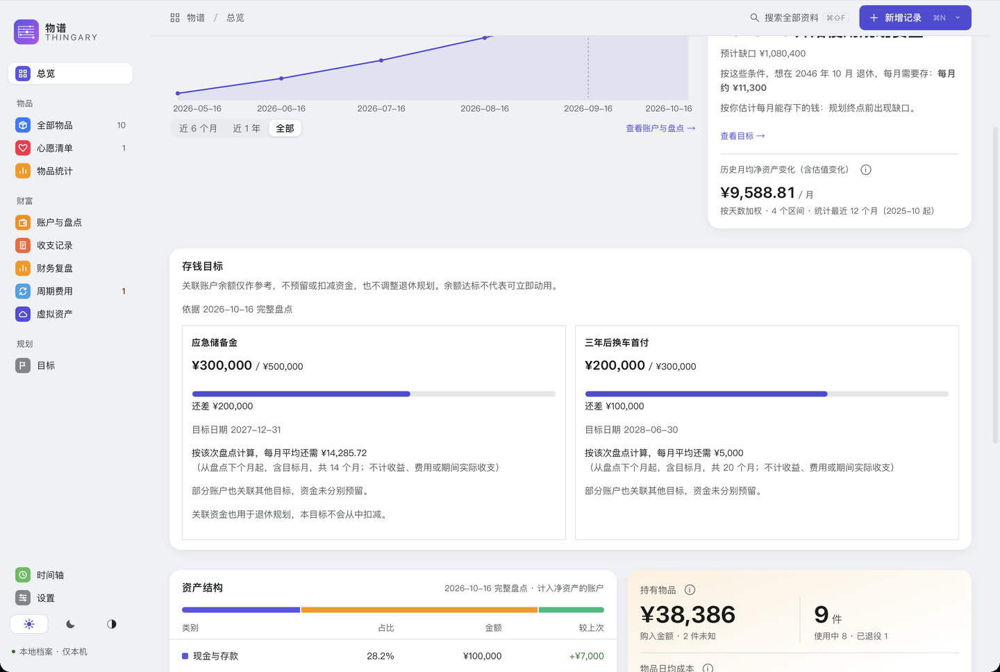
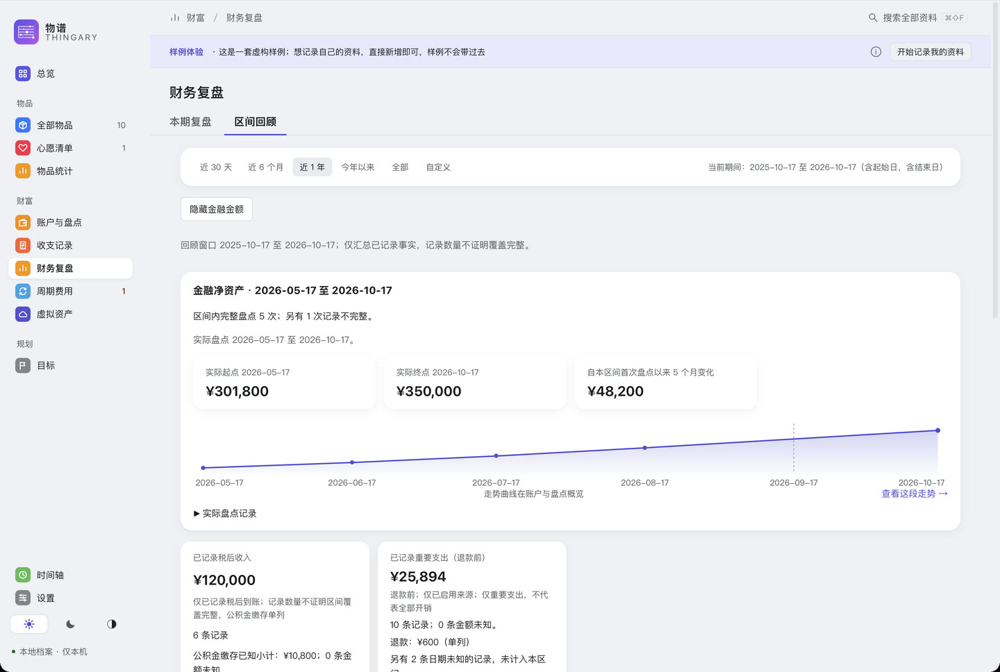
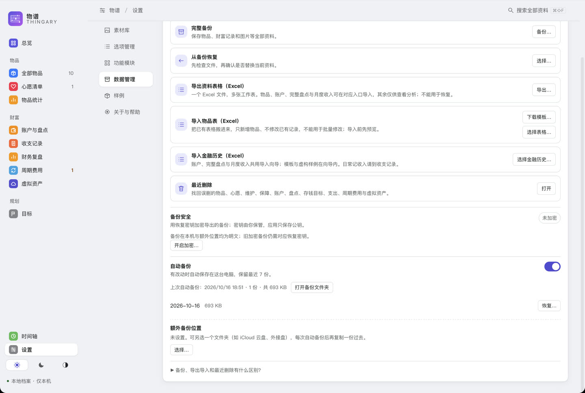

# 快速上手

十分钟内完成第一次盘点，看到第一个结论。想了解每个功能的细节，见[完整使用指南](USER_GUIDE.md)。

## 1. 安装

到 [0.0.8 下载页](https://github.com/CoderJackZhu/Thingary/releases/tag/v0.0.8)（国内可用 [Gitee 镜像](https://gitee.com/CoderJackZhu/thingary/releases)），在附件里选自己的平台；下载页里的 Source code 是源码，不是安装包。

- **Mac**：下载 `Thingary-0.0.8-universal.dmg`（Apple Silicon 与 Intel 通用），打开后把「物谱」拖进「应用程序」。
- **Windows**：下载 `x64-setup.exe`，运行安装器（简体中文，只安装给当前用户）；缺少 WebView2 时会在线安装，需要联网。

**Mac**：安装包只做了本地临时签名，没有经过 Apple 公证，首次打开可能被拦住：到「系统设置 › 隐私与安全性」，在底部选「仍要打开」。更多排查见[安装与故障排查](USER_GUIDE.md#download)。

**Windows**：安装包未签名，可能出现 SmartScreen「Windows 已保护你的电脑」：点「更多信息 › 仍要运行」。详见[Windows 安装](USER_GUIDE.md#windows-install)。

首次打开先看到的是**虚构样例**，随便点，不影响你的资料。

## 2. 盘第一次账户

点顶部「开始记录我的资料」，选「先盘点账户」。对照银行、支付宝、券商等平台，逐个录入余额和欠款，零余额填 0。完成后就能看到净资产。

账户类型包括现金、投资、公积金、贷款，也支持房产、个人养老金、保险现金价值和黄金。房产固定不计入金融净资产，保险默认不计入。详见[账户与盘点](USER_GUIDE.md#first-snapshot)。

## 3. 回答三个问题

到「目标」，填目标时间、生活预算和预计每月能存的钱：

- **每月要存多少**：按固定目标月份反推。
- **什么时候能不靠工资**：按你的投入估算财务独立时间。
- **歇一阵能撑多久**：临时试算，不用先设目标。

结论会写明哪些条件未知或待核对，不会把缺项当成零。更多见[规划入门](USER_GUIDE.md#planning)。

## 4. 存钱目标与区间回顾

想攒一笔钱，在「账户与盘点」概览或总览里设「存钱目标」，选关联账户，每次盘点后看进度。目标只做参考，不会冻结或预留资金。

随时到「财务复盘 › 区间回顾」查看近 1 年，也可选近 30 天、今年以来、全部或自定义期间（自然年在自定义面板里按年份快捷选择）。净资产按实际盘点日期展示，存钱目标显示当前进度及依据日期；缺项和范围变化会如实说明，只列端点、金额与变化，点「查看这段走势」可到账户与盘点概览看曲线；复制摘要默认不含金额和名称。

## 5. 备份

录入后先做一次完整备份，再决定要不要加密：到「设置 › 数据管理」。默认不加密、自动备份照常运行；想加密就开启「备份安全」，恢复密钥由你保管，应用只存公钥，丢了无法找回。

自动备份和主资料在同一台电脑，请另外保留一份异地备份。恢复、换机与更新见[完整指南](USER_GUIDE.md#backup)。

## 物品档案（可选）

不记账户也可以只整理物品：点「先整理物品」，填名称和价格即可，日期、照片、保障以后再补。未知的金额和日期会显示「待补充」，不当作 0。

外币账户可手填汇率，历史金额保持保存时的折算值；具体操作见[外币账户](USER_GUIDE.md#外币账户)。

## 已知限制

- **平台**：Mac 在 Apple Silicon、macOS 27 验证；Intel 与 macOS 14 尚未实机验证。Windows 10 1809+／11 x64 的安装包未签名，首次运行可能出现 SmartScreen 提示（点「更多信息 › 仍要运行」）；若 Windows 11 开启了「智能应用控制」，未签名安装包可能被直接拦截且没有放行按钮，请见[Windows 安装](USER_GUIDE.md#windows-install)。
- **未完整验证**：Mac 的通知送达、VoiceOver 与完整键盘路径、系统显示缩放；Windows 的无 WebView2 机器、Windows 10、多屏和 100%／125% 缩放、讲述人与输入法。
- **恢复**：恢复页是「选择备份文件＋粘贴恢复密钥」，没有直接选密钥文件的入口。
- **加密范围**：只加密导出的备份文件；主资料库、图片和恢复前保护副本未加密。
- **不做**：日常流水记账、行情交易、自动付款、跨设备同步。

用过之后想说说感受（卡在哪、哪里看不懂、有没有用），填[使用反馈](https://github.com/CoderJackZhu/Thingary/issues/new?template=usage_feedback.yml)；遇到错误请提[缺陷报告](https://github.com/CoderJackZhu/Thingary/issues/new?template=bug_report.yml)。请遮住真实资料，不要上传数据库或备份。
