# 物谱使用说明

> 本文跟随当前源码。“更新今天的余额”、首次样例优先等等新操作尚未包含在 0.0.8 安装包；使用 0.0.8 请看[对应版本指南](https://github.com/CoderJackZhu/Thingary/blob/v0.0.8/docs/USER_GUIDE.md)。已发布功能以版本说明为准。

> 推荐在网站阅读[按主题整理的使用指南](https://thingary.jackzhu.top/guide/)或[快速上手](https://thingary.jackzhu.top/quickstart/)。本页保留完整参考和旧版软件使用的链接锚点；无需从头读完。离线也可阅读[快速上手源文档](QUICKSTART.md)。

物谱帮你每月盘一次家底：把各平台的余额和欠款录一遍，看净资产怎么变；再按自己的条件算每月要存多少、什么时候能不靠工资。重要物品的档案是可选功能。不需要编程、注册账号或联网使用。除 Mac 与 Windows 电脑版外，另有 iPhone 版（即将推出，TestFlight 测试中，尚未上架 App Store），见[iPhone 版](#iphone)。

[下载安装](#download) · [第一次盘点](#first-snapshot) · [第一件物品](#first-record) · [日常操作](#modules) · [规划入门](#planning) · [职业试算](#career-trial) · [iPhone 版](#iphone) · [备份与恢复](#backup) · [更新与换机](#update) · [常见问题](#faq) · [当前限制](#limits)

## 三步上手

1. **安装并先看样例**：按[下载安装](#download)装好，首次打开直接进入全功能虚构样例，随便看看；不想看到的功能以后可在设置里关闭。
2. **盘第一次账户**：先看看样例，准备好后点顶部「开始记录我的资料」，到「账户与盘点」点「添加第一个账户」，对照银行、支付宝、券商等平台逐个录入余额和欠款（零余额填 0），完成后就能看到净资产。详见[第一次盘点](#first-snapshot)。
3. **看第一个结论**：到「目标」填目标时间、生活预算和预计每月能存的钱，查看每月需要存多少、预计何时财务独立。详见[规划入门](#planning)。

之后每月或每季盘一次即可，不用记每天的流水。想存够一笔钱，可以在「账户与盘点」概览里设「存钱目标」，每次盘点后看进度；随时到「财务复盘 › 区间回顾」查看近 1 年，也可选近 30 天、今年以来、全部或自定义期间。备份可以用恢复密钥加密，密钥要自己保管，丢失无法找回。录入重要资料后，请[做一次完整备份并异地保存](#backup)。想先给物品留档，也可以在首次引导勾选「整理我的物品」，见[第一件物品](#first-record)。

本页描述当前主分支的操作。财务工作区、政策测算退出与当前报告预览已接入源码并完成对应核心验证；公开安装包的内容以其版本说明为准。截图来自虚构资料，来源与更新范围见[截图维护清单](https://github.com/CoderJackZhu/Thingary/blob/main/docs/images/README.md)，不表示全部原生功能已验收。

下载与安装步骤对应 **0.0.8 公开测试版**，用于收集使用与兼容性反馈。安装包与版本说明见 [0.0.8 Release](https://github.com/CoderJackZhu/Thingary/releases/tag/v0.0.8)。若某个 Mac 版本没有 DMG 附件，说明该版本尚未提供 Mac 安装包；维护者的本机安装状态不代表已公开发布。

安装步骤对应 0.0.8，其他操作描述当前源码；公开安装包所含功能以对应版本说明为准。Windows 的安装与平台差异见下文。目标页、财务复盘与区间回顾采用 0.0.8 原生虚构图，其他功能截图的版本见截图清单。0.0.3 及更早的包不含这些新界面。更新兼容性与验证范围见[0.0.8 发布说明](https://github.com/CoderJackZhu/Thingary/blob/v0.0.8/docs/releases/v0.0.8.md)。

## iPhone 版

iPhone 版与电脑版出自同一个应用，记录与测算用同一套口径，界面按手机重新设计。目前正在 TestFlight 测试，**尚未上架 App Store**；上架后以 App Store 页面为准。本指南其余章节的安装、快捷键和更新检查等步骤针对电脑版，iPhone 上请看本节与各章里标明「iPhone」的小节。

**手机上有什么**：底部五个标签。「总览」看物品日均成本、金融净资产、退休规划卡（「按现在的节奏，还要上班约 N 年 M 个月」，下面一条进度条用金额说明已有多少、现在退休约需多少、还差多少；隐藏金融金额时这些金额也隐藏）、待处理事项与近期记录；「物品」含物品、心愿与统计；「财富」含账户、盘点记录、支出、周期费用、虚拟资产与财务复盘；「规划」含目标、测算详情与试算，可选一个人或两个人一起算；「我的」含时间轴、搜索全部资料、设置与数据管理。关闭的功能模块会隐藏对应入口，资料不删除。

**手机上的操作习惯**：
- **新增在右下角**：物品、心愿、支出、周期费用和虚拟资产的新增按钮都是右下角的圆形「+」，顶部不再重复放新增。
- **下拉刷新**：在「总览」「物品」「财富」页面顶部往下拉，松手后重新读取资料。
- **左滑操作**：心愿左滑可「不再考虑」（已不再考虑的可「重新考虑」）；「最近删除」里左滑可「恢复」或「永久删除」，永久删除会先确认。
- **物品筛选**：「筛选与排序」里的改动立即生效，底部显示「共 N 件」，「清除条件」随时可点。
- **批量操作**：打开时不预选动作，先选一个动作才能保存；「删除」排在最后，物品会进入「最近删除」。
- **隐藏金融金额**：开关是全局的，在「财务复盘」里点也会同时隐藏所有页面的金融金额。
- **首次打开**：「开始记录」是主按钮；「先看看样例」「从备份导入」「以后再说」是下面的文字链接。
- **支出明细**：点物品类的支出会在当前页面打开物品详情，点「返回」回到支出页；明细较长时点整行的「显示更多」继续看。

**手机和电脑各有一份资料。** 两边是互相独立的资料库，没有账号、没有云端，也不会自动同步；在一边录入的内容不会出现在另一边。要把资料带到另一台设备，用完整备份导出、再导入，见[在 iPhone 与电脑之间搬资料](#phone-transfer)。

**手机版没有的功能**：金融表格导入向导、投资流水核对、职业变化的地图版（手机用表单版）、桌面快捷键和应用内检查更新。自动备份只保留这台手机上的最近 7 份，没有额外备份位置，请自己导出备份并保存到手机以外的地方。

- **财富页**：「概览」只放金融净资产、待确认的周期费用付款、趋势、对比和结构，右下角的「盘点」按钮是这一页的主要动作；账户清单在「账户」分段，那里右下角是「新增账户」。重要支出、周期费用、虚拟资产和财务复盘的入口都在概览底部的「更多财富记录」，每项只出现一次。
- **盘点页**：只有底部一个「保存本次盘点」。漏填时会滚到第一处缺项，那一行变红并写明原因；保存后回到财富页，提示「已保存 10月22日 的盘点」。盘点途中改日期，如果已经填过内容，会问「切换并放弃输入」还是「继续编辑」，什么都没填就直接切换。
- **放弃修改**：新增或编辑账户、盘点、物品、心愿、支出和周期费用等弹出的表单，有改动时点「取消」或从屏幕边缘右滑返回，会先问「放弃这次修改？」，选「放弃」才丢弃，「继续编辑」回到表单。没有改动时直接关闭。
- **金额输入**：「增减金额」「份额变化」这类可正可负的输入框旁有「±」按钮，点一下在正负之间切换。数字键盘上方有「下一项 / 完成」栏：盘点页的「下一项」跳到下一个没填的账户，其他表单跳到下一个输入框，「完成」收起键盘。
- **停用账户**：账户详情页右上角「编辑」是修改资料的唯一入口。「停用账户」弹出确认框，选停用日期（晚于上次盘点和启用日，不晚于今天）后停用，账户之后不再出现在盘点里，历史保留；已停用的账户在同一位置可「重新启用」。「更新余额」不能用时，按钮下面会写原因。
- **弹窗按钮位置**：弹窗左上角是「取消」，右上角是「完成」或「保存」；只读的弹窗只有右上角的「关闭」；整块的底部按钮只用于确认类弹窗（例如「放弃」「停用」「删除」）。
- **照片**：在「物品 › 新增物品」点「拍照建档」用相机拍摄，或点「从相册选」从照片图库选取（可多选，每件物品最多 20 张），第一张作为封面。首次使用时按系统提示允许相机或照片访问。
- **账户分组**：在「财富 › 账户」点「管理分组」（编辑账户时在「分组」里选「管理分组…」也能进入），可新建、改名、上移下移排序和删除；删除前会说明有几个账户变为未分组，账户本身保留。
- **最近删除**：「我的 › 设置 › 最近删除」可恢复或永久删除所有类型的记录，包括关联订阅：点一项后选「整组恢复」或「永久清除…」，会先读取并列出影响（与电脑版相同的确认内容）再提交。
- **面容 ID 与屏幕隐私**：在「我的 › 设置 › 隐私」设置，见[隐私与资料安全](#privacy)。
- **提醒**：保修到期、付款、盘点和心愿提醒都是本机通知，见[心愿完成与系统通知](#phone-notifications)。
- **报告 PDF**：在「规划」的目标页打开「当前报告」，点「导出当前报告」生成 PDF，并通过系统分享面板存到「文件」、发给自己或打印；可先打开「隐藏金额和私人名称」。
- **更新**：由 App Store 管理，物谱不检查更新，见[iPhone 版的更新](#phone-update)。

## 下载、安装与首次打开

### 选择正确的文件

从 0.0.5 起提供 **通用安装包**，Apple Silicon（M 系列）与 Intel Mac 都下载同一个 `universal.dmg`。当前只在 Apple Silicon、macOS 27 验证，尚未实测 macOS 14 和 Intel Mac；Windows 10 1809+／11 x64 见[Windows 安装](#windows-install)；暂无 Linux 客户端。

1. 在 [GitHub 上的 0.0.8 Release](https://github.com/CoderJackZhu/Thingary/releases/tag/v0.0.8) 打开对应公开测试版（标有 Pre-release）。**GitHub 打不开时，改用国内镜像 [Gitee 发行版](https://gitee.com/CoderJackZhu/thingary/releases)**，两处的安装包内容相同，可用 `SHA256SUMS.txt` 核对。
2. 在附件（Assets）中下载 `Thingary-<版本>-universal.dmg`（0.0.4 及更早版本为 `arm64.dmg`）。`Source code.zip` 与 `Source code.tar.gz` 是源码，不是安装包。
3. 双击下载好的 DMG，将「物谱」拖到同一窗口里的「Applications／应用程序」文件夹。
4. 等待复制完成，在 Finder 的「应用程序」中双击「物谱」。安装后可推出 DMG；无需一直保留挂载窗口。不要直接从 DMG 运行应用。

### 首次被 macOS 阻止打开

首发安装包使用本地临时签名，未经过 Developer ID 签名和 Apple 公证。

1. 先尝试从「应用程序」打开一次物谱。
2. 若提示无法验证开发者或 Apple 无法检查该应用，打开「系统设置 › 隐私与安全性」。
3. 向下找到本次物谱的阻止提示，确认文件来自本项目的 Release 后，点「仍要打开」，再确认「打开」。

这是针对该应用的例外，不需要关闭整个系统的安全保护，也不需要使用终端。如果没有该按钮，或出现「将损坏你的电脑」「已损坏」等其他提示，停止操作并看[故障排查](#faq)，不要把不同提示都当作同一种拦截。受管理的 Mac 可能需要联系管理员。

步骤依据 [Apple 官方打开说明](https://support.apple.com/zh-cn/102445)。

### Windows 安装

目标为 **Windows 10 1809+／Windows 11 x64**，安装包未签名。安装、通知和界面验收未全部完成，详细范围见[Windows 验收清单](https://github.com/CoderJackZhu/Thingary/blob/main/docs/WINDOWS_ACCEPTANCE.md)。ARM 机器运行 x64 应用依赖系统模拟，不等同于原生 ARM 安装包。

1. 在 [0.0.8 Release](https://github.com/CoderJackZhu/Thingary/releases/tag/v0.0.8)（或 [Gitee 镜像](https://gitee.com/CoderJackZhu/thingary/releases)）的附件里下载 `x64-setup.exe` 与 `SHA256SUMS.txt`。
2. 用 `SHA256SUMS.txt` 核对文件后运行 `.exe`。安装器使用简体中文，只安装给当前用户；通常不需要管理员权限。缺少 Microsoft Edge WebView2 时会在线下载并安装运行时，这一步需要联网。
3. 包尚未签名，首次下载可能出现 SmartScreen“Windows 已保护你的电脑”。确认来自本项目、校验值一致后，可展开“更多信息”查看并选择“仍要运行”。若提示恶意软件、没有该选项或设备策略禁止运行（例如 Windows 11 开启了「智能应用控制」，它可能直接拦截未签名安装包且没有放行按钮），请保留完整提示并反馈，不要为此关闭整机的系统保护。
4. 从开始菜单打开物谱，先查看虚构样例。录入自己的资料前确认应用名称为「物谱」：名为 `Thingary Windows Acceptance` 的是独立验收包，只可使用虚构数据，不能当作正式安装。

应用安装目录中的 `许可/BUILD_INFO.json` 列出版本、完整源码提交、资料身份与第三方告知散列；可用它核对安装包来源。程序代码、第三方许可全文和源码入口同在 `许可/`。

Windows 选图仅接受 **JPEG、PNG、WebP**；HEIC／HEIF 请先另存为 JPEG 或 PNG，原图自行保留。Mac 继续使用系统支持的图片格式。应用正常使用无需联网；安装器下载 WebView2 与主动检查更新分别需要网络。

### 先看看样例，再开始记录

首次打开直接进入独立的虚构样例库，顶部醒目显示「先看看样例」。可以浏览和修改样例，它们不会混进自己的资料。

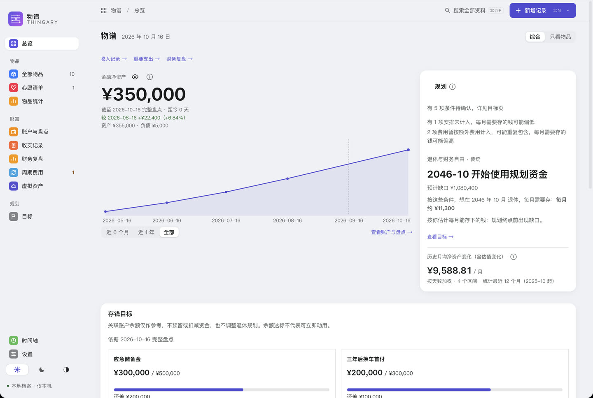

图中为 0.0.6 内置虚构样例，已保存目标条件仍有待确认项；这里只说明布局，不表示这些条件已被核实。

首次打开不再先问用途：所有功能默认开启，先在样例里随便看。准备好后点顶部醒目的 **「开始记录我的资料」** 进入自己的空白资料，侧栏里的各项功能照常可用。不想看到的功能，可在「设置 › 功能模块」按用途（**盘一盘我的钱、整理我的物品、为以后做计划**）或逐项关闭，已有资料会保留。

真实录入时确认顶部没有「样例体验」。顶部横幅同时提醒：资料只存在这台电脑、不上传、未加密，自动备份在本机，建议之后添加额外备份位置。

侧栏直接显示已开启的功能。默认保留全部，暂时不用的用途或功能可在设置中关闭，已有资料会保留；以后重新开启即可恢复入口。

以后到「设置 › 功能模块 › 重新选择用途」调整，或直接使用下面的细项开关。取消不会生效；关闭入口会隐藏功能，资料保留，随时可以打开。关闭的用途重新开启时，该用途下的功能会全部开启。用途窗口可以按 Tab 切换、空格勾选，按 Esc 或「取消」放弃；保存或取消后，焦点回到「重新选择用途」。小窗口中底部操作保持可见。取消物品用途会暂停心愿提醒，取消钱用途会暂停订阅续期与盘点提醒；用途窗口会按取消项说明，保障提醒不受影响，重新开启后按原设置安排。不会根据你的操作自动改变这些设置。

## 五分钟入门：完成第一次账户盘点

如果只想记录物品，可以跳过本节；需要时在「设置 › 功能模块」启用「账户与盘点」。

无账户时，可先点 **“导入已有的资产表格”**，进入设置 › 数据管理的金融导入；对话框可保存现有 Excel 模板。没有表格时，点“手动添加第一个账户”，按下列步骤填写。

1. 进入左侧「账户与盘点」，点「新增账户」。名称填「日常银行卡」，类型选「现金与存款」，平台可留空，点「保存账户」。启用日期不要晚于这次盘点日期；不需要卡号或登录信息。保存后页面会出现「已添加『日常银行卡』」，可选择「继续添加账户」或「去填写余额」；直接关掉提示也没关系，随时可以开始盘点。
2. 点「更新今天的余额」，核对今天的日期。假设这张银行卡余额为 10,000 元，在金额栏填 `10000`。
3. 填写每个应盘点账户的当前余额，零余额填 0，填齐后点「保存今天的余额」。本例只有一个资产账户，金融净资产为 **10,000 元**。
4. 下次约一个月后再核对余额；至少两次完整盘点后才能比较账户变化，不需要逐笔录入每天的消费。

需要记录信用卡或贷款时，另建对应负债类型账户，只填仍需归还的正数欠款；信用额度不作为余额。负债从金融净资产中扣除，下图的单账户例子没有负债。

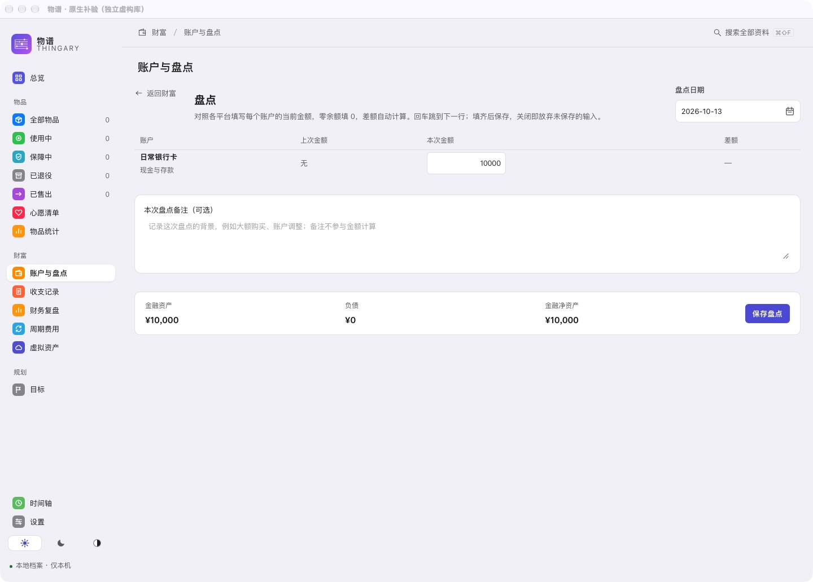

保存成功后回到「概览」，即可看到账户、资产与负债汇总。已有前次完整记录时，点「看哪些账户变化了」查看这次变化；需要时再调整计划。想补记或更正过去的记录，请从盘点记录进入，选择对应日期。

金额旁的「这次填写」「沿用旧金额 · 最近填写日期」「这次金额待填写」说明它是否在这次核对过。未知不会显示成旧余额或零；未列入本次记录的账户另行标注，不计入本次分组小计。

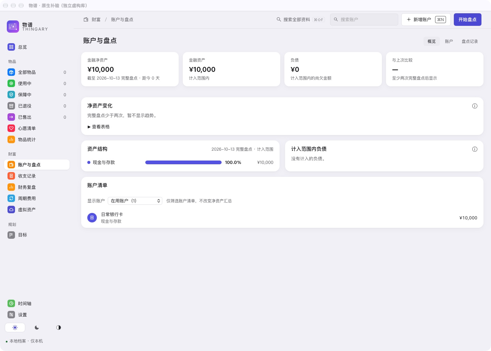

本节首次盘点的两张图片来自既有独立原生验收样例，全部使用虚构资料；总览、起步选择和新增物品的更新图也来自隔离身份的原生应用。安装步骤图是示意图，逐图来源见[截图清单](https://github.com/CoderJackZhu/Thingary/blob/main/docs/images/README.md)。

前面电脑的 5,000 元是购入记录，**不加进这 8,000 元金融净资产**；如果银行卡余额已反映购买电脑，不要再从余额中扣一次。净资产变化也不等于投资收益。每次盘点都填写账户的当前数值；旧版缺失金额仍保持为空，不能当成 0。

### 其他账户类型

房产记录估值，固定不计入金融净资产；保险填写现金价值，不填保额或累计保费，默认不计入，可手动开启。个人养老金、黄金与贵金属默认计入，公积金和个人养老金的余额不代表能立即提取。房贷单独记录，不会自动和房产估值抵扣。应收款记借给别人、还没收回的钱，默认计入；对方还钱后把余额改小，全部收回后停用账户。车辆记录当前估值，默认不计入金融净资产，需要时可以手动开启。

房产和车辆可在账户表单的备注前选填“购入价”和“购入日期”，两项可只填一项。账户清单用最近已知估值显示相对购入价的涨跌，不把购入价加进净资产或规划；购入价未知不显示涨跌，尚无估值显示“尚未估值”，购入价为零只显示涨跌金额。要改成其他类型，请先清空两项并保存，再更改类型。

### 为一笔钱设置存钱目标

进入「账户与盘点 › 概览」，点击顶部「存钱目标」可直接定位，如果还没有可关联账户，先点「先添加资产账户」，保存或取消账户表单后会回到这里。有可关联账户后，再点「新增存钱目标」，填写名称、金额、可选目标日期，至少选择一个资产账户。账户余额还没填写也可以先设目标，进度暂时未知。每个目标按最近一次完整盘点的关联余额显示进度，并标明日期；缺金额或账户不可用时先补资料，不会当作零。

尚未建立目标时，首页不显示目标卡片。建立后，首页下部显示最多两个目标的当前进度与缺口，点「管理目标」可直达完整管理区域。

填写未来目标日期后可查看从基准盘点估计的每月需存；同月、今天或逾期分别提示剩余缺口，不编造月数。查看依据可展开账户和按当前设置回看的历史趋势，历史只到目标创建日为止。删除的目标可在最近删除恢复。

关联只是观察余额，不预留资金。多个目标可以使用同一账户，进度不能相加；它也不会扣减退休规划可用资金，若一笔钱同时用于首付与退休，需自行调整安排。表格导出能查看目标及关联，不能用这两张表回导；完整恢复请使用完整备份。

## 五分钟入门：记录第一件物品

以下金额与名称只是例子，开始记录自己的资料时请按实际情况填写。

1. 在左侧进入「全部物品」，点右上角「新增物品」。
2. 名称填「我的笔记本电脑」。只填名称也能保存；分类、标签、购买渠道直接显示，也可以以后再补。
3. 如果实际购入价是 5,000 元，在「购买价格」填 `5000`，选择实际「购买日期」。新建日期默认留空，心愿转购入默认今天；不知道金额或日期就留空，**不要用 0 代替不知道**。
4. 点击图标（手机上是顶部居中的图标，角上有 ⇄ 小标）选择封面。名称、购买价格、购买日期、分类、标签、购买渠道都直接显示；备注是一个大框，文字下方是图片缩略图和「添加图片」格（点缩略图可看大图）。保障时间、已退役、已售出是开关，打开后出现各自的日期与金额；成本计算模式、目标设定直接选择；只有品牌、型号、序列号收在一行里（已有内容时自动展开）；最底下是置顶物品和不计入统计。手机上添加图片会先问「拍照」还是「从相册选」。
5. 点顶部「保存物品」，保存后进入完整档案。点左上角「全部物品」回到列表；单击物品查看右侧摘要，双击或点「打开完整档案」查看和更正资料。

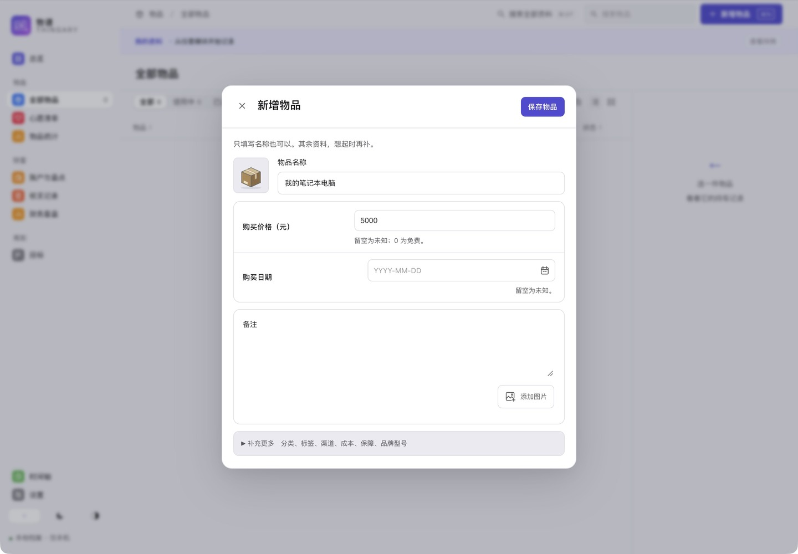

先记录最值得留档的几件物品即可，不必一次填完所有信息。普通表单点叉会丢弃未保存输入；已点击保存但结果未知时，请按提示核对原请求，避免重复提交。收入、账户盘点等财富记录关闭表单或重启后，可在页面上方点“核对保存结果”；金融导入点“前往数据管理核对导入”。物品保存仍按原恢复提示核对。读取失败会保留原请求，可再试一次。

## 先保护资料：完整备份与恢复

### 做一次完整备份

1. 录入第一批自己的资料后，进入「设置 › 数据管理」。
2. 在「完整备份」旁点「备份…」（默认是明文备份，想加密先在「备份安全」开启加密），选择保存位置，等待应用提示备份完成。
3. 保存的是 `.thingary` 或加密的 `.thingary.age` 文件，包含物品、账户盘点、心愿、支出、周期费用、虚拟资产与图片等完整资料。
4. 把它再复制一份到外接盘或你自己管理的云盘，确认副本确实存在；不要只留在原机。已开启备份加密时导出为 `.thingary.age` 密文；未开启时备份内容未加密，请选可信的位置。

自动备份开关默认开启，首次明确选择备份安全方式后才会运行；它与主资料放在同一块磁盘上，不能防止整块磁盘损坏。详细行为见[记录与保护资料](#records-and-protection)。

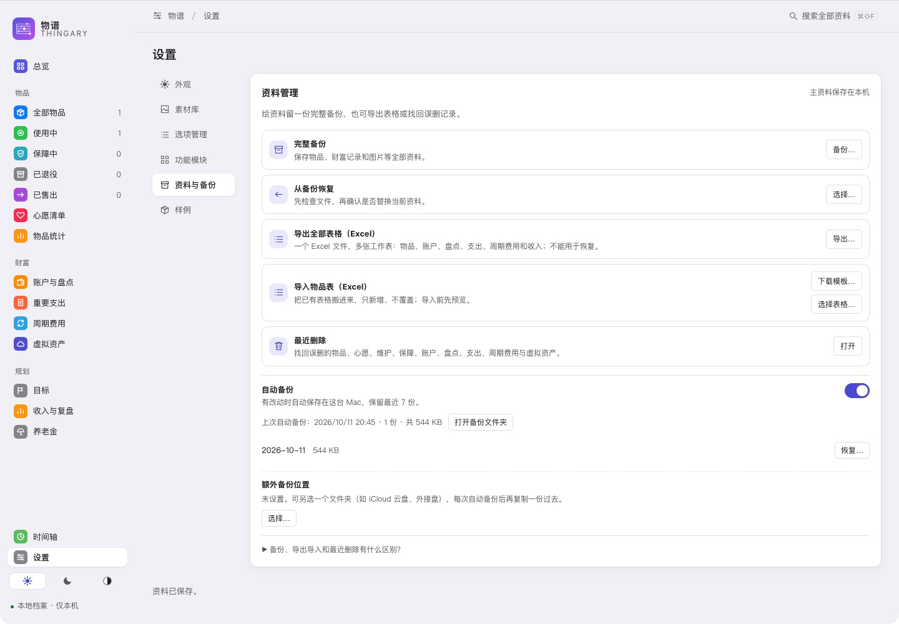

### 从备份恢复

先为当前资料另做一次完整备份，再在「设置 › 数据管理 › 从备份恢复」点「选择…」，选 `.thingary` 或加密的 `.thingary.age` 文件。加密备份先输入恢复密钥，或选择已保存的密钥文本文件（最多 64 KiB），再点“解密并检查”。选择文件只填入本次输入，不会保存密钥。阅读检查摘要，确认后替换当前资料。同机恢复会保留身份验证、失焦遮挡和金额隐藏等本机偏好。恢复是整体替换，不是合并；恢复前会在本机保存未加密保护副本。表格只用于分析和已支持的数据导入，不能代替完整备份恢复。

### 备份加密与恢复密钥

「设置 › 数据管理 › 备份安全」管理加密。首次使用先选择启用加密或继续明文，选择前自动与额外备份暂停；继续明文后可随时点「开启加密…」。启用时应用生成一个恢复密钥并只显示一次，请自行保存到与备份不同的位置，然后重新输入该密钥完成验证；应用只保存派生的公钥。丢失恢复密钥就无法打开对应备份，也无法找回。密文可用标准 `age` 命令行工具解密：`age -d -i 恢复密钥.txt -o 解密.thingary 备份.thingary.age`。轮换密钥后旧密文仍用旧密钥；关闭加密不删除已有密文。主资料库、图片与恢复前的保护副本始终未加密；删除临时文件不等于安全擦除。Windows 备份暂存目录仅允许当前用户与 SYSTEM 访问；无法确认权限时本次备份会停止，主资料目录权限不作更改。

生成、检查或解锁备份期间可点「取消本次备份操作」；启用或轮换后的首份加密备份可点「取消本次加密备份」。取消请求后仍需等待清理和原操作结果，未结束前不要重复操作；已发布的成品保留。首份备份取消不代表撤销已经验证的加密策略，请分别核对策略状态和首份备份结果。最终确认替换资料后不提供运行中取消；结果未知时使用「核对恢复结果」只读核对原会话，不重复恢复。

### 在 iPhone 与电脑之间搬资料

手机和电脑的资料库互相独立，唯一的搬运方式是完整备份：

1. 在来源设备做一次完整备份。电脑按上文「设置 › 数据管理」备份；iPhone 在「我的 › 数据管理」点「立即备份并分享…」，在系统分享面板选「存储到文件」，或用隔空投送、邮件等发给自己。分享被取消时，备份文件仍保留，可在「文件」App 的物谱目录找到。
2. 把 `.thingary` 或加密的 `.thingary.age` 文件送到目标设备（iCloud Drive、隔空投送、数据线或你自己的网盘均可）。加密备份还需要你单独保管的恢复密钥，丢失无法找回。
3. 在目标设备恢复。电脑在「设置 › 数据管理 › 从备份恢复」选择文件；iPhone 在「我的 › 数据管理 › 从备份恢复」点「选择备份文件…」，加密备份先输入恢复密钥，阅读检查摘要后再确认。
4. 恢复是整体替换，不是合并：目标设备上原有的资料会被替换（恢复前应用会先在本机保存保护副本）。因此不要把两边各自录入的内容当作可以合并；先决定以哪一边为准，再为另一边的现有资料另做完整备份。恢复后核对物品、账户、金额、未知值和图片。

iPhone 的「我的 › 数据管理」还提供「导出表格」（Excel 工作簿，只供分析，不能用于恢复）和「备份安全」（恢复密钥加密，开启后「立即备份并分享…」导出的是加密文件）。外观、面容 ID 等本机偏好不随备份迁移，需要在新设备上重新设置。手机和电脑版本不同时，较新版本的资料不能保证被较旧版本读取，详见[更新、换机与卸载](#update)。

## 样例体验

打开软件默认进入「总览」。首次使用会进入独立的虚构样例库，包含物品、心愿、保障、账户与历史盘点、重要支出、周期费用和虚拟资产。顶部先显示醒目的「先看看样例」，之后为「样例体验 · 虚构资料，改动不影响你的资料」；旁边说明按钮可查看样例完整规则。

- **可以编辑和删除样例**：这些操作只改变样例库。删除物品在「编辑资料」表单中点「删除物品」（本次修改不保存），确认后可从「设置 › 数据管理 › 最近删除」恢复。
- **最近删除里有一条样例心愿**：展示心愿也能删除与恢复（新建或重置样例后才有）。
- **样例不接受新增物品**：在样例中点「新增物品」会回到自己的资料并打开新增表单；心愿的「已买到，记录购入」也会新增物品，样例中会被拒绝。心愿、账户、支出等其他记录仍按原规则留在样例中。
- **开始记录自己的资料**：先点顶部「开始记录我的资料」，再在任意模块添加；取消或保存失败不算开始记录。
- **再次查看样例**：「设置 › 样例 › 查看样例」会保留上次的样例修改；顶部「返回我的资料」随时返回。
- **恢复初始样例内容**：「设置 › 样例 › 重置…」，确认后重建完整样例，自己的资料不受影响。
- **删空自己的记录**：自己的资料不会被填入样例。只要自己的资料里还有记录（包括「最近删除」中的），启动时默认进入自己的资料；全部永久删除后，下次启动会先显示样例，点顶部「返回我的资料」即可回到空白的自己的资料。
- 编辑或核对未确认的保存结果期间，需要先结束当前操作才能切换。样例不发送系统通知；备份、恢复和导出须在自己的资料中操作。

## 界面与导航

- **侧栏：**「物品」组只保留「全部物品」「心愿清单」「物品统计」，后两项随功能模块设置显示；「时间轴」与「设置」在侧栏底部，底部的太阳、月亮、半明半暗三个按钮分别是浅色、深色和跟随系统，同一时间只有一个高亮。
- **素材库**是「设置」里与「外观」并列的分组，在里面浏览、搜索素材并「添加图片」；**最近删除**在「设置 › 数据管理」，点「打开」进入，用「返回设置」按钮、面包屑或 Esc 回到原分组。
- **物品状态：** 在列表工具栏用「全部｜使用中｜已退役｜已售出」切换，数字表示各状态的物品数量。切换回到第一页，保留分类、标签、搜索与排序。「保障中」通过「筛选 › 保障 › 有有效保障」查看；只选「全部」状态时标题为「保障中」，另选状态时按状态显示标题。选择「金额待补充」或「日期待补充」后，状态分段没有选中项；点击任一状态会替换该资料筛选。「清除条件」同时清除状态、保障、资料和其他筛选。
- **物品分类栏：** 分类放不下时，末尾出现「更多分类」菜单，可搜索、用方向键选择，Enter 选中，Esc 关闭并回到按钮；选中的分类会显示在栏内。窗口很窄时整行收成一个选择按钮，状态分段与其他操作可换行。「全部」和「未分类」始终固定可选。
- **心愿清单**筛选顺序为「全部｜考虑中｜已购入｜不再考虑」，默认「全部」，历史待核实的旧记录在「全部」和「考虑中」中可见并单独标记；列表列为「心愿｜预计价格｜加入日期｜计划日期」，名称下显示状态、分类与一行理由摘要。页头显示「考虑中 N 条 · 预计价格合计 ¥X（Y 条价格未知）· M 条历史待核实」，合计只是想法的预计价格，不是已发生支出或资金承诺。
- **周期费用**的计划名称、服务覆盖期与说明会自动换行，长说明不会撑宽页面。计划表列为名称、分类、每期金额（带周期单位，非月付另列月均）、下次付款、状态和累计费用（估算或已确认付款）；固定期限的租期预计费用显示在状态下。“到期”清单里月付等 7 天内、年付 30 天内的期次算即将到期。付款记录保留完整日期、金额和状态。

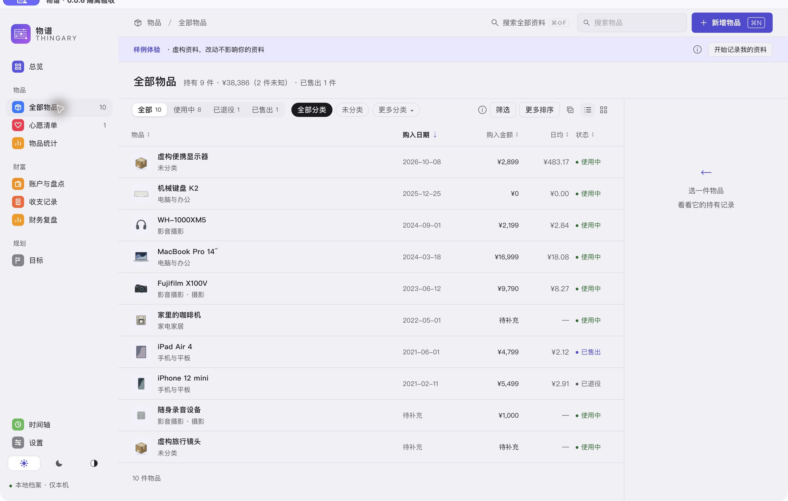

### 语言与币种

在「设置 › 通用」（手机是「我的 › 通用」）里可以选界面语言（自动 / 简体中文 / English；自动时中文系统显示中文，其他显示英文），切换后界面会重新载入，并回到这一页。语言只改变显示，不影响已保存的资料和备份。

同一页还可以选默认币种。新增物品时，购买价格后面的币种按钮默认是它；点开可以在最近使用、常用和全部币种中选择，也能按代码、名称或国家搜索。用外币录入时，金额右边的币种按钮显示币种符号，选了外币后下面会出现「折合 1 美元 = 汇率」和「实际支付 ¥」两格，填其中一格另一格自动算出；信用卡账单上的人民币金额填进「实际支付」最准。汇率默认带出这个币种上次用过的值；没用过时带出应用内置的参考汇率（欧洲央行的快照，会标明日期，只是估算）。新台币、越南盾等内置没有的币种填一次后会记住。想统一改默认汇率，到「设置 › 通用 › 汇率」；应用本身不联网查汇率。记录以实际支付的人民币为准，所以之后汇率怎么变都不会改变已经发生的花费；统计和日均成本按实际支付的人民币计算，物品详情会同时显示原币价格和汇率。账户盘点时，汇率旁会写明「上次 1 美元 = …（日期）」，超过一个月会提醒汇率可能已变化；盘点比较里，外币账户的变化会拆出「其中汇率」影响。价格留空表示未知，不是 0。

## 关于与帮助

「设置 › 关于与帮助」直接显示名称、版本、维护者、「检查更新」按钮与「启动时检查更新」开关，无需再点击关于按钮或打开弹窗。菜单栏「物谱 › 关于物谱」「帮助 › 物谱帮助」也进入这一页；「物谱 › 检查更新…」直接进入并定位更新区域。

检查更新及结果留在本页，打开页面不会联网，只有点击「检查更新」才发起查询；「启动时检查更新」开启后，打开物谱时每天最多自动查询一次公开版本列表，只在界面空闲且解锁时进行，不上传你的资料，下载和安装仍由你决定。开关下方显示上次成功检查（或上次未成功尝试）的时间。自动检查失败不打扰；手动检查失败会显示原因并可重试。数据管理不提供更新区域。「备份与恢复」仍进入数据管理并定位到备份区域，不会开始备份或恢复；菜单栏「帮助」也提供备份入口。外部链接在系统浏览器打开，需要联网；打开失败时保留可复制的地址。DMG 内附有离线「开始使用.html」。

维护者名字可打开 GitHub 主页，页底 Star 提示可打开项目页；是否点赞由你自行决定。版本行右侧直接提供检查更新，结果在下方显示。

发现适用于这台设备的新版本后：侧栏「设置」入口会出现一个小圆点（读作「设置 · 有新版本」），点进本页就能看到版本卡。你实际看到这张卡后圆点消失（下载入口保留）；不想再被这个版本提醒可点「忽略此版本」，之后更高的新版本仍会提示。点击「下载 Mac 安装包」（Windows 版为「下载 Windows 安装包」）即可在浏览器下载匹配文件；Mac 通用包同时适用于 M 系列与 Intel。先做完整备份，下载后退出物谱再安装或替换应用；点下载只代表打开浏览器，不代表已安装，安装后以应用实际版本判断。「其他下载来源」可切换镜像，「发布页与手动下载」用于查看完整发布页面。更高版本只有其他平台安装包时，页面说明当前设备暂不可用，不提示下载错误平台的文件；上次发现的版本超过 7 天未再确认时，圆点不再出现，页面显示上次发现日期，可重新检查。

第一次保存自己的资料后，应用会在合适的普通页面轻问一次「自动发现新版本？」：选择「开启自动检查」即生效；「保持手动检查」（或直接关掉）都会记录为本机已选择，不再主动询问，之后可随时在这里打开开关。样例里不会出现这个询问；它不会与盘点提醒同时弹出。

如果本机更新设置损坏，这里会提供「保持手动并修复设置」与「开启自动检查并修复设置」；选择后先保留损坏原件，再保存你的选择。若设置由较新的应用版本生成，则保留原件并提示使用较新应用，不覆盖它。两种情况下仍可点击「检查更新」手动查询；修复失败会保留错误和重试入口。

「反馈时提供什么」说明问题反馈所需的信息；「开源许可与致谢」提供第三方声明入口，AGPL 许可全文与第三方依赖许可清单可离线查看，默认收起。帮助链接里的「产品主页」打开官网，「使用指南」打开官网按主题整理的使用指南，备份与更新说明也跳到官网对应章节，仍由系统浏览器打开。地址调整用于后续版本；已发布的 0.0.8 及更早安装包保持原行为，写死的 GitHub 地址无法远程替换，所以本文件与原锚点继续保留。

### 隐私与资料安全

**iPhone**：「我的 › 设置 › 隐私」有两个开关。「切到后台时遮住内容」让切换应用或回到桌面时，任务切换器里只看到遮罩。「启用面容 ID」（设备使用触控 ID 时显示为「触控 ID」）让每次打开物谱先验证身份，也可用设备密码验证；设备没有设置面容 ID 或密码时开关不可用。开启后可选「闲置后重新验证」：从不、5 分钟、15 分钟或 1 小时，离开物谱后返回时检查；未完成的编辑、保存或待核对请求会延后到处理完再锁。这只是防止旁人看到屏幕，不加密资料库文件，不能代替加密备份。iPhone 版不联网，也没有检查更新。以下为电脑版的说明。

在「设置 › 屏幕隐私」可开启「窗口不在前台时遮住内容」：离开窗口立即遮住，回来继续编辑，进行中的保存不受影响。

Mac 可开启「启用身份验证」（每次打开物谱需要验证身份），先完成系统验证才会保存开关。下次打开先显示「物谱已锁定」，验证通过后进入；取消或失败时可点「解锁」重试。系统可以用 Touch ID 或登录密码验证；没有设置登录密码或 Touch ID 时开关不可用。开启后才会展开「闲置后重新验证」，可选择闲置 5 分钟、15 分钟或 1 小时后重新验证，默认从不；超过所选时间后离开窗口再回来才锁定。仍在编辑、保存或核对保存结果时会等操作处理完再锁，保留页面。锁定时点击原生关于、备份或检查更新等菜单不会执行，解锁后需要重新点击。

闲置时长只在离开后返回时检查；有未完成编辑、保存或待核对请求时延后验证。需要离开即遮住内容，可同时开启遮挡。两个开关默认关闭，只保存到本机。这只是防止旁人看到屏幕，不会加密资料库文件。可另行创建加密备份；本机资料库文件仍未加密。

没有账号，资料保存在本机，应用不上传资料。资料使用完全离线；只有你开启「启动时检查更新」或主动点「检查更新」时，才会向 Gitee 和 GitHub 的公开版本列表各查询一次，请求与普通网站访问一样带有常规网络信息和应用版本标识，不发送资料、设备或使用信息；主动打开指南、项目或反馈链接后，由系统浏览器访问对应网站。更新开关、已读与忽略版本只保存在这台电脑，不进入资料库和备份。

备份可在「备份安全」启用恢复密钥加密；主资料库、图片与恢复保护副本未加密。自动备份和主资料位于同一台电脑，建议[额外保存一份完整备份](#backup)到外接盘或其他位置；若选择云盘，副本由云盘软件同步。这些说明也可在「关于与帮助 › 隐私与资料安全」离线查看。

**手机物品页**：手机「物品」页顶部有物品／心愿／统计小开关，与标题同一行。下面的摘要卡显示「持有物品总价」（使用中＋已退役中已知购入价之和，不含已售出；有价格未知的会写“N 件价格未知，未计入”，不会当作 0）、日均成本和持有数量（如“7 件 · 1 件已售”）。搜索收在放大镜按钮里，点开才出现输入框；点「批量选择」图标（对勾圆圈）或长按某件物品进入多选；「筛选与排序」图标或上方的“分类：全部 · 购入日期 ↓”文字都会打开筛选面板，分类也在面板里选。新增物品用右下角的悬浮「＋」。「统计」页只放时间段购入、分类分布、趋势等，不再重复摘要里的三项；切换统计里的分段时页面保持当前位置。

## 首页的物品日均成本

总览的“持有物品”主卡和“只看物品”顶部均显示“物品日均成本”：把当前持有各件物品的日均成本相加，含已退役物品与维护费，售出后退出当前合计。下方显示计入与未参与的件数，信息不全时标明“仅已知部分”；没有可计算物品时显示 —，空资料库为 ¥0.00。它是持有成本摊算，不是每天实际付款；金融账户、订阅与房租不参与。

## 列表排序

物品、心愿和财富模块的记录列表使用同一套操作：点击列标题排序，第一次选择其他列按升序，再点同一列切换升降序；↑ 表示升序，↓ 表示降序，↕ 表示可排序。名称按正反顺序，日期按早晚，金额按实际数值比较，不按格式化后的文字排序。Tab 可聚焦表头，回车或空格切换。

| 列表 | 默认顺序 |
|---|---|
| 物品 | 购入日期从新到旧；可点物品、购入日期、购入金额、日均、状态 |
| 心愿（列表视图） | 加入日期从新到旧；可点心愿、预计价格、加入日期、计划日期 |
| 虚拟资产 | 名称升序；可点名称、类型、期限与付款安排（按结束日期）、状态、累计费用 |
| 周期计划与待确认期次 | 下次付款／到期日从近到远；付款记录按期次从新到旧 |
| 重要支出 | 日期从新到旧；金额按列表显示的正负值排序 |
| 账户 | 名称升序；最近金额按所显示的余额或欠款排序，资产与负债类型保持不变 |
| 盘点历史 | 盘点日期从新到旧；可比较净资产、资产与负债金额 |

置顶物品与心愿仍优先显示，组内未知值放最后；按日均排序时按次计算和信息不全的物品也排在最后。持续订阅与永久权益没有结束日，期限排序时放在有限期记录之后；不完整盘点的金融净资产保持未知。不提供按组合说明文字或操作按钮排序。

排序只改变记录的展示，不改变期间、筛选、汇总或历史事实；物品与心愿先对完整结果排序再分页。窄窗口可在列表内横向滚动查看完整列。物品的「更多排序」只补充添加时间、持有时长，选中后按钮显示当前方式与方向，其他列不亮起排序箭头。持有时长从购入日算至今天，已售出算至售出日，包含退役后的持有期间；日期未知放最后。状态按使用中、已退役、已售出分组，降序时倒转。网格没有表头，保留上方完整排序选项。

## 记录与保护资料

从侧栏进入「全部物品」，点右上角「新增物品」（或按 ⌘N），填写名称后即可保存；金额和图片可按实际情况补充。新建购入日期默认留空，心愿转购入默认今天；记录旧物时可通过「选日期」用鼠标选实际日期，也可用键盘输入；日期不确定可清空。其他日期字段也支持鼠标选择和键盘输入。在详情中可更正记录，也可点顶部「删除物品…」，确认后从「最近删除」找回。

名称左侧默认显示箱子。点击可选择图标、立体图标、最近使用的素材或自己的图片；支持分类和搜索。「摄影」分类包含相机、镜头和摄影配件，按常用器材优先排列；「最近使用」仍按实际选择顺序排列。自己的图片可从 Mac 选择，也可拖入或粘贴到选择器。实物照片等通过备注区的虚线「添加图片」入口加入。替换已有图标会把原照片保留为附件；恢复默认箱子也不会删除旧照片。

**搜索全部资料**：顶栏常驻「搜索全部资料」按钮（或按 ⌘⇧F、菜单「编辑 › 搜索全部资料」）打开居中搜索面板，查找任何已开启模块里的记录；它与本页搜索互不影响——⌘F 仍聚焦当前页的搜索框，⌘N 仍是当前页的新增。输入关键词后自动查询，英文字母不区分大小写，按字面子串匹配；中文输入在候选确认后再查询。账户类型和各类分类名称也可搜索。关键词最多 200 个字符，超长时会保留输入并提示；类型筛选与分页可用，方向键选择、回车打开、Esc 关闭并回到原位置。空面板里的「查看搜索范围」列出可搜索与不搜索的内容。账户结果会打开账户资料表单，盘点结果进入只读盘点详情；记录已删除或模块已关闭时会提示并刷新。搜索失败可点「重新搜索」；已跳过的付款结果也可打开对应期次。关闭面板再打开会保留这次的关键词、筛选、页码与滚动位置；若期间资料已修改，重新查询会回到第一页。切换资料库、改变模块开关或重启后清空。

**顶栏搜索与新增**：每个页面的右上角只放和本页有关的搜索与主操作，例如账户页是「搜索账户」「新增账户」「更新今天的余额」，支出页是「记一笔支出」。⌘N 执行当前页的新增；总览（综合回顾）和时间轴打开「新增记录」菜单，从中选择要新增的记录，只列出已开启的模块。⌘F 聚焦当前页的搜索框；设置和总览没有搜索，按 ⌘F 不会跳到别的页面。搜索按名称、类型、备注等页面上显示的文字查找，不区分英文大小写；只筛选下方列表并显示「找到 N 条」，不改变物品、账户、支出、周期费用等页面顶部的概览与金额汇总。搜索词在各页面分别保留，切到样例或自己的资料、关闭模块或重新打开应用后清空。窗口较窄时，搜索会收成一个按钮，点击或按 ⌘F 展开。菜单栏「文件」和「编辑」里的对应项也会显示当前页的动作；按钮上的 ⌘N 提示标在按下 ⌘N 会触发的那个按钮上。

侧栏底部的太阳／月亮／半明半暗圆形胶囊按钮可随时切换浅色、深色与跟随系统，高亮的一侧表示当前外观。「设置 › 外观」选择清新原生、暖米橄榄或柔和卡片，与明暗外观分开保存；之前选过「纸本档案」的会自动显示为暖米橄榄。单击列表中的物品后，右侧摘要底部始终可打开完整档案；摘要和完整档案的下方内容可各自滚动查看。

**开始录入真实资料后，请立即在「设置 › 数据管理」做一次「完整备份」。** 以后定期重复，尤其是在大量录入、更换 Mac 或准备恢复资料之前。将生成的 `.thingary` 或 `.thingary.age` 备份文件另存一份到这台 Mac 以外的地方，例如你自己管理的外置硬盘。检查外置副本确实存在、可读取；不要只把备份留在原机。

**自动备份**：开关默认开启；首次使用须先在「备份安全」选择加密或继续明文，选择前自动与额外备份暂停。备份安全配置损坏或丢失时，自动与额外备份也会暂停，窗口右下角会常驻显示「自动备份已暂停」并可一键进入数据管理处理（样例体验中不显示；全新且还没有任何记录的资料库先不提示）。完成选择后，个人资料有改动并空闲约 2 分钟时生成完整备份，放在资料目录旁的 `auto-backups` 文件夹。同日多份使用不同文件名，旧格式和新格式、明文与密文合计保留最近 7 份，只在新备份成功后清理超出的旧份；新文件名记录秒和更细时间，同刻创建按进程内顺序区分；兼容旧文件名，同分钟旧文件只在文件时间与名称一致时据此排序。清理始终保留刚发布的文件；保留边界的时间缺失或并列时停止清理、保留文件并提示错误，不按随机后缀猜测先后。额外副本沿用相同顺序并保留源文件时间。样例改动不备份。「设置 › 数据管理 › 自动备份」可查看备份、打开文件夹、选择一份恢复或关闭开关，关闭不会删除已有文件。自动备份与主资料在同一块磁盘上，仍需异地保存。额外位置可选云盘或外接盘，每次本机自动备份后复制一份；未连接或复制失败单独提示，不把本机成功说成复制成功。恢复后的个人资料可触发后续备份；从加密备份恢复且本机尚无有效加密策略时，先暂停自动与额外备份，重新确认后续安全方式。

需要恢复时，在「设置 › 数据管理」在「从备份恢复」下点「选择…」，选中 `.thingary` 备份文件，先阅读应用给出的检查摘要，再确认替换当前资料。恢复会替换本机当前档案；操作前先为当前资料另做完整备份。

物品批量操作的资料或选项读取失败时，可在当前面板点“重新读取”或“重新读取选项”，已填写的内容保留。若资料修订已变化，先核对最新状态再确认保存。

## 成本、状态与心愿

物品可选择按日或按次计算。按次请填写累计使用次数；零次时不会显示虚假的单次成本。物品详情顶部右侧显示单位成本、持有天数和目标进度；购买与投入以两栏列出，没有记录的保障、维护和图片各占一行并可直接添加。目标可按单位成本或日期设定；物品退役后目标停在退役日，重新启用后继续；详情会显示进度条，按日目标给出预计达成日期和剩余天数，按次目标给出还需使用次数，推算按当前总投入，之后新增维护会推迟达成。标签用来给物品分组（如「工作用」），一件物品一个标签，显示在列表的分类后面，也可在「筛选」中按标签筛选；使用中、保障、退役和售出按真实记录自动显示，停用标签不会修改历史。标签、购买渠道及售出渠道可在选择面板或「设置 › 选项管理」中管理、拖动排序，也可按上移／下移调整。存放位置建议写在备注首行，例如「存放在书房左侧柜；保修卡在抽屉」。也可用标签按位置分组并筛选，但每件物品只能选一个标签，会占用原有的用途分组。

“不计入统计”可分别排除总金额、日均成本、统计页和全局时间轴，物品仍可在列表和详情找到。

维护记录的类型可选“配件”，例如 Mac mini 底座、补光灯透镜：费用计入主物品的总投入和日均成本。若配件已经单独建成物品，不再重复记维护费。

心愿是大额购买的考虑清单与决策记录：名称之外都可以留空，「保存心愿」只保存想法，不生成物品、不产生支出。表单依次为名称与图标、预计价格、想买的理由与顾虑、相关链接，以及默认收起的「更多资料」里的计划日期、提醒、图片和可选的「考虑替换的物品」。分类、可能购买的渠道和置顶不在新心愿表单出现，旧记录已有这些值时仍可修改或清除；添加时间自动记录、不可修改，在详情只读显示。「考虑替换的物品」：从在册物品中选一件（同名按购入日期与状态区分），这条关系独立于购入关联，不会改动该物品；详情会显示它的购入日期、状态与已有总投入，物品删除或永久删除后关系会相应显示恢复入口或失效历史；保留原关系或只修改备注均可正常保存，失效历史只有明确清除时才移除。选择器按输入搜索全部在册物品，结果可加载更多；资料读取失败可重试。计划日期可空，表示准备再次考虑／购买的日期；到期只显示日期与「计划日期已过」，不会自动购买或催办。

购买必须明确确认：考虑中的心愿在详情点「已买到，记录购入」打开「记录这次购入」表单，名称／分类／封面可预填，实际价格（「实付金额」，与其他页面同样的金额输入框）留空表示未知，预计价只作参考；校验提示显示在页面顶部；保存后直接进入新建物品的详情，并提示已标为已购入；若已单独建过物品，点「关联已有物品」搜索并按名称、购入日期和状态选择那一件，结果较多时点「加载更多物品」（本心愿的旧版生成档案也可明确复用），关联不会修改物品资料。保存一次完成物品、心愿状态、关联与回执；取消或失败不留下半条记录。已购入心愿点「查看物品」；关联物品被删进最近删除时详情提供恢复入口，误记购入须到物品中用更正／删除机制处理。

「不再考虑」可填写「为什么不买」（即决定备注），档案与图片保留，可随时「重新考虑」回到考虑中（上次的决定备注保留并可在那时更正，提醒不会自动恢复）。它与想买的理由分开，后者是想法资料。

**旧攒钱记录**：攒钱模式与快捷加钱已停用。升级前的已攒金额、模式与实现来源保留为只读历史（详情的「旧版记录」中查看）；旧版因攒钱达标自动标为实现、或来源不足的记录显示为「历史待核实」，其自动生成的物品仍在档案中。需要时点「核实这条旧记录」，等待原物品价格和日期读入后再更正；不修改则保留原资料，留空也保持原值。资料后来有更正时，修改会提示冲突，须重新读取。核实选项为：确实已购入（复用原物品，可补录实际价格与日期；原物品在最近删除时先恢复）、尚未购入继续考虑（旧关联转为只读历史关系，物品仍在，如为误记请前往核对）、或不再考虑。升级不会自动删除或补生成物品；升级前已提交、结果未知的攒钱请求仍可在详情核对，不会重新执行。

新建物品开启「保障时间」时，默认从购买日期起一年（闰年 2 月 29 日到次年 2 月 28 日），购买日期留空时从今天起，可修改结束日期。新建表单更改购买日期时，默认保障日期跟随更新；手动修改的结束日期保留，已有保障记录不会自动更新。

保障与倒计时可设置本地通知，首次启用需允许 macOS 通知。通知时间是所选日期上午 9 点，已过去的时间不补发；系统未能安排时会提示。保存后由 macOS 安排提醒，关闭窗口或完全退出物谱后仍可投递，无需常驻后台。Mac 关机、睡眠、专注模式及系统通知设置可能影响时间和横幅展示，不能保证准点弹出。更正日期、关闭提醒或删除相关记录并保存后，会同步更新或取消尚未发送的提醒。

购买趋势的两张图可悬浮查看准确日期、金额与件数，点击固定详情，再点取消；方向键切换期间，Home／End 跳到首尾，Esc 关闭。按月／季／年切换时清除旧选中期间，未知金额单独提示，精确明细也可展开“查看表格”。

统计页可在全部、本周、本月、本季、本年间切换，按购入日期筛选物品；购入日期未知只进入“全部”。可查看分类分布、持有周期、回收分析与售出保值率。回收率只比较已售出物品的已知购入价与售价，不含维护费用。页面下方的「售出保值率」按「售出价 ÷ 购入价」给出平均保值率（每件同权）、总回收率（按金额加权）、总盈亏和逐件排行，可切换从高到低或从低到高，点物品名进入档案；购入价未知或为 ¥0 的物品、「不计入统计」和已删除的物品不参与，未参与的列在卡片底部。

## 账户与盘点

侧栏“财富 · 账户与盘点”用于定期核对各平台余额与欠款。标题下方的“概览／账户／盘点记录”是页面切换标签；“显示账户”放在账户清单附近，可筛选在用、已停用或全部账户，仅改变清单，不改变净资产汇总。先新增账户：只需名称、平台、资产或负债、类型与启用日期，不需要卡号或登录信息；房贷、车贷等可关闭“计入金融净资产”。

概览的账户清单与「账户」页默认只显示使用中的账户。在账户清单附近的「显示账户」可切换「已停用」或「全部账户」，不用去设置页；切换在本页各分段间保留，重新进入默认使用中。全部账户先列使用中、再列已停用；「账户」表的状态表头也可点击排序。这只是显示筛选，不改变净资产、盘点范围或历史记录。「变化」默认收起两端已知为零且无变化的停用账户；仍有余额、变化、未知金额或参与比较的账户变化的停用账户保留，方便核对历史。上方比较指标与合计始终使用整个区间。

「完整盘点」表示本次应盘的账户金额都已确认；资料缺失仍为未知。盘点时对照各平台逐行抄入当前金额，零余额填 0；每行左侧的「上次金额」只是参考（不会自动填入），回车到下一行（输入法选字时的回车不受影响），所有应盘点账户填齐后点「保存今天的余额」（过去日期显示「保存这次余额」或「保存更正」），差额自动计算。还没填齐时，底部提供「定位下一处未填」，按汇率、金额、份额、单价的顺序跳到下一处空缺，填齐后该按钮消失。金额没有变化时，可逐行点「与上次相同」，核对后统一保存；这算本次主动确认，不是自动沿用。未知或上次录入方式不兼容时不提供此按钮，不提供批量确认。已经注销或清空的账户，可以直接在盘点这一行点「已注销，从这次起停用」（手机点账户行选择），这次不用填金额，保存时自动把停用日期设为盘点日期；点「撤销」可恢复。也可以在账户资料中设置停用日期，不需要先盘成 0。账户已有盘点历史时保留历史记录。盘点里也能直接「新增账户」，填完回到盘点，已填的金额不会丢。同一天再次盘点会更正原记录。账户表下方的「本次盘点备注（可选）」记录背景（例如大额购买、账户调整），随金额一起保存，不参与计算。更正会加载原金额，只改备注不会重新按更早盘点推导金额；修改金额就直接填写新数值。旧版不完整盘点可以查看，更正时补齐缺失金额再保存。切换日期会加载那一日自己的备注，有未保存的备注修改时提示确认，取消保留当前日期、金额与备注。

保存完整盘点后，回到概览提示「今天的余额已保存」（历史日期会说明日期），可点「看哪些账户变化了」比较本次与前次完整记录，再按需调整计划；只有一次完整盘点时会说明「再盘一次后就可以比较变化」，不显示假的增长率。「盘点记录」表有备注摘要列；点日期或摘要打开**只读盘点详情**，查看日期、完整性、各账户记录金额与全文备注，「更正这次盘点」再进入编辑。总览近期记录与时间轴里的盘点来源同样进入只读详情。导出的财富表在行末增加“盘点备注”列。有账户未填写的盘点单独标出，不画进净资产曲线，也不参与和上次的比较。净资产变化包含存取、消费和估值变动，不等于投资收益。实物购入金额不计入金融净资产。

净资产、单账户趋势、购买趋势与规划年龄图按窗口宽度留出横轴文字间距，相近日期不堆叠；省略的只是刻度文字，完整数据点与悬浮详情仍保留。

### 账户分组

在「账户」工具栏点「管理分组」，可创建、改名、拖动排序；手柄聚焦后也可用上下方向键。删除前会列出关联账户数量，确认后这些账户变为未分组，账户仍保留。数量包含已停用和最近删除的账户。

账户表单的「分组」可选已有组或「未分组」，末尾「新建分组…」能在当前表单里创建并选择，不丢已填写内容。账户页选择「按分组」可看组头小计；小计标明最近一次盘点日期，未知或该次未涵盖时提示，不用更早已知余额补数。下方各账户仍显示自己的最近金额日期。概览的资产结构可切换「按类型／按分组」，始终按最近完整盘点计算；分组只影响查看，不会预留资金或改变规划。总览开启「隐藏金融金额」后，组头小计和按组结构的金额、比例及占比条也会隐藏。

导入账户工作表可增加可选「分组」列：已有同名组会复用，没有的会在预览说明中列出，确认整批后一起创建。空白为未分组，旧模板不需要补列。导出账户表带分组名称；完整备份包含分组。

概览的「净资产变化」默认只显示金融净资产，点击「负债」图例可开启同轴对比；不完整盘点保留虚线竖标。采用渐变面积与底部图例，风格与目标页轨迹一致；这些仍是历史余额，面积不相加，也不表示预测。单账户历史同步采用这一样式。范围和「较期初」的规则与总览相同。按需展开「查看流动资金与投资走势」，沿用同一组范围：流动资金为计入净资产的现金与存款，投资包含投资账户、混合投资、基金、债券和贵金属；不包含公积金、个人养老金、保险与房产等。按每次盘点当时的类型和计入设置统计；未知不画零，变化含存取与估值，不等于收益。

概览「与上次比较」卡片的「看哪些账户带来变化 →」进入「财富 › 财务复盘 › 盘点比较」，打开两次盘点的逐账户比较：默认就是概览用的那对日期，也可从下拉里任选两次盘点（起点须早于终点）。表格按对净资产的影响排序，可切换按类型；每行显示起点、终点、变化和对净资产的影响，负债同时显示「欠款变化」和对净资产的影响，不进合计的负债（如房贷）单列一节。能对账时表尾显示「合计 ＝ 净资产变化 ✓」；有一端未知或账户改过「计入」设置时，指标显示「—」并说明原因，表尾只给已知账户的变化合计。区间里新启用的账户标「新增账户」，起点算 0。下方的结构比较显示资产按类型的占比在两次盘点间的变化。点行尾的箭头可展开该账户全部盘点的小趋势线和明细（日期、金额、与前次、状态、是否计入），「未知」的盘点在趋势线上留空不画 0。窄窗口下类型和变化率两列会收起，金额不截断。

误建的盘点和从未盘点过的账户可移入最近删除；有盘点记录的账户不能删除，只能填写停用日期；不需要先盘成 0，停用时剩下的余额视为已转出或已花掉，之后的盘点不再出现这个账户。账户与盘点包含在完整备份中。恢复前会检查版本兼容性；较新版本的备份不保证可被旧版本恢复，详见[更新与换机](#update)。

在「设置 › 数据管理」选择金融历史导入，使用下述四步工具。「月度收入」工作表填稳定 `income_key`、到账日期、税后到账，可选缴存、备注及 category、source_account_key、destination、receiving_account_key；分类可用 unclassified、non_investment、interest、cash_dividend、other_investment，去向用 retained、transferred、unknown，缺列保持未分类。账户编号通过同批账户表或明确映射关联。缴存空单元格为未知、0 为明确没有。不同编号的同日同额收入均保存，同编号异值需明确保留或更正。可与账户／完整盘点工作表一起提交，任一失败整批回滚。导出月度收入时未知缴存为空单元格，零为 `0.00`。

### 随时更新一个账户

在「账户」每行、概览的「账户清单」或已有账户编辑表单顶部点「更新此账户」，选日期后使用以下方式：

- **修改余额**：填更新后的余额或欠款，原来没有金额也可以用；零余额填 0。
- **增减金额**：填变化额，减少用负数。负债账户写「增加欠款／减少欠款」，下方会预览原欠款与新欠款；没有已知金额时请先修改余额。
- **转账**：只从资产账户转出，可转到另一个资产账户或偿还欠款。两边金额都要已知、计入范围相同，转出后余额和还款后欠款不能小于 0。转账只更新余额，不自动生成收支或资金流动明细。两个账户的金额变化相互抵消，净资产的这部分不变；不同计入范围请分别修改余额。

默认今天，日期不能早于最近一次盘点。当天已有记录时更正当天记录，其他账户保留原记录；没有时其他账户沿用更早金额，没有金额的仍是未知。当天未知不会被更早余额代替。可填最多 500 字的备注，保存时按账户名追加到当天备注。快速更新只保存余额，不代你新增收入、支出或资金流动记录。

保存提示金额已经变化时，输入和备注会保留，请核对重新读取的原余额与预览后再保存。结果未知时先点「核对结果」，不要重填重交；也可关闭表单后使用页面的核对入口。由账户编辑页打开时，返回会保留原账户表单的未保存输入。

盘点记录含沿用金额时显示「快速更新」；只读详情分开列出填写、沿用与未知。来源日期无法可靠核实时只显示「沿用」。没有未知账户的快速更新仍是完整盘点，会进入趋势与比较。账户金额旁标注「这次填写」或「沿用旧金额 · 最近填写日期」，沿用不会刷新最近实际填写日期；本次未知仍显示待填写。完整盘点仍需逐行填写或主动确认「与上次相同」，不会自动用前值填入。

### 外币账户

新增账户时选择或输入三位大写币种代码，默认 CNY。常用币种可从建议列表选取；未列出的币种按两位小数处理，日元 JPY 只填整数。账户一旦有任何盘点记录，就不能更改币种；需要时新建账户，并在原币余额为零后停用旧账户。

盘点时填写原币金额，并在表格上方“本次汇率”填写每单位原币兑换的人民币，最多6位小数。历史汇率建议会标明记录日期，可以修改；没有历史值时留空等待填写。零金额也要有合法汇率。每次修改的同币种金额共用本次汇率；未改动的历史记录保持原汇率，只改备注不会重新折算。所有净资产、规划和复盘仍使用保存时的人民币金额，不联网取汇率，也不按新汇率重算历史。

快速更新的增减与转账按原币填写。转账仅支持币种和计入范围相同的账户，并共用一个汇率；如果旧汇率不同或舍入导致人民币变化不能相互抵消，会提示分别修改余额。金额已变化时保留输入并重读，请核对新的预览后再保存。清单和盘点详情显示原币金额、人民币折算、汇率及记录日期；隐藏金额会一起遮蔽只读金额。

导入账户表可选“币种”，不填按 CNY；完整盘点表增加“币种、原币金额、汇率”。外币的原币和汇率必须同时填写，人民币金额可以留空，若已填则必须相符；请确认与映射账户币种一致。Excel和财富CSV会保留这些字段，完整换机仍使用备份恢复。

### 按持仓记录投资

通常直接记录平台总余额就够了。想用份额和单价算金额时，编辑投资、混合投资、基金、债券或黄金与贵金属账户，开启「按持仓记录」，可选填写“份”“克”等单位。一个账户记录一个持仓；同一券商有多只证券时可分别建账户，或继续填写账户余额。这里只算份额×手填单价，不记录交易成本、收益率或联网价格。

完整盘点中逐行填份额与单价，分别最多8位和6位小数，金额自动显示；可点「沿用上次份额」，单价仍需手动确认填写，上次单价仅供参考。确认份额、单价及所需汇率都没变时，也可点「与上次相同」一起填入，再按需修改。可以粘贴 `1,234.5678` 或 `1 234.5678`；千分位须按三位分组，逗号和空格不能混用。错误分组、小数中间的空格、数字中间的换行或超过小数位都会保留原文并提示，修正后才能保存。单价使用账户币种，外币还要填写本次汇率，最终净资产仍以人民币计算。

快速更新的「增减持仓」填份额变化，减少用负数，单价默认上次且可修改；「更新价格」保留已知份额；「修改持仓」同时填写份额和单价。没有已知份额时使用修改持仓，0份额明确填0。持仓账户不参加转账。保存结果未知先核对，金额或份额已经变化时保留输入，请看新预览再保存。

切回余额或切到持仓只改变以后填写的方式，旧盘点及只改备注仍保留原事实。若已在账户表单修改录入方式，请先保存再打开快速更新。隐藏金额时只读份额、单价和折算金额一起隐藏；正在填写的输入保持可编辑。单位是当前标签，改变不换算数量；历史没保存旧单位，关掉模式后只写“份额 × 单价”。

导出的账户表含当前「按持仓记录」「持仓单位」，盘点表含每行「份额」「单价」，可导回新资料库；旧表缺列仍可用。仅填份额与单价也可计算金额，外币需手填汇率；同时提供金额时必须相符。历史行可以保留与当前账户模式不同的原录入事实，完整换机仍用备份恢复。

### 导入账户、完整盘点与收入历史

在「设置 › 数据管理」在「导入金融历史（Excel）」中点「选择金融历史…」。选择一个 `.xlsx` Excel 工作簿，读取「账户」「完整盘点」「月度收入」工作表；空表不参加导入，可组合三类或只填一种。不接受旧 CSV、`.xls`、总额参考、收入覆盖声明、OCR 或银行格式。

1. **选择文件**：下载统一 Excel 模板或虚构样例；各类数据填在对应工作表，表头从 A1 开始，不改工作表名。编号按文本填写，保留前导零。账户表用稳定的 `account_key`，盘点表用 `snapshot_key` 和同一账户键；编号不等于名称。金额单位元，最多两位小数，负债填正数，日期 `YYYY-MM-DD`。账户表可选“购入价”“购入日期”两列，仅房产和车辆可填；购入价空白是未知、0 是明确零，购入日期须在 1900-01-01 至今天之间。旧模板没有这两列仍可导入，两项保持未知。余额空白报错，明确零写 `0`，不复制前值。
2. **对应账户与列**：标准列自动匹配，其他表头可对应模板列。确认来源名称和映射集合；重导入同一份历史时保持一致，不同表格用不同来源。同名仅作候选，需要明确选择已有账户，否则账户文件的新编号会创建新账户。`kind_at_date` / `counted_at_date` 可显式记录历史类型／范围；空值用映射账户当前资料，类型必须与账户方向一致，不更改当前账户类型。
3. **预览核对**：查看新增、相同、冲突及可定位问题。每个盘点日须包含真实资料库中当日所有有效账户，缺行、空余额、重复组行不能形成完整盘点。冲突只选保留现有、更正整项或明确排除；盘点更正覆盖整组，不能逐行合并。资料在预览后被改、模块切换或恢复会使旧预览失效。先建立完整保护备份；备份取消／失败明确显示未受保护，须主动确认才可继续。
4. **确认与结果**：所选有效集合在一次事务提交，任一失败整批无写入。核对实际新增／更正／跳过数量与对象修订，重复批次可查看原回执。结果未知时点「核对上次导入结果」，只检查是否已经成功，不再次导入。当前资料中查不到成功记录，不能据此断定原来的资料没有导入；上次操作编号仍保留，可以回到原来的资料中核对。起点改变会提示复核计划来源，未来净投入、规划假设和冻结基准不会自动改变。

工作簿及选中内容最多 **20 MiB、50000 数据行**，解压后最多 **64 MiB**，每表最多 **32 列**；超限请拆分。公式须先粘贴为值，错误单元格须先修正。对象、组内账户、问题和回执分页各最多 50 项，分页不减少后端核对。解析有进度与取消，提交后只核对结果；关闭普通预览不保存草稿或 Excel 副本。非法货币符号、千分位、指数或分单位须在源表修正，当前不自动清理。

同批指纹相同仍只展示原回执，不再次写入。回执中的对象已被删除或永久清除时，预览与回执明确显示原导入日期和当前不可用对象数；历史新增数量不代表对象仍在库内。尚未清除的对象可从最近删除恢复；需要再次导入时，修改文件内容并核对外部编号，或更换映射集合。已清除对象的原外部键不能在原映射集合重新绑定。

**金融 Excel 导入不等于完整备份。** 它只写账户、盘点和月度收入，不带入物品、图片及全部关系。更正后的整体回退使用导入前 `.thingary` 完整备份；永久清除后的外部键保留墓碑，不能按同名重绑。

## 重要支出

在「财富 › 收支记录 › 重要支出」回顾多年大额消费。物品的购入价和维护费用会自动计入，改了物品价格这里也会跟着变；设了“不计入统计页”的物品不计入。旅行、培训等没有对应物品的花费，用“记一笔支出”单独记录，可选旅行、教育培训、医疗健康、家居服务、数字服务、礼物人情、其他。

收支记录首次进入默认显示「全部」，会话内切页签保留期间，可选年、月或自选日期。年度直接从年份下拉框选择；选择后立即刷新，无需再点应用；自选日期未填齐或顺序无效时保留上一有效范围并提示。四项摘要（支出／退款／净支出／售出回收）汇总所有年份，下方是逐年柱状图「各年支出」。点击某年的柱子（或用 Tab 聚焦后按 Enter）进入该年，查看 1–12 月的月度图和全年明细；点「全部」或某个年份按钮随时切换。年度图只为有带日期记录的年份画柱，没有记录的中间年份不补零、按真实年份标识；从月份返回「全部」时，刚才查看的那根年度柱会重新获得焦点。金额未知或全部未知的年份在柱上标「金额待补」，不会画成确定的零支出；当年柱注明「截至今天已记录」。期间选择只保存在本次浏览中，不写入资料；从明细打开原记录再返回时，所选期间、搜索与滚动位置保留。

明细里的名称可打开来源：物品购入、维护和售出打开物品；房租、订阅等周期付款打开所属计划的只读详情，附「来源付款记录」，列出原付款期、实际付款日、实付金额及已记录的覆盖期，修改时点「更正这笔付款」；虚拟资产打开服务档案的只读详情，储值充值打开对应充值记录。独立支出与退款仍打开原支出表单。跳转按原记录的稳定 ID 核对，记录已删除或归属变更会提示，不会打开同名替代。

每笔支出可记一次退款：原来的月份仍按全额计，退款计入退款日期所在的月份。先记了支出、后来又把它建成物品时，在支出里“关联到物品”，这笔就不再单独计入，避免重复。售出回收单独列出，不从支出里扣除。日期未知的购入或维护单独小计，不归入任何月份。支出与退款也会出现在时间轴的“支出”筛选里，误删的支出可在最近删除恢复。

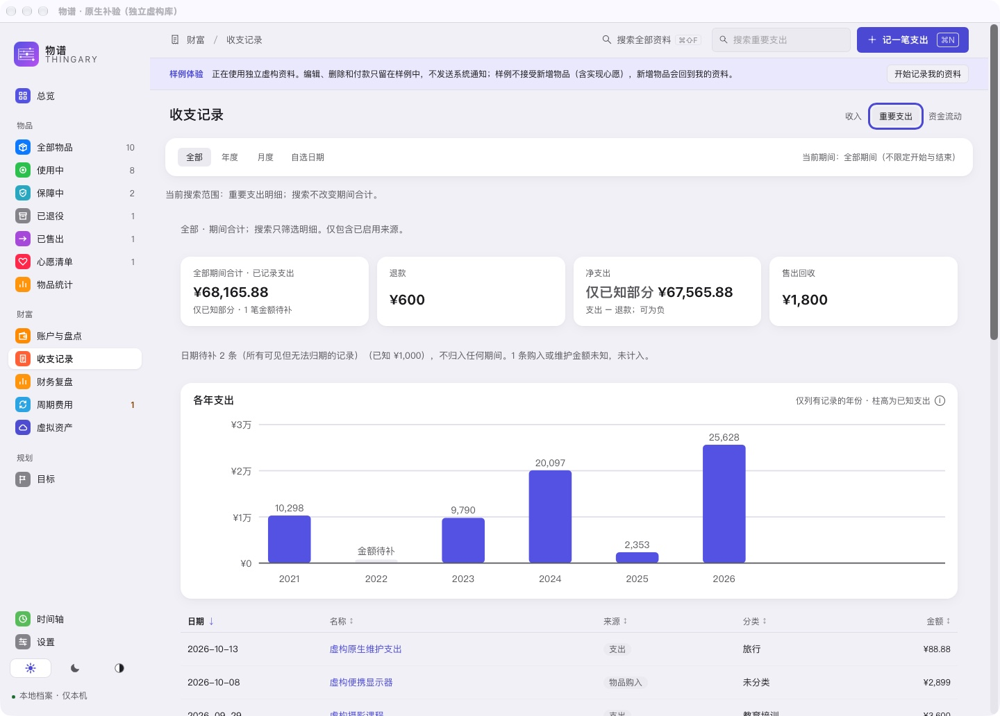

## 周期费用

侧栏“财富 · 周期费用”记录房租、订阅等付款安排。付款历史每页显示 50 条，可翻页查看全部记录，排序与累计金额仍按全部付款计算。选周期，再填一次付款的总金额：月付填月费，季付填整季总额。填写开始使用／租住日期、下一期付款日，订阅结束方式默认“持续续费”，其他费用默认“持续进行”，不确定何时结束就不用填结束日期。历史开始日期不会自动补造付款或生成多年待确认。月底付款按原始月日锚点顺延，不会逐月提前。

**新建周期费用默认用简易表单**（房租、订阅、水电网、保险、会员都一样），只问五件事：付款周期（每月／每季／每半年／每年）、每期金额（季付填整季的钱）、租住开始日期、**提前几天付款**（当天／提前 7 天／15 天／一个月，或自己填天数）、**到期日**（房租叫租期到期日，其他叫结束日期；**不含当天**，就是下一期的第一天；不确定何时结束留空，会一直续费）。表单下面直接列出将生成的每一期（付款日、覆盖期）和合计，你看一眼就知道对不对。例如 2025-07-06 起租、每季 8,400、提前一个月付、到期日 2026-07-06：共 4 期，付款日 6 月 6 日、9 月 6 日、12 月 6 日、3 月 6 日，合计 33,600，月均 2,800。填 2026-07-05 也是同样的 4 期。开始日期是过去的日期时，会多一个「已过去的 N 期都已付清」开关（房租默认开，其他费用默认关）：保存时一次补记为已付，日期按付款日、金额同每期，计入重要支出；日期或金额不同，之后在付款记录里单独更正。需要固定天数、免费试用、分段价格等高级设置时，点表单底部的「改用完整表单」；已有的这类计划仍用完整表单。

例如月租 3,000 元、不确定租到何时：选择每月、填 `3000`、租住开始和下次付款日，保持持续进行。租一年但季付：选每季、填 `9000`、指定租期起止。租期 2026-11-01 至 2027-10-31，2026-10-25 提前付第一季，在“付款覆盖期与更多设置”确认本期服务开始是 2026-11-01；应用安排四期，不会把 2027-10-25 为下一年预付算进来。页面显示月均 3,000 元、期限预计 36,000 元。末期覆盖至结束日，金额仍按整期，不自动按天折算。

点击计划行（或按 Enter）先打开**只读详情**：每期价格与月均、累计估算、已记录付款、当前服务期、下一付款候选、最终结束日、已付覆盖期和关联的服务档案分开展示，修改点「编辑」进入表单。订阅类计划在详情里可「建立关联服务档案」：填服务资料后一次保存，只新增档案，已有付款与排期保持原样，不补记任何新付款；两页随即共用计费信息、付款记录与整组删除／恢复。

到期不会自动算作已付。逐期点“确认已付”（可改实付日期和金额）或“本期不付”。补历史付款时，打开已保存计划里的“补记往期实际付款”，选择范围、每期实付并勾选确实已付；已有记录会跳过。补记默认按付款日记录实付日期，不同日期和金额可在付款记录中单独更正。请先保存对计划的修改再补记。

已确认付款才计入重要支出和时间轴。年化、月均、未来 12 个月预计、期限预计和累计估算均不是已付，也不改变账户盘点。累计估算按服务整期与价格记录计算：录入前历史按当前价格估算，之后调价从更正日起分段；不代表历史实际扣费。

改计划金额、周期或付款日不改已确认金额、日期和覆盖期，旧期次不再符合新安排时显示“计划外”。已关联订阅的计费编辑会同时更新服务档案一侧；两页名称不同的旧记录在编辑里会分别显示「服务名称」与「付款计划名称」，需要一致时点「统一名称」明确选择。停止后续续费用「取消后续续费…」：确认最后使用日（默认建议当前服务期末）后关闭续费，两页状态一致；历史付款与估算依据保留。旧的暂停开关只暂停排期，不改变已付权益；实际停订后再开通请使用下方的取消与重新订阅流程，明确保存停订期间。删除计划连同付款隐藏，可从最近删除恢复。订阅可设置备款提醒，具体见虚拟资产说明。

**记错付款与停订后再订**：打开订阅详情，直接在「付款记录」里点对应一笔的「更正」，可改实付日期、金额、备注，改为「本期不付」，或用「删除误记」撤回错误记录。只有向付款账户充值、服务尚未扣款时，不应记为订阅已付；真正扣款后再点「记录实际扣款」。删除误记不表示发生退款，也不改变账户余额。付款历史每页 50 条，单个订阅与两页共用同一批事实；读取失败明确提示并可重试。

取消续费时，先在服务方关闭自动扣款，再在物谱点「取消后续续费…」，确认最后使用日；历史付款保留。订阅已经结束后，点原详情的「重新订阅…」，填「本次服务生效日期」、周期与价格。生效日期可以在未来，但须晚于上段最后使用日。表单预览首期服务区间、首期计划付款日与下一期日期。仍用原档案，各段使用期间、价格与旧付款保留，停订空档不继续估算费用或要求补付款。Plus和Pro可以分别建档，重新订阅其中一项不会自动结束另一项。

例如原来每月17日续费，停订后10月21日重新生效：新段默认在每月21日付款，首期服务为10月21日至11月20日，不沿用原来的17日。**只是这一次提前付款**，如10月17日已经扣款、21日才生效，保存安排后点「记录实际扣款」，实付日期填17日；之后仍按21日续费。**每期都在另一个日期付款**，才开启「每期付款日与生效日不同」，把本段首期计划付款日设为17日；以后按每月17日付款、21日开始服务分别排期。付款表单会显示对应服务期，不把付款日当作生效日；尚未扣款只保存安排，不要记为已付。

未来生效的服务显示「待生效」，提前付款仍如实计入支出。未生效且没有本段付款时，可「调整订阅安排」或确认「撤销待生效安排」，恢复为上段已结束；有本段付款后不能直接改日期或撤销，先核对付款与服务安排。真实已付应保留，需要停止下一期时用「取消后续续费」；未来生效且已预付时，建议最后使用日为已付服务期末。修改或撤销只维护物谱记录，不会替你在服务方取消订阅或办理退款。新段不自动沿用旧免费试用或未来调价；已有冲突记录会明确提示。

## 虚拟资产

侧栏“财富 · 虚拟资产”记录买断软件、域名和订阅权益。新建订阅只填一次，应用同时创建关联的周期计划。例如从 2024-01-04 开始持续使用 GPT：选订阅服务、每月、填当前月费、开始使用填 2024-01-04、下一期付款填实际下次续费日，保持“持续续费”。无需填写有效期或逐月补记，列表显示持续订阅、月费、月均、下次付款与累计费用（估算）；未补付款不会被判为已到期。

如果服务已经结束（例如只订阅了 2024 年至 2026 年初），填写实际开始日期、付款日和最后使用日期，结束日期已过会自动判断为已结束。过去的付款日只是排期起点，不表示服务结束。保存后显示“已结束”，不再安排后续续费，也不计入“使用中”。例如 2024-01-20 至 2026-02-19、每月 140 元，共 25 期，累计费用估算为 3,500 元，不会继续增加。已有记录可点名称编辑并补上结束日期。已结束订阅保留在历史档案中，不再显示在主页「待关注」；即将到期且尚未结束的权益仍会提示。

累计估算与付款事实分开展示。确认这些月份确实都已付后，选中该订阅，点“补记历史付款”，选择付款期范围、填写每期实付并勾选确认；已有付款或跳过记录不会被覆盖。尚未补记时显示“未记录付款”，不会把估算冒充实付或写入重要支出。历史价格有变化时，可分段补记不同实付金额。

“持续订阅／已暂停续费”表示你记录的安排，不保证平台实际扣费。实际已确认金额和已付覆盖期分别展示；有结束日期按结束日提示到期。已关联订阅不再使用时点“结束订阅…”确认最后使用日，历史档案与花费保留；单次购买、储值及未关联档案沿用原有停用规则。买断软件按一次性价格记录，未填有效至表示永久有效。域名仍可手填期限或关联已有计划；不保存账号、密码或激活码。

订阅默认每月。例如 10 月 4 日开始，首期服务至 11 月 3 日，11 月 4 日开始下一期；不指定结束日就持续续费，月底按实际月份处理。表单会展示首期区间。单期结束不会触发权益到期提示，总览和侧栏也不会反复提示持续订阅的每月付款待确认；要记录实付时仍可进入周期费用操作。主动选择“有结束日期”时，订阅默认建议一个周期；房租选择“有结束日期”仍默认建议一年。

虚拟资产是服务档案，周期计划记录每期价格、付款日期和实际付款。新建订阅会同时创建并关联一项周期计划；GPT Plus 和 Claude 使用相同规则。详情里的“周期计划”会显示关联关系。旧版独立订阅没有关联计划，原金额按单次投入保留，更新不会推断月费；如需按月计费，核对每期金额与服务期间后新建订阅，原历史花费保留并注意避免重复补记。列表的累计费用优先显示按服务期间计算的估算，并标明已记录付款；顶部“已记录支出”只汇总实际记录，重要支出不重复计算。未关联的单次价格按购买日计入数字服务支出。旧版独立订阅保持单次投入，旧关联计划保持原排期；未指定结束日的旧订阅同样显示持续订阅，已付覆盖期单独保留。有指定结束日按该日期提示到期。更新不会把旧价格改成月费或补记历史。删除进入最近删除，可恢复。

### 标签、计费方式与储值

一次性服务已完成时，在单次购买表单的「使用情况」选「已结束使用」，填写实际结束日期，不必把购买日期改掉或伪造到期日。结束后费用仍保留，也可撤回。纯医疗等消费可以直接录入「重要支出」，同一笔不要在两个地方重复记。还贷款本金通过账户盘点同时减少欠款与资产，只把利息记成支出。贷款账户需计入净资产才能抵消本金流出；若此前未计入，相关区间可标记为一次性变动，不让它代表常态支出。

> 以下功能随 2026-10-05 重建的 0.0.1 Beta 提供；原生完整交互验收尚未闭环，参见[当前限制](#limits)。

新增虚拟资产时选择三种**计费方式**之一：

- **单次购买**：填实付金额与购买日期；明确勾选“永久有效”后状态与详情显示永久，留空则是“未设置有效期”——两个明确状态（旧买断软件留空仍按永久解释，旧域名留空仍显示待补充）。支付方式只是文字备注。
- **订阅**：默认用与周期费用相同的简易表单——付款周期、每期金额、开始日期、提前几天付款、结束日期，下面预览每一期；后续续费价格、本期特殊到期、备款提醒和支付方式收在「更多」里；需要免费试用、固定天数、暂停续费时点「改用完整表单」。结束日期不含当天（那一天就是下一期的第一天），留空表示持续续费。下面是完整表单里各项的含义：填每期价格、周期、开始使用日期。“自动续费”与“最后使用日期”是两个独立控件：默认持续续费；开启续费时也可随时设定最后使用日期；关闭续费则需确认“使用至”哪天，到那天为止仍算使用中，次日自动显示已结束。只填名称、价格、开始日和结束日即可录入历史订阅（例如 2024-01-20 至 2026-02-19、每月 140 元，保存后直接显示 25 期、3,500 元估算、已结束）。“高级订阅设置”一层展开：免费试用（默认 7 天，从开始日计入第一天，计费从试用结束的次日开始）、固定天数周期（7／30／90／365 或自定义 1–3650 天，按自然日计数）、付款日锚点（未手改时随开始日期与试用联动；下次付款是推算值，不会写回锚点）、本期服务开始日、暂停、后续续费价格（从指定生效期开始分段，清空并保存即取消尚未生效的部分，已确认付款不变）、本期特殊到期、一次性续期提醒和支付方式备注。
- **储值**：如饭卡、购物卡。按“充值”累计投入：每条充值记录充值日、实付、赠送和到账额度。到账额度默认随实付与赠送联动（实付 150＋赠送 50 默认到账 200），手动修改后停止联动——折扣充值可以这样记录，额度不等于支付成本。实付按充值日期计入重要支出，赠送与额度不计入。实付未知的充值照实保留，累计显示“仅已知部分”；无充值记录显示“尚未记录充值”，不会写成零。详情面板可补记、更正、删除充值和记录带日期的“剩余额度”；额度到期日过去后档案自动显示到期，不退款。

每条虚拟档案可设置一个**标签**。标签与实物标签是同一套管理（设置 › 标签）：新建时可选适用范围（实物／虚拟／通用），改名两域同步；另一领域仍有引用时不能收窄范围，删除时两个领域的引用一起迁移。同一标签的实物“标签投入分析”不包含虚拟费用。

列表可按状态、标签（含未设置）和计费方式筛选，表头可排序。“金额”列显示每期价格或单次金额（如 ¥140／月、¥150 单次），按未年化的原始金额排序——周期不同不代表负担可比；“累计费用”列单独排序，订阅标注“估算”（已记录付款在详情查看），储值显示实付投入。列表不再单列“计费方式”和“开始”，计费方式看金额单位或用筛选，开始日期在详情。已有付款或充值事实的档案不能更换计费方式；转换请求会被拒绝并说明原因。

储值档案的日常维护在右侧详情面板：点列表行打开后可“记一笔充值”、更正或删除已有充值，并可记录带日期的“剩余额度”（手动盘点，充值与到期不会自动扣减）。重要支出里的充值条目点击后会定位到对应档案并高亮那笔充值。

订阅的“自动续费”与“最后使用日期”独立保存：可持续续费到指定日期，关闭续费时默认建议当前服务期末。开始日期、周期或试用变更时，尚未手改的建议末日会立即跟随更新；手填或已保存的结束日保持原样。高级订阅设置集中管理试用、固定天数、付款锚点、后续价格与提醒；自定义天数为空或超限时不能保存。旧版关联计划保留原排期，可在周期费用中管理。充值更正保留已保存的到账额度；需要跟随实付与赠送变化时，点击“恢复到账额度默认联动”。

**0.0.2 的订阅付款与提醒**：持续自动续费的 GPT Plus 等订阅，请开启“自动续费”并把“最后使用日期”留空；它表示整项服务真正终止的日期，每个月的服务末日不应填在这里。虚拟列表只在付款日前的窗口内显示“记录付款”（月付等 7 天，年付 30 天；开启每期提醒时取提醒提前天数和这个默认值里较大的；逾期未记录会一直显示），年付域名付完后不会提前一年弹出；更早付款可在详情点「记录付款」进入。列表与详情均可记录真实扣款，填写实付金额和实际付款日后保存。状态继续显示“持续订阅”，付款候选转到下一未记录期。历史漏记仍用“补记历史付款”，不会自动变成支出。

“当前服务期”指包含今天的服务期间，提前支付后不会跳到未来未付期；“下一付款候选”与“已付覆盖期”分别显示。周期费用与虚拟资产的编辑入口共用后续价格、特殊到期和提醒设置。关闭虚拟资产模块后，周期费用仍可维护计费与提醒配置，提醒显示暂停。提醒单独保存后关闭编辑表单，需重新打开再编辑计费，避免沿用旧修订。

点订阅行打开只读详情。周期费用、虚拟资产和重要支出里的同一个订阅打开的是同一个详情：顶部是名称、状态、每期价格与下次付款，三项主指标是每期价格（含月均）、实际已付和当前服务期至（已结束时为上次使用至）；当前服务期、下一付款候选、最终结束日、已付覆盖期、累计估算、备款提醒等放在默认折叠的「排期与费用估算」里分开展示。正常情况下不再显示「关联某某」或互相跳转的入口，只有档案停用待核对、一方在最近删除、两边名称不同时才会提示。修改价格或排期点「修改价格与设置」；不再使用时点「取消后续续费…」确认最后使用日，关闭续费，两页保持一致。删除已关联订阅是**整组**的：服务档案与付款计划一起移入最近删除，确认框会列出将隐藏的付款笔数；从最近删除也是整组恢复，删除前单独删过的付款不会回来。档案停用但计划仍在进行的旧记录，详情会出现「核对停用记录」：确认已结束（同一事务设置最后使用日并关闭续费）或撤回误记停用（只清标记、原排期保持）。

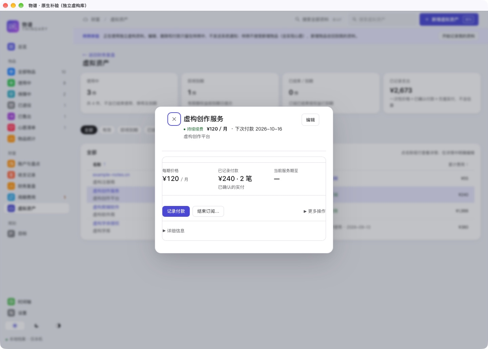

升级前分别保存的旧订阅档案和同名的付款计划，会在周期费用与虚拟资产页顶部提示“发现旧记录可能是同一个订阅”。点「查看并合并…」逐对勾选：合并只把档案挂到计划上，不新增也不删除付款；档案原有的单次价格和到期日不再单独计入重要支出（以付款记录为准），原值保存在档案备注里，有旧单次价格的默认不勾选，请先确认这笔钱已在付款记录中。名称只要有一点不同就不会被提示，可继续在计划详情用「建立关联服务档案」。

旧记录如果只有一方或双方已删除，详情或最近删除会进入“核对历史关联记录”：可恢复原有双方，或归为一个可整组恢复的删除组；有多个候选时须明确选择。不会新增付款，原先单独删除的付款保持删除。永久清除或清空最近删除前，会展示全部付款、价格与规则、特殊到期、提醒的影响；事实或引用变化后须重新读取，受引用保护的组会完整保留并说明原因。

点订阅行打开详情，再点“编辑”，在“备款提醒”开启“每期提醒”，选择扣款前几天（默认 3 天）。每期自动提醒，确认真实扣款已付后撤销该期提醒，继续下一期；仅向付款账户充值时不要确认订阅已付。“仅本次”仍可指定日期，已有的单次提醒不会自动改成每期。每期提醒提前安排未来 12 个月内的扣款期，重新打开应用时补充；自动续费关闭、暂停排期、停止使用或服务结束后会暂停或撤销。已过的提醒不补发，通知权限与系统投递限制沿用既有到期提醒。每期提醒与直接付款入口随 0.0.2 Beta 提供。

## 规划：目标

### 从目标开始

当前源码的规划使用简化模型，已发布安装包以对应版本为准。目标按五个主要步骤填写，没想好的条件可以暂留空：

1. 先选择钱够用后退休或按计划退休，再填写出生年月、希望多少岁退休，以及规划到多少岁；软件自动换算月份，同时展示年龄与年月。需要精确到几岁几个月时可补月份，也可直接按年月填写。修改出生年月会保留已保存的目标月份并更新年龄显示，再调整年龄即可改变退休或终点月份。
2. 填写退休后每月生活预算。没想好留空，不会当作零。
3. 选择盘点中的可动用账户，或手填模拟资金与截至日期；不会与实际余额叠加。可用资金包含准备变现用于本计划的基金、证券等投资，不只现金。新增现金及投资账户会先建议可动用，请确认赎回限制和参与比例；已有选择保留，不能赎回或不准备动用的账户可设为暂不能动用或不参与。
4. 选择未来收入：暂未确认、明确不计、或自己填写。养老金可通过官方入口取得参考结果后，填写每月金额和开始月份。
5. 填写每月能存下多少钱，即到账扣除全部开销后剩下的钱；买基金等投入也算。可以跳过，明确每月不存钱填零，需要动用存款填负数。没填时仍能算每月需要存多少，但不能判断照你目前的存钱能力能否实现。

**两个人一起算**：第 1 步「规划给谁」选「两个人」，再填伴侣出生年月和伴侣打算几岁停工（「跟我同时」或填一个年龄）。生活费和每月能存的钱都按两人合计填写。伴侣比你晚停工时，可在第 5 步填「其中伴侣每月存多少」（已包含在两人合计里，不是另外加的）；软件把这部分当作伴侣停工前的收入，结果会多显示「两人都不上班」的时间，以及和两人同时停工相比你能早或晚几个月。不确定伴侣那份可以先空着，结果旁会提示伴侣的存款没有单独计算。双人模式只做简单合并，不分别计算两人的社保、医保或养老待遇；伴侣的养老金可在未来收入里按伴侣的年龄填写。子女以后给的生活费，同样按「其他」未来收入自己填写。

手机上设置条件分 7 步，顶部的步骤点可以点任意一步直接跳转（已填显示 ✓，需要确认显示 !）。中途不会写入任何内容，只有点右上角「保存」才一次保存；保存只检查填错的值（例如应急金月数），有问题会跳到对应步骤并在字段处提示，留空的选填项不会拦住保存。点「取消」时若有改动，会问「放弃这次修改？」。最后保存一次。关闭窗口不保存未提交草稿；保存失败保留输入，结果未知时先核对原请求。以后可在目标首页逐项修改目标类型、时间、预算、资金、收入、净投入与假设；应急金设置用于既有参考，不从本次退休测算可用资金另行扣除。收入子编辑需要先完成，父窗口才可保存。

出生年月用于把退休年龄换算成月份；也可直接填写目标与终点年月。软件不再收集政策测算所需的缴费基数、医保年限或停续缴安排，也不自行判断社保待遇与领取资格。未来养老金属于假设收入；需要时备注来源和核对日期。金额默认口径按表单说明选择，未来名义金额和今天购买力不要混用。

个人养老金、公积金继续在账户与盘点中维护。暂时取不出的钱（公积金、个人养老金等）可以另填明确月份的预计可用净额；这只是规划，不会创建真实到账或缴存记录。金额未知可留空，并会提示未计入。

目标页右侧的结果栏直接给出每月要存多少和预计的退休时间；想看逐年表、压力测试等，点结果栏里的「查看详细结果」。尚未设置目标时先设置目标。资金续航（歇一阵能撑多久）在“试算”页，无需退休目标。

结果并列展示“为目标每月需存”和“你估计每月能存”：前者按你希望的退休时间来算，后者是你自己的估计。结论用你的估计判断，也会检查能否按时付款，不能只比较两个金额。点“这两个金额怎么看？”可查看解释；可在结果旁直接填写或修改每月能存的钱。收益、物价与应急金在“更多设置”中，待确认和读取失败提示仍直接显示。影响结果的事项在结论旁提示；结论卡里并排有“查看详细结果”和“查看当前报告”，“查看结果依据”可展开计算依据。财务自由模式分别说明希望退休的时间与按当前投入预计达成的时间；按计划退休模式检查固定时间是否够用。预计投入未知时可先看需求，不给假达成日期。标题下方的“目标／测算详情／试算”切换不同内容：“目标”保留已保存条件、当前结论、大额计划、核算注意事项和当前报告；“测算详情”保留轨迹、覆盖与逐年表，假设分析保留压力、市场路径、敏感性及收益顺序检查；“试算”包含心愿影响、职业变化与资金续航。尚未设置时测算详情不可用，试算的独立资金续航仍可填写，其他内容说明待补齐条件。重新进入规划默认目标；有编辑、设置、报告或待确认回执时先完成或关闭当前操作，再切换标签。通过标签切换后焦点回到页面标题，通过问题入口则定位对应结果或续航标题。没有年龄参考时显示月份，市场路径结果不是现实保证。

大额计划在“目标”的主要条件之后；已有计划保持展开，没有计划时展开“有买房、买车等大额计划？”再添加。来自心愿清单的“心愿对目标的影响”位于“试算”。未来买房、买车等设想填好月份和金额后，打开计入开关就会重算，不要求记录实际付款或贷款余额；实际发生后再核对实际资料。旧计划的持有／循环终点待重设时，可点该行「按规划终点计算」一次确认，或编辑其他终点。结果旁的提示可以定位对应计划。心愿购买仍单独比较买下后的影响，不自动写入上方目标或扣真实余额。

大额计划提供常用模板：买房、买车，以及装修、婚礼与彩礼、生育与养孩子、子女教育、旅行，另有「其他」用于自己拆。除买房、买车外，这些模板都是同一套字段预设：一次性支出（可选分期）、每月持续支出、每隔几年重复一次、持续到哪个月；例如「生育与养孩子」是一笔一次性费用加每月养育支出并持续约 22 年，「子女教育」和「旅行」按年重复到截止月份。选「子女教育」时可填孩子出生年月和负担到孩子几岁（默认 22 岁），软件据此算出截止月份。模板里的金额和年限只是占位示例，不是统计数据，请按自己的情况改；不改变真实余额，也不新增计算口径。预计礼金、旧房出售等一次性收入暂不支持，也未计入。

「每月能存的钱」是你自己的判断，物谱不会用历史盘点替你改。但做过几次盘点并记录了收入后，如果近几个盘点区间估计的每月存下与你填的相差较大，这一行下方会出现一句提醒，可点「去财务复盘查看依据」核对，或「先不提醒」（下一次完整盘点后可能再出现）。这个估计只看现金、存款和负债，转进投资账户的钱会让它偏低，收入没记全会让它偏高。

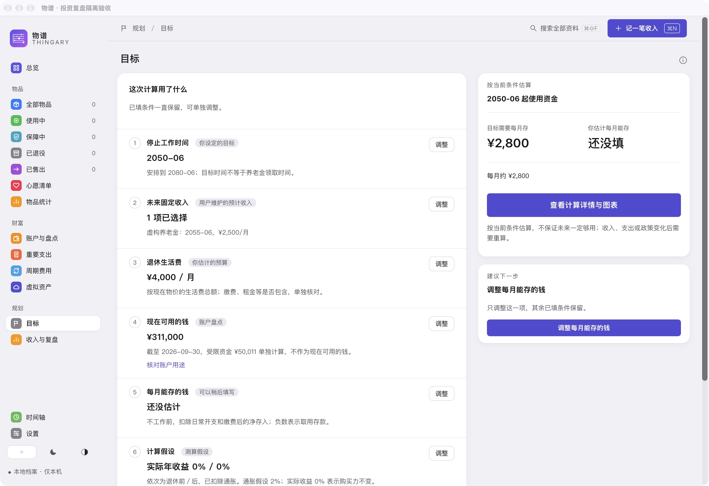

目标页下方的「盘点以来的变化」列出每次完整盘点后第一次打开目标页时的结论：当时的可用资金、需要每月存多少、你当时估计每月能存多少，以及按当时投入的结论。它按当时的条件计算，之后修改目标或假设不会改写这些历史，历史数字也保留当时的计算方法，跨版本差额不保证直接可比；变化可能来自资金、目标、假设或计算方法，不能只解释为实际资产变化。带 * 的是当时仍有需确认事项。至少记下两次后才显示；手填模拟起点、没算出结果的盘点日不会记录，升级前的盘点也不补记。

结果卡片中的「查看测算详情与图表」与标题下方的「测算详情」标签进入同一视图；结果有缺口时，可点「试算：歇一阵或换工作会怎样」直接去试算。

测算详情中的「预计资金变化」显示资金走势；「不同生活预算需要多少钱」可展开比较停止追加存钱、较少预算、完整预算与更宽裕预算，保留各自的假设说明，不需要先理解英文缩写。
手机上，测算详情顶部有「假设分析」入口；逐年表在手机上是每年一张小卡片（期间与年龄、期末资金、有缺口时的缺口），点开看存入、收入与解锁、支出；「查看月份」除滑块外有「−1年 −1月 +1月 +1年」按钮，并用大字显示所选月份。目标页把「改条件」（计算条件、大额支出）和「看结果」（假设分析、盘点以来的变化、查看当前报告）分成两组。

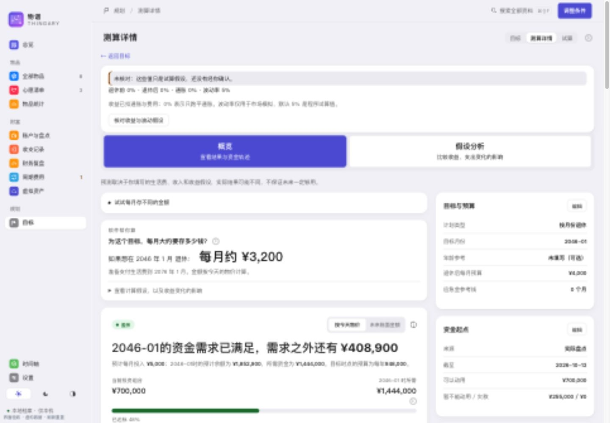

### 投资组合轨迹与假设分析

投资组合轨迹同时显示预计资金、所需资金、目标时间和财务独立时间。固定月份退休与财务自由模式的退休触发条件不同；不是证券行情或历史收益曲线。下面截图来自 0.0.6 的同一组财务自由虚构样例，保留完整说明、结果、坐标与图例。当前源码已调整压力情景及模拟路径上限，具体参数以实际页面显示为准；旧截图不作为新计算核心的验收证据。

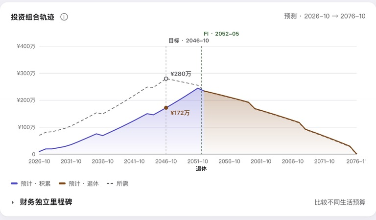

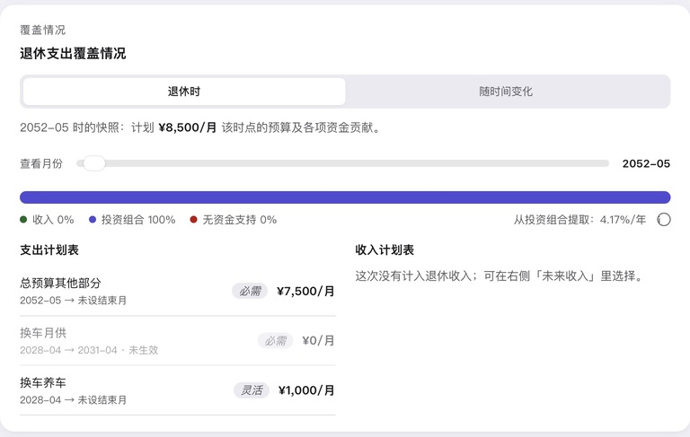

在“假设分析”里，压力情景常显，一次改变一个条件，比较收益降低、通胀升高、必要预算增加、目标推迟、投入减少和一段市场回报受挫的影响；每项显示本次改变的实际幅度。这些是试算条件。市场路径、敏感性矩阵和收益顺序检查收在“深入分析”，默认收起，可用键盘 Tab 后按 Enter 或空格展开；同一次规划页会话跨标签保留展开状态，重新进入、切库、恢复或关闭规划后复位。收起时自动 1,000 条市场路径仍照常计算，摘要可显示结果；失败会在折叠外说明原因并提供查看重试入口。市场模拟支持 1,000、1 万、2 万条路径，查看中位数和第 10 至第 90 百分位区间；资金充足占比只描述这些模型路径，不是现实成功概率。

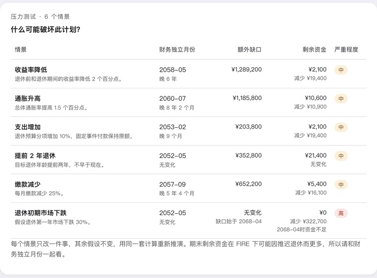

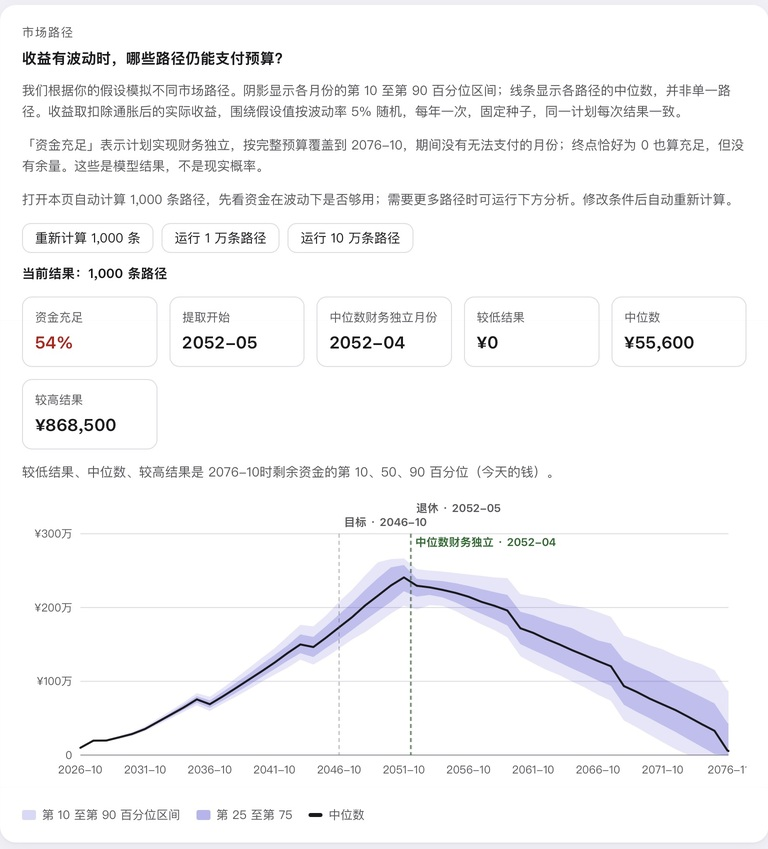

敏感性矩阵比较供款与收益、退休月份与生活预算。收益顺序检查用相同的一次下跌，比较发生在退休开头与末段的差别；它不是实际投资账户的收益率统计。

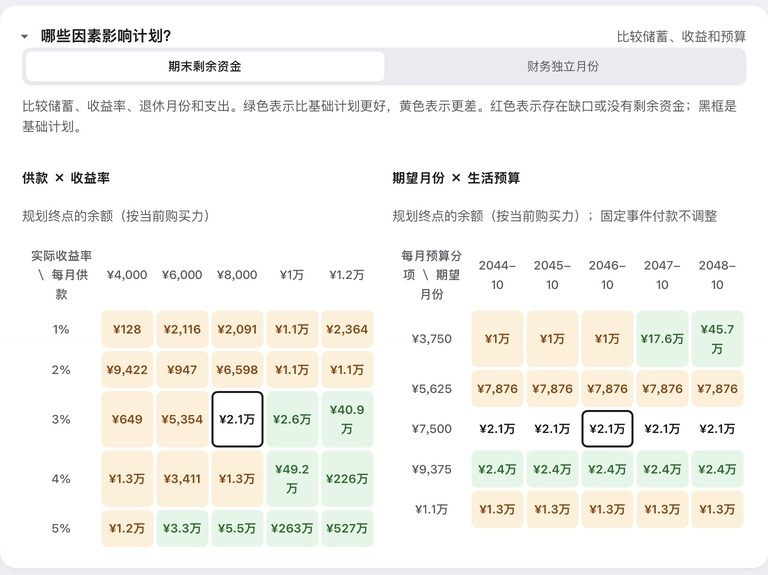

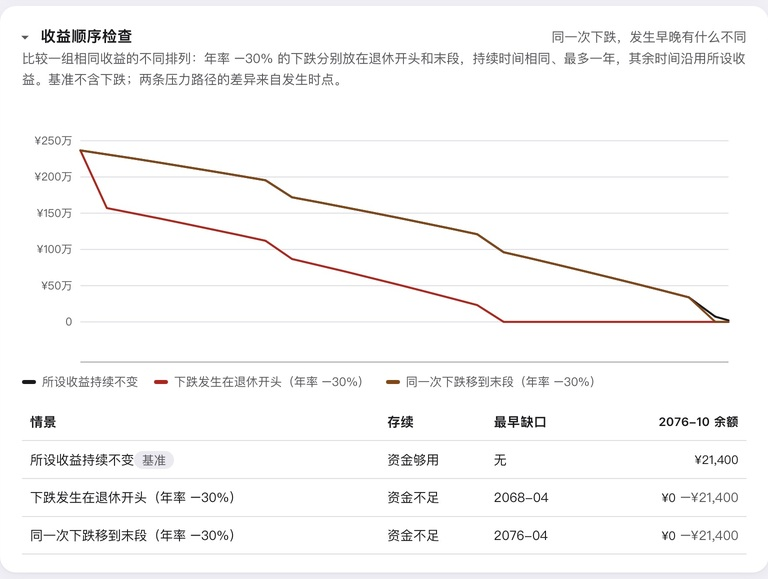

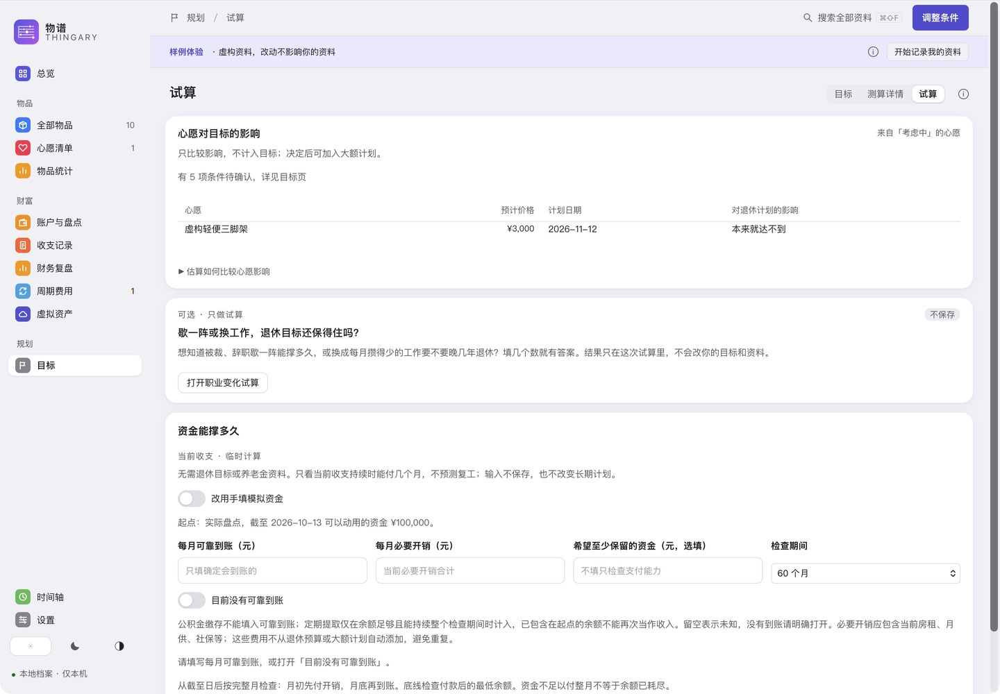

结果旁常显每月需要存的钱可能偏低、偏高或方向尚不确定的摘要；「查看未计入的安排与需确认的条件」可展开具体遗漏、缺项与对应入口。缺输入、读取失败或输入无效等使结论不能计算时，会明确说明原因与补充或重试入口；未知不会当作零。「现在可用的钱」显示现金与投资的计入金额，以及暂不能动用或不参与的账户，可点「核对账户用途与投资计入」修改。

### 当前资金能撑多久

在规划“试算”中找到临时资金续航，填写可靠到账、必要开销和资金底线。租金、月供及社保等自付费用应纳入自己的现金预算。按月初付款先于月底到账检查；未知不当零。公积金缴存不是现金到账；每月提取只有在确认余额足够、整个检查期间均能持续时才可计入，不能重复计入起点资金。当前尚未推演周期缴存、提取和余额耗尽。临时试算关闭即丢弃，不改保存计划。

### 职业变化临时试算

规划“试算”中直接展示职业变化入口，可比较空窗、降低投入或换工作后的资金条件。默认沿用保存计划的未来收入与已确认资金释放，可在「本次收入与资金假设」调整。临时收入与开销由本人确认；填写金额后确认已包含社保、医保等全部自付费用，避免另扣。未确认时不计算；不预测裁员、涨薪或社保资格，不保存职业路线。

### 核对规划假设

目标结果与计算详情展示退休前／后实际收益、通胀和市场模拟年波动率。目标页在「计算假设」的「条件与核对」中查看确认状态并打开四项编辑；未确认或条件已变时，折叠外会有一行轻提示，已确认时不显示；「试算值，未确认」不代表这些值必然来自默认设置，读取失败会显示原因与重试入口。默认 0%／0%／2%／5% 只是程序试算值；实际收益 0% 表示只跑平通胀，波动率仅影响市场模拟。点“核对收益与波动假设”集中编辑四项：普通保存不会自动确认，“确认并保存”才明确核对。恢复默认只改表单，关闭不存草稿。已确认后再改值显示「条件已变，请确认」，不会阻断试算。

请先保存基础规划，再独立核对假设。生活预算和预计每月储蓄由本人填写；历史反推值只保留在复盘的折叠参考中，不再放入规划表单作为建议。

### 查看当前报告

当前源码在目标页提供“查看当前报告”：先保存规划条件，再点结论卡里的“查看当前报告”，先查看结论、关键数字和主要条件，再查看详细依据和账户。报告默认隐藏金额，可点“显示金额”查看数值，账户用局部别名表示；“复制摘要”复制当前选择的版本，失败时会提示重试。关闭不会改变条件或保存报告。输入缺项、目标未满足、终点无余量与报告展示范围有限分别说明；隐私版本保留受控结论、隐藏金额和自由文本。结论旁会显示影响结论的事项数量，具体依据见下方“影响结论的事项”；没有影响项时不显示这行提示。报告的未覆盖内容会列明，逐月图表和详细购买结果继续在目标的计算详情查看；0.0.5 已提供这个报告入口。

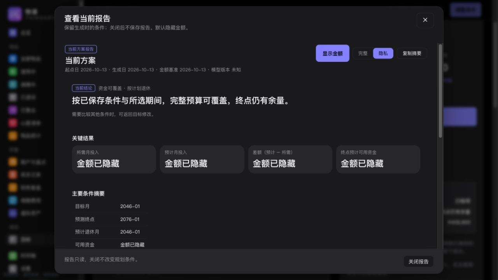

### 随时回看一个区间

进入「财务复盘 › 区间回顾」，默认查看「近 1 年」，从今天向前 12 个日历月的同日到今天，包含起止两天。期间控件与首页总览一致：近 30 天、近 6 个月、近 1 年、今年以来、全部和自定义；想在自定义面板里按自然年回看时，直接用「自然年」快捷选择，它会填好该年 1 月 1 日至年末（今年到当天），之后仍可改日期。自定义日期未填齐、结束晚于今天或先后顺序无效时，保留上一有效范围并提示。切换期间即可分别查看盘点、已记录收入、重要支出、当前存钱目标和已有规划结论，不用等到年底。

净资产标题写实际盘点起止日期。起点优先取窗口开始日当天或之前最近一次完整盘点，缺失时取窗口内第一次；终点取窗口内最近一次完整盘点，因此实际跨度可能比所选窗口长。预设窗口标为对应名称（如「近 1 年变化」「今年以来变化」「全部期间变化」）；自定义窗口不足 11 个整月时显示「自本区间首次盘点以来 N 个月变化」，达到 11 个月时显示「区间变化」。只有一个端点时只列该端点的日期与金额，不显示变化额；没有完整盘点、范围改变、缺项及读取失败分别说明，失败可重新读取。

收入与重要支出按所选窗口汇总；没有记录不代表没有收入或开销，记录数量也不证明覆盖完整。存钱目标始终显示最近完整盘点的当前进度及依据日期，不随窗口回溯。规划结论按关联盘点日期筛选，只显示实际留下且仍有效的记录，并标明实际记录日期；后来补记的结论不等于当时的判断。

页面金额沿用隐藏偏好；复制「区间记录摘要」默认不含金额、比例、真实名称和备注，明确选择含金额后仍使用别名，不带名称和自由文本。区间回顾只读，不会生成新盘点或规划历史；页面不展开大图曲线，想看图时点「查看这段走势」进入「账户与盘点」概览，并为它带上同一期间。期间只在本次会话保留，重新打开应用后恢复近 1 年，已保存资料与金额隐藏偏好仍保留。

### 持续记录与财务复盘

「财富 › 收支记录」有收入、重要支出和资金流动三个页签，共用全部／年／月／自选日期期间；日常新增、更正收入就在收入页签。打开新增收入时会显示“正在准备收入”；公积金默认值来自最新一条非投资收入，读取失败时留空并提示，仍可填写实际收入。批量收入历史导入和其他导入／导出统一到设置的数据管理。搜索只筛明细，不改变期间摘要；日期待补单独列出。侧栏切换收支记录或财务复盘不增加返回按钮；从复盘或其他来源跳入时，标题附近的“返回财务复盘”等链接保留原范围与浏览位置。

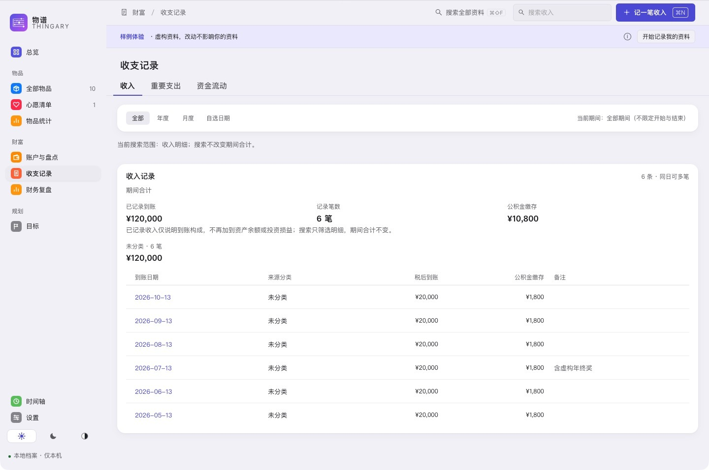

「财富 › 财务复盘」有**本期复盘**与**盘点比较**。本期复盘选择相邻两次完整盘点，先看净资产变化、已记录收入、重要支出和投资损益；收入构成、付款依据与历史估计按需展开。本期到账和重要支出来源每页显示 50 条，翻页不改变本期合计。四项各自表达，不用收入减重要支出推断真实结余。任意两端的逐账户比较和单账户历史保留在盘点比较。没有目标也可连续记收入、盘点和复盘；没有账户或两次完整盘点时显示相应起步说明。

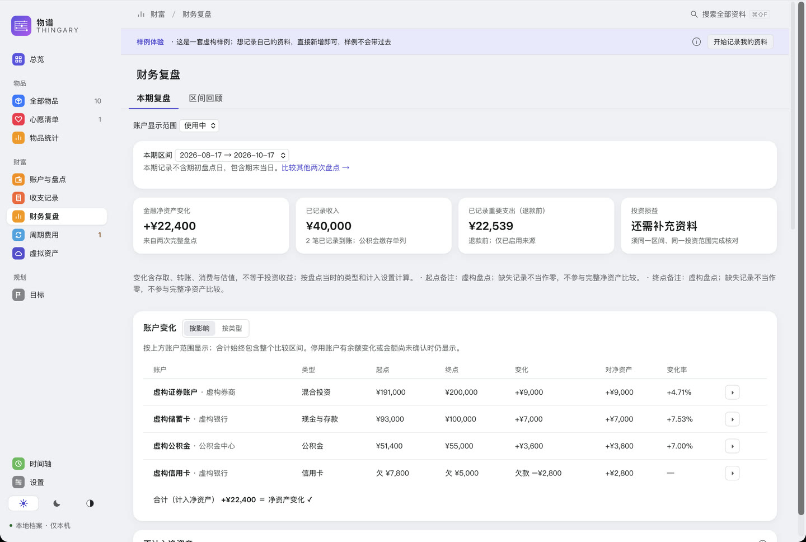

建议每月记录实际到账、每月或每季度做一次完整盘点，再核对这期间的投资资金流动。生活预算、目标时间或未来收入预期变化时，回到目标逐项调整。新盘点更新可用的事实起点，历史区间核对继续保留；更正旧盘点后，相关投资核对可能需要重新确认。目标是持续更新的计划，未来收入不会自动生成实际到账。

逐年快照在计算详情下方横跨内容区，默认显示期间、阶段、期末资产及投入／收入／支出／提取。只有填写年龄参考才显示年龄列；特殊安排可展开查看。每行从资金起点起汇总最多12个月，不一定是日历年。

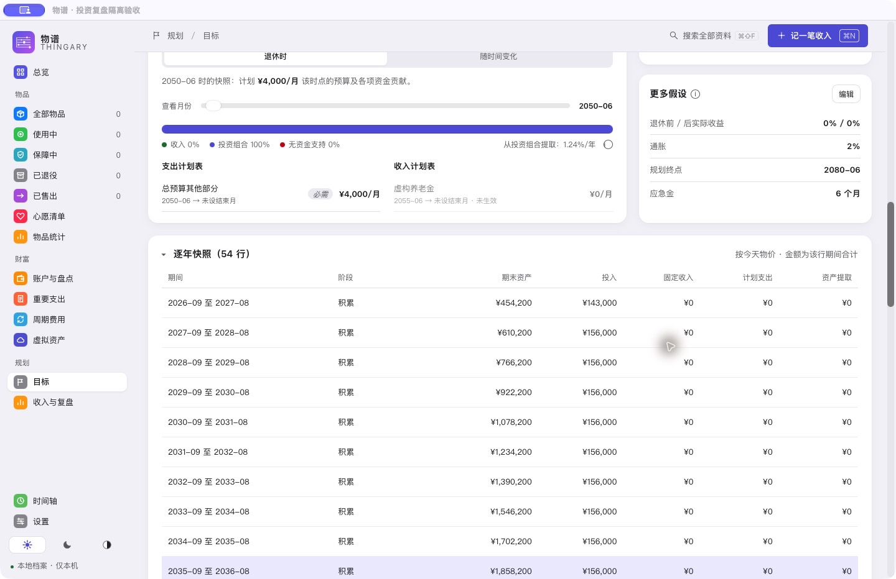

软件首次打开采用最大1600×1000的窗口，小屏按可用空间缩小。关闭或退出时记住普通窗口大小；全屏、最大化及最小化不覆盖该尺寸，换屏后重新适配。

### 已有资料与进一步核对

投资区间核对与资金流动是按需使用的高级功能，每月盘点账户、查看净资产无需先使用它们。资金流动不需要时，可在「设置 › 功能模块」关闭，之后也可重新打开；关闭不删除资料。这个开关只控制资金流动明细，不会关闭整个投资核对。起步选择保留原有资金流动开关。

记录实际到账时可选择来源分类，旧记录保持未分类。投资收入可选来源账户及“留在来源账户／转到其他账户／去向未确认”；这些关联只作核对，不更改账户余额。投资收入不会沿用公积金默认金额，已有缴存事实改分类时须明确确认。

在「财富 › 收支记录 › 资金流动」记录一笔转账、外部投入／取回、生活支付、投资现金收入分配或投资费用。在顶栏点“记一笔资金流动”，发生日期默认今天，可用日历选择实际结算日；填写金额与转出／转入两端，本人账户互转只记一次。明细卡片可按账户与记录状态筛选，记录与核对说明默认收起。记录不会修改账户余额，也不会自动生成收入或消费。没有规划或两次盘点也可先记录；没有账户时先创建账户。金额不确定时先取消，不能以 0 代替未知。

在财务复盘展开默认收起的「投资区间核对（高级）」，再点“核对方式与完整性（手填／明细）”，选择手填合计或由明细汇总，两种方式不相加。关闭资金流动模块不会自动改成手填模式：已存手填核对仍可只读查看，明细模式会提示不可用。手填合计未知可留空，没有流动须明确填 0；明细为空也须确认本区间全部记全，才会按 0／0 核对。切换方式会展示旧合计、新合计与差额，切换后重新确认完整性，再点“保存核对方式”。预览不是已保存结果。 相关流动、端点或来源变化使原确认失效后，重新打开会取消完整性勾选；核对新事实并明确勾选后才能再次确认完整。

复盘区间不含起始盘点日，包含结束盘点日；从复盘跳到收支明细沿用这个边界。日常明细列表手选开始／结束日期均包含当天。打开来源再返回会保留期间、筛选与位置；返回只有一层，多步跳转时最近一次覆盖更早的位置。组合内部互转抵消，直接从投资账户付生活费属于流出，已从投资账户余额扣除的费用不作为取回加回。利息分红不另加到损益。例如投资赚 5000 元、取回 8000 元，余额减少 3000 元，投资损益仍是 +5000 元，取回本身不能证明发生消费。范围外另付的投资费用未包含在该组合净损益中。

可选关联同日同额的收入或独立重要支出，列表由已有记录提供；暂不支持购买、维护、周期付款等派生支出。关联仅说明同一笔现实发生，不能重复使用同一来源。来源更正或删除后，流动保留并提示复核；可更正流动或明确解除关联。列表可筛选“含已删除”并恢复误删记录，已删除记录也能单独解除来源。恢复时会检查来源占用与核对区间重叠。

核对需重新确认、暂不可用、读取失败或存在未确认保存结果时，会自动展开并在折叠外保留提示；手动收起也不隐藏这些提示；范围外投资费用未包含在损益中的说明也会保留在折叠外。核对编辑或提交期间保持展开；未确认保存结果仍须通过页面顶部核对。折叠标题可用 Tab 到达，用 Enter 或空格展开／收起。

修改盘点金额、日期或投资范围后，需要重新核对；备注更正不影响确认。新增中间盘点后旧汇总不会自动拆分，可查看原记录并明确删除，再核对新分段；恢复旧记录会检查重叠。历史估计默认折叠，包含投资收入或更正分类的区间暂不提供旧口径估计。

规划“目标”保留大额计划、“这笔计划实际发生了吗”的确认／撤回、实际付款与余债；心愿影响位于“试算”。已发生事实不能通过关闭计入或删除设想撤销；先核对原事实与引用保护，再使用原撤回入口。已发生付款只按来源与盘点吸收关系计算一次；未确认发生的过去计划不会自行挪到今天。账户资金规则、费用包含关系和贷款安排可就近核对。

旧库升级或恢复时，物品、账户、盘点、实际收入与已发生记录保留；旧政策资料移除，规划时间和收入选择需要重新确认。当前开发候选源码使用 schema 44，升级后的库和备份不能直接交给旧版打开。资金流动、投资核对、假设确认与收入分类随完整备份保留；Excel 中资金流动、规划假设、核对审计及投资区间表供查看分析，不能用它恢复完整资料。

### 已有贷款直接还款安排

目标页「告诉我你的贷款怎么还」会点名尚未处理的贷款和余额；超过 3 笔时列出前 3 笔及总数。点「去做」，每个账户选择「每月还一笔固定金额，单独算上」「这笔还款已经含在我的每月开销里」或「这次先不考虑」。每月金额填实际付出的钱，本金和利息一起；填剩余月数或最后一期，未知可留空；未填完整时会说明尚缺的金额或期数。可只保存部分账户，关闭不保存。开销声明默认覆盖退休前／后，「更细」分别设置；先不考虑停止提醒但说明可能偏低。卡片消失后可用「贷款还款安排」再打开；显示原填写月份，两段安排相同时只写一次，不同时分别说明退休前、退休后。余额明显变化时请复核，归零停流。已有大额计划已安排同账户时只算一次。带新贷款字段的数据与备份不能被旧版读取，回退前保留兼容备份。

## 总览与时间轴

总览顶部可在「综合」和「只看物品」之间切换，App 会记住上次的选择。综合回顾顶部只在还没有账户时提供「添加第一个账户」，读取失败时可重试；已有账户时不催你盘点，想更新到「账户与盘点」页，整次盘点点「更新今天的余额」，只改一个账户点该账户行的「更新此账户」。其余从上到下依次是：金融净资产（取最近一次完整盘点，最新盘点不完整时顶部提示缺几个账户；大数字下是截至日期、较上次的变化和资产负债）与历史净资产单线面积图、规划摘要、资产结构与持有物品、辅助指标、待关注和近期记录。它们分别列出，不加成一个“总资产”。

「只看物品」的分类分布默认按购入金额从高到低列出分类，圆环和表格用同一个顺序，当前口径那一列标有 ↓。切到「按数量」就改按件数从高到低，金额不再决定先后。统计范围可在「当前持有」和「历史全部」之间切换，只改变参与计算的物品。每个分类的颜色跟着分类本身，不会因为排序或换口径而改变。同值的先后顺序保持稳定，不受系统语言影响。

「金融净资产」旁的眼睛按钮可隐藏／显示金额，隐藏后用 `******` 替代。曲线保留线形，提示、播报及较期初金额和比例均显示为 `******`；同时收起规划摘要和资产结构的金额，并隐藏近期盘点的金融金额。应用记住这个显示偏好。它只作用于总览金融信息，物品和费用金额、其他页面与导出仍按原方式显示。

开启「账户与盘点」与「规划」时，顶部内容宽度达到 960 像素后，净资产与曲线约占左侧 2/3，规划摘要约占右侧 1/3；更窄时上下排列。关闭规划后净资产恢复满宽；只开启规划而关闭账户与盘点时，显示开启依赖模块的提示。「只看物品」不读取或显示规划摘要。

总览规划标题旁的说明统一解释估算条件；有可核对条件时显示“有 N 项条件待确认，详见目标页”，仅有未计入说明时显示“有安排未计入，详见目标页”。规划摘要与目标页采用同一退休假设和月龄：FIRE 显示还需多久、已覆盖退休所需，或实际搜索终点前尚未达成；传统模式显示目标退休年龄的盈余或缺口。覆盖比例是当前可支配资产与今天退休所需之比，不是成功概率。下方「过去每月家底变化（含投资涨跌）」默认展开，是历史资产参考，独立于预计每月投入，可手动收起。相关来源因功能关闭而不可用时不显示该区域；真正读取失败会显示重读按钮。缺基础资料或还没确认哪些钱可以动用时显示补全入口；还没估计每月能存多少，也能先算出需要多少。计划里已过期、还没核对是否发生的安排，只暂停相关部分并在结果旁标注；来源读取失败单独标明，未知不显示成零。点击摘要入口去规划或盘点后返回总览，曲线范围、期间与滚动位置保留；刷新时标明上次结果，切换资料库清空会话上下文。

总览保留净资产单线面积图；账户概览默认只画净资产，正数负债对比按需开启，负净资产时显示零轴。账户图例至少保留一条线，浮层只展示已显示的系列；聚焦后可用左右方向键浏览日期与金额。曲线下方的「近 30 天／近 6 个月／近 1 年／今年以来／全部／自定义」只决定曲线画哪一段，不改变最近盘点的大数字、较上次变化和结构表；预设范围内完整盘点不足两次时按钮置灰。近 30 天包含今天及往前 30 个自然日（共 31 天）。自定义通过共用日历选择双端包含的起止日期，结束不能晚于今天；日期错误或完整盘点不足两次时会提示，曲线保留上一次合法范围。范围、合法自定义日期和各图图例在当前资料库的本次会话中记住，切库或重启清空。范围旁「较期初」显示第一次与最后一次完整盘点的净资产差及比例；期初非正时没有比例，期间账户计入范围有变化时只说明不直接比较。资产结构按类型列出最近一次完整盘点的占比与金额，「较上次」是与上一次完整盘点相比的变化：类型在上次没有时标「新增」；两次盘点的计入账户范围不同、变化读取失败时显示「—」并说明原因，不会当作零。这些变化含存取与估值，不等于投资收益。辅助指标是重要支出（可切换年份）、固定负担、平均持有和考虑中的心愿。待关注列出待确认付款、即将到期的付款与权益，只提示、不会自动付款；近期记录按所选年份显示。

时间轴可按领域（实物、心愿、财富盘点、支出）、年份和事件类型组合筛选，日期待补的记录单独列出。近期记录、待关注和时间轴里的「查看来源」会直接打开原记录：盘点打开只读盘点详情，付款打开所属计划的只读详情并展示来源付款记录，再明确选择更正；支出、心愿、虚拟资产和计划打开各自的档案。之后点侧栏回到总览或时间轴，年份、筛选和滚动位置都会保留；记录已删除时会提示并刷新，不会打开同名记录。

## 桌面快捷键与关闭窗口

Mac 使用 ⌘，Windows 使用 Ctrl；下文的 ⌘A／⌘Z 在 Windows 分别为 Ctrl+A／Ctrl+Z。

| 操作 | Mac | Windows |
|---|---|---|
| 新增物品／编辑所选物品 | ⌘N／⌘E | Ctrl+N／Ctrl+E |
| 查找物品／全局搜索 | ⌘F／⌘⇧F | Ctrl+F／Ctrl+Shift+F |
| 打开设置／切换外观 | ⌘,／⌘⇧D | Ctrl+,／Ctrl+Shift+D |
| 全选／撤销 | ⌘A／⌘Z | Ctrl+A／Ctrl+Z |
| 加选／连续选取 | ⌘ 点击／⇧ 点击 | Ctrl 点击／Shift 点击 |

新增、编辑和搜索仍受当前页面及操作状态限制。光标在文本框内时，全选和撤销用于文字；输入法组合期间不派发这些业务动作。Windows 文本框保留右键编辑菜单，页面背景不显示浏览器菜单；刷新、打印及浏览器缩放快捷键不作为应用操作。

Mac 关闭主窗口会隐藏窗口，完整退出使用“物谱 › 退出物谱”。Windows 点右上角叉或按 Alt+F4，在没有进行中的操作时退出；页面表单、功能设置或数据任务未结束时会提示先完成或取消。当前普通物品编辑的退出确认未通过实机验收，关闭应用会丢弃未保存输入，请先保存或明确关闭表单后再退出。正在提交时先等结果；已持久保留的未知回执可重启后只读核对，不会因它永久阻止退出。

## 批量处理物品

在物品列表中按住 ⌘（Windows 为 Ctrl）点击可加选或取消，按住 Shift 点击可连选，⌘A（Windows 为 Ctrl+A） 选中当前筛选的全部结果（不只当前页），Esc 取消；也可以点列表上方的选择图标（两个叠放的方块），再逐个点选，或点出现的「全选」。选中两件及以上时，右侧会显示已选数量、购入合计和批量操作：设置分类与渠道、标签、退役（全部已退役时为重新启用）、添加保障、售出、统计口径和删除。

每项操作打开一张表，一行一件物品：默认「保持不变」，用「全部设为」一次填满整列，再单独改个别行；不适用的行（例如已售出的物品不能退役）会灰显并说明原因。批量保障默认从各自的购入日期起一年，购入日期未知时从今天起；批量售出需要逐件填写售价（可为 0），会显示净成本。保存时整批一起生效；之后底部出现「撤销」（10 秒内也可按 ⌘Z），一次撤回整批，之后被单独改过的物品保持不变。

## 数据管理与资料操作的区别

在「设置 › 数据管理」集中备份、恢复、导入物品表、导入金融历史和导出资料表格。金融导入完成先核对回执，再主动选择查看收入／账户／盘点；结果未知时点「核对金融导入结果」，只查询原请求，不能重新提交。物品导入提交后结果未知时，同样点「核对物品导入结果」按原请求核对，确认未提交后才重新选择文件导入。业务页保留日常新增操作。

| 操作 | 用途 |
|---|---|
| 完整备份 `.thingary` | 保存可用于整体恢复的档案、关系和图片；异地保存它。 |
| 导出资料表格（Excel） | 保存为一个 `.xlsx` 工作簿，含「说明」「物品」「账户」「完整盘点」「月度收入」「盘点记录」「重要支出」「周期费用」「投资区间核对」「资金流动」「规划假设」「核对审计」。只有部分工作表支持导入：物品、账户、完整盘点和月度收入可在设置的数据管理预览导入，其余表仅供查看分析；Excel 不含图片及全部配置和关系，**不能用于恢复全部资料**。导出编号、日期、金额均为文本，空金额保持未知；计算时可在副本中将金额转换为数值。 |
| 导入物品 Excel | 「下载模板…」后填写「物品」工作表（只有名称必填），再「选择表格…」。导入前预览有效行、问题、疑似重复和将新建的分类／渠道；名称、购入日期和购入价与已有物品或文件内其他行相同判为疑似重复，默认跳过。只新增，不修改已有物品，不能用于批量修改；全部成功才写入。提交后结果未知时按原请求核对。一次最多 5000 行、内容 5 MiB，工作簿最多 20 MiB；导出工作簿的「物品」表也可读取。 |
| 金融历史 Excel 导入 | 在设置的数据管理导入同一工作簿中的账户、完整盘点与月度收入，先预览、整批提交；未知历史余额仍导出为空，补齐前不能作为完整盘点导入。不能用于整体恢复。 |
| 最近删除 | 找回当前资料库中误删的记录；不能代替异地备份。 |

**删除与恢复。** 删除只用于录错或重复的记录；东西不用了、送人或丢了请用「退役」，卖掉了用「售出」，退货则直接删除。物品、维护、保障、售出都在各自的编辑表单里修改或删除：物品在「编辑资料」顶部，维护和保障点「更正」后在表单中删除，售出记录点「修改」后可「撤销误记售出」，退役或重新启用记错了可在时间轴点「更正」后「撤销误记」（只能撤销最近一条）。心愿在「编辑心愿」中删除，实现的物品仍保留。删除后底部会短暂出现「撤销」，这 10 秒内也可以按 ⌘Z（光标在输入框里时 ⌘Z 仍是撤销文字）；之后可到「设置 › 数据管理 › 最近删除」恢复，恢复时这次删除带走的维护、保障、关联支出和图片一起回来。「最近删除」不会自动清空；「永久删除」和「清空最近删除」需要再次确认，删除后无法找回。由心愿实现的物品要先永久删除那条心愿才能永久删除。

## 心愿完成与系统通知

**iPhone**：保修到期、付款、盘点和心愿提醒都通过本机通知送达，物谱不联网。在「我的 › 设置 › 通知」点「允许提醒」，按系统提示授权；若曾拒绝，点「打开系统通知设置」到系统设置里开启。盘点提醒在「我的 › 设置 › 盘点提醒」设置。授权状态以该页显示为准，设置保存不等于系统已允许通知。以下为电脑版的说明。

启用计划日期提醒后可继续填写，不必等待系统许可对话框。macOS 首次请求时请允许“物谱”发送通知；若曾拒绝，可用表单中的“打开系统通知设置”前往系统设置 › 通知 › 物谱。Windows 不显示首次许可弹窗；请通过“打开系统通知设置”在“Windows 设置 › 系统 › 通知”检查物谱开关。Windows 通知需要安装器建立的开始菜单快捷方式；应用启动时会同时登记点击通知唤起物谱所需的系统注册，点击已送达的物谱通知会打开或切换到应用窗口。直接运行未安装的开发程序不能证明通知有效。两平台按提醒当天的本地上午 9 点安排，已过去的提醒不补发；正常排队后由系统管理，应用退出也可投递，但实际送达仍受系统通知设置影响。开关与日期保存并不代表系统通知已经获准；通知关闭或安排失败时会提示，已保存的提醒日期仍保留。

### 盘点提醒

每月盘点最容易忘。在「账户与盘点 › 盘点记录」页底部的「盘点提醒」选择每月、每 2 个月或每 3 个月（默认关闭），物谱会在距上次**完整**盘点满该间隔的当天上午 9 点发系统通知；若届时还没有盘点，一周后再提醒一次。保存新的完整盘点后会自动重新计时，不完整的盘点不算。这个资料库第一次完整盘点保存后，如果提醒还关着，物谱会在保存提示下方轻问一次要不要开启（不预选间隔，点选后才会请求通知权限）；选「先不用」也算问过，之后不再主动问，需要时可随时到盘点记录页底部开启。Mac 首次开启时请允许“物谱”发送通知，Windows 请检查系统通知开关；设置保存不等于系统已允许通知，界面会提示未能安排的提醒。提醒偏好与这次询问的记录都只保存在这台电脑，不进入资料与备份，账户与盘点关闭时暂停。

## 桌面录入与心愿操作

新建和编辑表单顶部保存，点叉直接退出并丢弃未保存的输入，不保留普通草稿。已点击保存但结果待确认时，按顶部提示核对原请求，避免重复记录。

心愿列表整行点击进入详情；考虑中的心愿在详情底部有「已买到，记录购入」「关联已有物品」和「不再考虑」。

「设置 › 功能模块」可以重新多选用途，也可以关掉不用的模块（物品档案、心愿清单、时间轴、统计、账户与盘点、收入记录、重要支出、资金流动、周期费用、虚拟资产、目标规划），关掉后侧栏、总览和时间轴不再显示它，心愿、订阅续期和盘点提醒随对应模块暂停；保障提醒不受影响。资料不会删除，重新打开后按原设置安排提醒。收入记录独立于目标规划；资金流动还需要账户与盘点开启。关闭目标不关闭收入或财务复盘。提交结果未知时，仍可从原待核对入口或设置的数据管理只读核对原请求，不重新提交。各记录列表的操作见[列表排序](#list-sorting)。

默认分类为电脑与办公、手机与平板、影音摄影、家电家居、服饰配饰、出行运动和其他。首次打开时，旧的默认分类（如电脑、摄影器材、生活家电）会自动并入对应分类，物品随之移动；自己新建或改过名的分类保持不变。分类和渠道左侧手柄可拖动排序，拖动时整行跟随指针；右侧排序按钮或聚焦手柄后的上下方向键也可排序；改名和移除放在每行更多菜单。名称和新建按钮相邻，输入后点击创建即可。

## 更新、换机与卸载

### iPhone 版的更新

iPhone 版的更新全部由 App Store（TestFlight 测试期间为 TestFlight）负责：在 App Store 的「更新」里下载，或在系统设置里开启自动更新。物谱本身不检查更新，也不联网，所以 iPhone 上没有「检查更新」按钮；下文「安装更新」中的检查更新、下载安装包与替换应用的步骤只适用于电脑版。更新前仍建议做一次完整备份（「我的 › 数据管理 › 立即备份并分享…」），并保存到手机以外的地方。更新通常保留资料；从 App Store 删除应用会同时删除手机上的资料库，只有已导出的备份还在。

### 安装更新

以下针对 Mac 与 Windows 电脑版。

物谱不会自动下载或安装更新。想知道有没有新版本，可以点「设置 › 关于与帮助 › 检查更新」：点击后向 Gitee 和 GitHub 各查询一次公开的版本列表（读取版本、发布说明与安装附件信息，不发送你的资料或设备信息）。也可以在检查按钮旁打开「启动时检查更新」，之后每次打开物谱时每天最多自动查询一次，发现适合这台设备的新版本会在「设置」入口亮小圆点；下载和安装始终由你手动完成。任何一边连不上都不影响另一边，界面会说明不可达来源。只推荐适合当前应用平台与架构的安装包，Mac 不会收到 Windows 包的更新提示，Windows x64 也不会推荐 Mac 包；更高版本缺少兼容附件时会明确说明。可直接在浏览器下载推荐安装包，或选择备用来源与发布页。下载与安装仍由你手动完成；也可以直接前往 [Releases](https://github.com/CoderJackZhu/Thingary/releases) 查看。更新前请先做完整备份，并阅读该版本说明。

应用更新沿增量迁移保留档案、付款事实、稳定引用与图片。应用版本号与资料格式版本分别维护，具体升级范围见所装版本的说明；不要用相同应用版本号推定不同构建的资料格式相同。Excel 格式变化不需要手动搬运原库，完整导入关系随 `.thingary` 备份恢复。较新资料与备份不能保证被旧版读取，回退必须使用与旧版兼容的升级前备份。

1. 在当前版本中做完整备份，并保存一份到原机以外。
2. Mac 使用「物谱 › 退出物谱」退出；Windows 完成或取消当前操作后关窗退出。
3. Mac 下载新版通用 DMG，拖入「应用程序」并按 Finder 提示替换；Windows 下载新版 `x64-setup.exe` 运行安装器更新。更新前先做完整备份。
4. 打开新版，Mac 在「物谱 › 关于物谱」、Windows 在设置中确认版本，再核对已有资料。

卸载旧应用不是更新的必需步骤。更新通常保留资料，但不要跳过备份；不要直接降级打开较新版本修改过的资料。确需回退时，使用与旧版本兼容的升级前备份，并保留现有资料。

### 从此前 2.6.1 更换为公开测试系列

此前 2.6.1 安装包已撤下，公开版本曾按维护者决定重新编号为 `0.0.1`（前一个测试版为 `0.1.0-beta.1`），本节旧版本更换说明对应公开测试版 `0.0.6`。编号重排本身不改变应用资料身份、备份格式或数据库 schema；公开版本的功能迁移以对应版本说明为准；当前源码继续沿现有迁移链升级资料。0.0.6 将 schema 39 升级为 40，新增空的目标进度表，不补造旧盘点历史；旧版不能直接打开升级后的资料及备份。**仍先做完整备份并异地保存**，退出旧应用，再按上面的安装更新步骤手动替换；核对资料后继续使用。当前没有自动更新，较低的公开版本号不是数据格式降级；以后真正降级仍须确认兼容性，不要据此假定所有旧版都可读新资料。

### 从 2.5.0 或更早的自用版本迁移

**新用户不用做这一步。** 当前版本不会自动读取旧身份 `local.possio.main`，旧 `.possio` 备份也不再识别。曾用过旧自用版且有自己的资料时：

1. 在旧版做完整备份，异地保存；退出旧版与新版应用。
2. 在 Finder 的「前往 › 前往文件夹」输入 `~/Library/Application Support/`，把旧 `local.possio.main` 文件夹完整复制到安全位置，保留原始副本。
3. **仅在没有 `local.thingary.main` 文件夹时**，将旧目录改名为 `local.thingary.main`。若新版已启动且新目录已存在，先分别保存两个目录，停止迁移并联系维护者；不要删除或覆盖其中任何一个。
4. 对需要恢复的旧手动备份先复制一份，只把副本的 `.possio` 后缀改成 `.thingary`；旧目录中 `library/auto-backups/` 的旧备份也需按此后缀识别，保留原件后再处理。改后缀不会转换格式，仍须由应用检查兼容性。
5. 打开新版，核对物品、账户和图片，再重新设置主题偏好与通知权限。核对完成前保留旧副本与备份；没有自己的资料时无需迁移。

不确定哪一份是自己的资料、无法完整备份或遇到格式检查失败时，停止迁移并[反馈问题](https://github.com/CoderJackZhu/Thingary/issues)，不要上传真实资料。

### 换一台电脑

在电脑与 iPhone 之间搬资料见[在 iPhone 与电脑之间搬资料](#phone-transfer)。

在旧电脑做完整备份，把 `.thingary` 或 `.thingary.age` 文件复制到新电脑；加密备份还需要单独保管的对应恢复密钥。安装同版本或兼容的更新版本，切到「我的资料」，通过「从备份恢复」读取该文件。核对物品、账户、金额、未知值、关系和图片后再处理旧机器；不要依靠 Excel 搬迁完整档案。当前开发候选的 Mac 与 Windows 源码复用 schema 44；明文备份与解密后的内层格式相同，外层可选 age 加密。较早 Windows 双向恢复证据使用 schema 40，不能替代当前候选验收，跨平台恢复的当前验证边界见[开发说明](https://github.com/CoderJackZhu/Thingary/blob/main/docs/DEVELOPMENT.md#windows-validation)。主题、窗口尺寸、模块及通知偏好属于本机，需要重新检查；Windows 仍不能新增 HEIC／HEIF 图片。

### 卸载与重装

Mac 在 Finder 的「应用程序」中移除「物谱」只删除应用，**不会删除资料或自动备份**。Windows 在设置的已安装应用中卸载，默认也保留资料；**若要保留记录，不要勾选卸载器的“删除应用数据”**。同一用户下重装相同身份通常仍能读到原资料。

| 平台 | 正式资料位置 |
|---|---|
| Mac | `~/Library/Application Support/local.thingary.main/` |
| Windows | `%LOCALAPPDATA%\local.thingary.main\`（通常为 `C:\Users\<用户名>\AppData\Local\local.thingary.main\`） |

开发预览与隔离验收使用各自身份的目录，不与正式资料混用。请通过应用管理资料，不要随意移动或删除目录；如需彻底清除，请先保留异地备份并确认不再需要资料。Windows 卸载器的删除选项不能代替备份。

## 常见问题

| 遇到的问题 | 怎么处理 |
|---|---|
| 下载页只有 Source code | 这不是安装包。Mac 请在 Release 的 Assets 中找 `.dmg`，Windows 找 `x64-setup.exe`（见[安装说明](#windows-install)）；没有对应平台附件时，不要改后缀冒充安装包。 |
| 首次无法验证开发者 | 按[首次被 macOS 阻止打开](#download)的步骤，仅为可信来源的物谱允许打开。 |
| 提示应用已损坏、将损坏电脑，或没有「仍要打开」 | 停止打开；核对是否来自项目 Release，重新下载。如仍失败，报告系统版本与完整提示。不要关闭系统安全保护或运行来历不明的修复命令。 |
| 看见不属于我的记录 | 确认顶部是否显示「样例体验」，点「开始记录我的资料」或「返回我的资料」。样例是独立的虚构库。 |
| 保存没有成功，输入还在 | 阅读顶部提示，修正字段后再保存；结果未知时先点「检查提交结果」，不要重复新建同一条。 |
| 找不到某个功能 | 查看「设置 › 功能模块」是否关闭了该模块，关闭不会删除记录。 |
| 数字显示「—」或「待补充」 | 常见原因是价格、日期或账户余额未知，或还没有足够的完整盘点；补齐事实即可，不要填假的 0。 |
| 误删了一条记录 | 立即用「撤销」，或进入「设置 › 数据管理 › 最近删除」恢复；永久删除后不能靠最近删除找回。 |
| 关闭表单后输入没了 | 普通表单不会保存草稿。要保留记录请点保存；仅结果未知的提交会留待核对。 |
| 卸载后记录还在 | 应用和资料分别保存，这是为了重装可继续使用。详见「卸载与重装」。 |
| 能在手机、Windows 上用吗 | Mac 与 Windows 10 1809+／11 x64 都有安装包，Windows 版未签名，见[安装说明](#windows-install)。iPhone 版即将推出（TestFlight 测试中，尚未上架 App Store），见[iPhone 版](#iphone)。手机与电脑的资料各自独立，没有跨设备同步，换设备用[备份导出再导入](#phone-transfer)。 |
| Windows 安装或通知失败 | 安装缺少 WebView2 时需要联网；核对是否安装了开始菜单快捷方式、系统通知开关和安装包来源。保留错误文字，见[当前限制](#limits)。 |
| Windows 无法添加 HEIC 图片 | 先将副本转换为 JPEG 或 PNG，再选图；保留原图。Windows 当前只接受 JPEG、PNG、WebP。 |
| 文件上传或同步到哪里了 | iPhone 版不联网，只有你自己用分享面板导出的备份文件会离开应用。电脑版：应用不上传资料，资料使用完全离线；只有你开启「启动时检查更新」或点「设置 › 关于与帮助 › 检查更新」时，才向 Gitee 和 GitHub 各查询一次公开的版本列表。你主动选择的额外备份位置若是云盘，其副本由该云盘软件同步；备份可选恢复密钥加密，主资料库、图片与恢复保护副本未加密。 |
| Excel 无法导入 | 使用 `.xlsx` 模板，保留工作表名和 A1 表头；编号按文本填写，公式粘贴为值，修正错误单元格。旧 CSV 请自行整理到新模板，不能当作完整备份。 |

其他问题请通过 [GitHub Issues](https://github.com/CoderJackZhu/Thingary/issues)反馈，写明物谱版本（Mac 在「物谱 › 关于物谱」，Windows 在设置中）、系统版本、芯片／架构、安装包来源、步骤与错误文字。截图请遮住真实资料；不要上传真实数据库、发票、序列号或备份。数据丢失或损坏时先保留当前资料和已有备份，不要反复恢复覆盖。

安全漏洞按 [安全政策](../SECURITY.md)私下报告，不在公开 Issue 中附细节。

## 当前限制

- Windows 版暂不支持打开时验证身份和闲置重新验证；「窗口不在前台时遮住内容」可用。Mac 的 Touch ID、密码兜底与闲置重锁仍需实机确认。

- Mac 当前只在 Apple Silicon、macOS 27 验证；安装包同时包含 Intel 版本，但打包最低目标 macOS 14 与 Intel Mac 都尚未完成兼容性验收。公开包仅本地临时签名，未经过 Developer ID 签名和 Apple 公证。
- Windows 版目标为 Windows 10 1809+／11 x64，安装包未签名，首次运行可能出现 SmartScreen 提示；是否已公开发布以[版本记录](../CHANGELOG.md)为准。缺少 WebView2 运行时、多显示器与部分提醒类型仍在验收中，详见 [Windows 验收清单](https://github.com/CoderJackZhu/Thingary/blob/main/docs/WINDOWS_ACCEPTANCE.md)。
- Windows 不支持把整个用户配置目录用目录联接（junction）迁到其他盘。Windows 11 x64 已在 OneDrive 虚构目录验证额外加密副本及文件占用后的重试；云同步、原生目录选择和从 OneDrive 文件恢复尚未验证。
- Windows 11 x64 已验证中文与空格路径的恢复密钥原生保存、选回密钥并验证，以及手动加密备份保存与保存面板取消；这不代表所有文件选择器或进行中的备份取消已验证。Mac 提供的明文虚构备份在 Windows 恢复后，业务表内容及 8 张原图散列一致，跨平台恢复仍需按自己的备份逐项核对。
- Mac 上通知三种状态的目视送达、VoiceOver 与完整键盘路径、系统显示缩放、Intel 与 macOS 14、接近容量上限的大库及部分强退时点尚未验证；恢复页只有「选择备份文件＋粘贴恢复密钥」，没有直接选择密钥文件的入口。
- Windows 上 Ctrl+逗号无法打开设置（WebView2 引擎在页面收到按键之前就拦截了它），请点侧栏「设置」；其余快捷键不受影响。
- Windows 11 x64 的心愿和盘点提醒已验证应用关闭后进入系统通知历史，可见桌面通知、其他提醒类型与权限拒绝／系统关闭仍未验证。VoiceOver／讲述人、完整键盘路径与显示缩放尚未完整验证；输入法只抽查过个别组合。
- iPhone 版仍在 TestFlight 测试阶段，尚未公开上架；手机与电脑的资料各自独立，不同步，只能经完整备份搬运。手机版没有表格导入向导、投资流水核对、职业变化地图版和额外备份位置，更新由 App Store 管理。
- 电脑版没有跨设备同步，不会自动下载或安装更新；可选开启「启动时检查更新」发现新版本，下载安装仍手动完成。备份可选恢复密钥加密，主资料库、图片与恢复保护副本未加密。自动备份同主资料位于本机，仍需异地完整备份。
- 当前源码已退出社保、医保和养老金政策测算；未来养老金只作为手填金额与开始时间维护。收入覆盖声明、命名方案、冻结基准和完整决策报告仍待实施；当前报告只读预览没有打印或 PDF。
- 完整备份上限为 32 GiB、10 万个文件，过程中约需资料两倍大小的可用空间。Excel 不含图片及全部配置与关系，不能代替完整恢复。
- 未引用的托管原图、恢复保护副本和恢复前旧资料不会自动清理。不要自行把它们当普通缓存删除；需要整理时先保留当前资料和异地备份。

发布历史与旧包的验收范围见 [CHANGELOG](../CHANGELOG.md)和对应版本说明；当前源码的检查入口与验证边界见[开发说明](DEVELOPMENT.md)。旧政策页验收记录不代表当前入口或新功能已经通过。
